The BenchBar app lives in the menu bar. It shows every bench as a small
runner, and a window with a page per bench for its sites, apps and
health. It installs with [Homebrew](install.md#homebrew) (the
`benchbar-app` cask), the
[one line installer](install.md#the-one-line-installer) or the
[DMG](install.md#the-app-from-the-dmg), and carries its own copy of
the CLI (see [The command line tool inside the
app](#the-command-line-tool-inside-the-app)).

## The runner

The runner in the menu bar sleeps when the bench is stopped, walks while
it starts, runs while it is up (faster when the bench is busy), stumbles
when it crashes, and shows a question mark when the CLI is missing.
Reduce Motion shows still poses. With more than one bench it shows the
worst state of all of them.

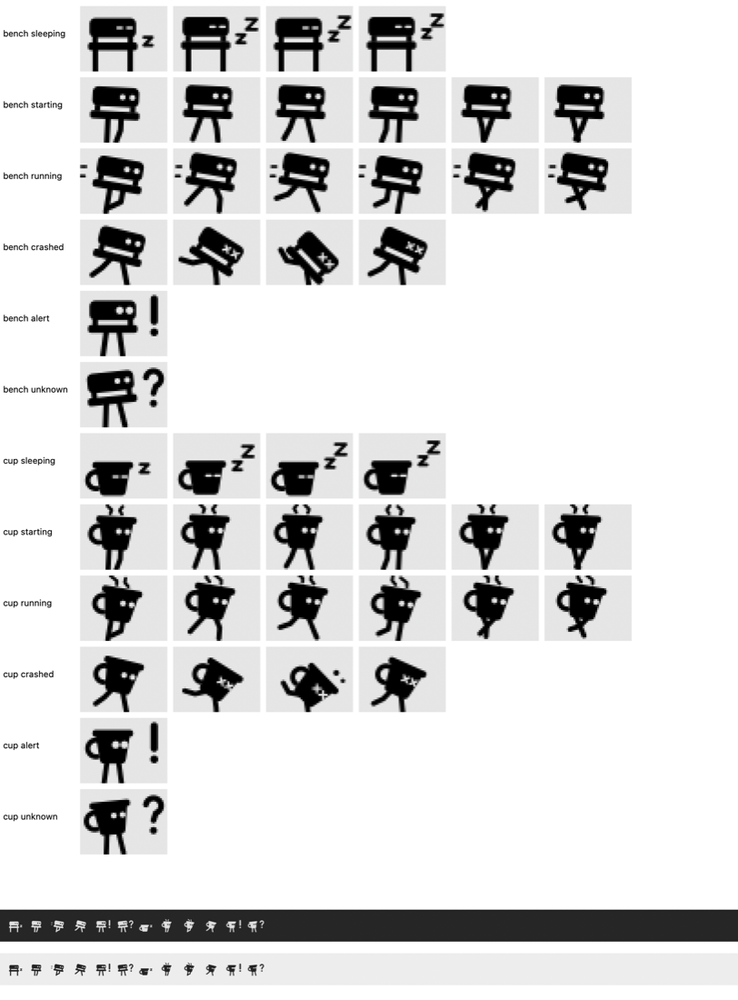

BenchBar ships seven runners: Bench, Coffee cup, Kettle, Server rack,
Paper plane, Snail and Rocket. Pick one under Runner in the Menu Bar
pane, or draw your own: see [Custom runners](runners.md).

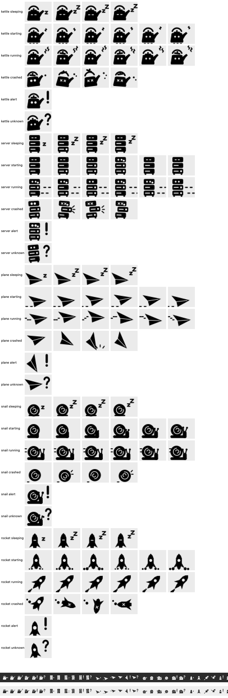

## The popover

Click the runner for the popover: bench, site, state and uptime, Start,
Stop and Restart, the logs and the bench folder, the bench's sites with
an Open button each (none for a site whose name has no `/etc/hosts` line, unless it ends in `.localhost`; the Sites tab in the window has Set Up…), and a health summary: the first checks that need
attention with a Copy Fix button, Repair when something is repairable,
and a button to check again. With more than one bench a picker at the
top chooses which bench the popover shows.

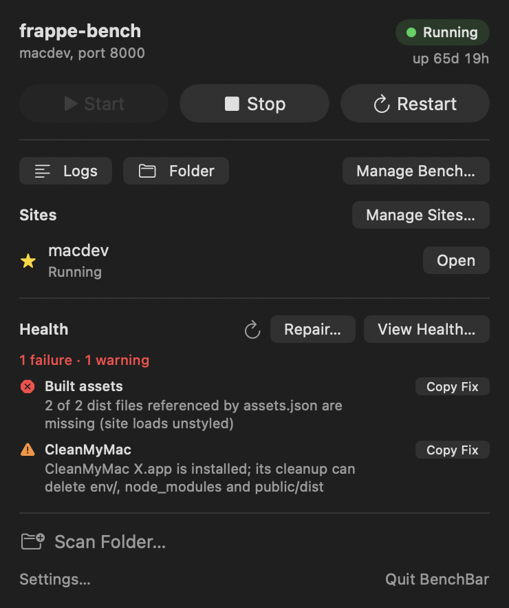

### Keyboard shortcuts

| Keys | Action |
|---|---|
| ⌘U | Start |
| ⌘D | Stop |
| ⌘R | Restart |
| ⌘O | Open the site |
| ⌘L | Logs: a log window with search and a filter per process |
| ⌘F | Open the bench folder |
| ⌘K | Health in the BenchBar window |
| ⌘M | The BenchBar window |
| ⌘0 | Open as Administrator, on the default site where Open as is on |
| ⌘1 to ⌘9 | Open as a pinned user, in menu order |
| ⇧⌘O | Switch back to the user before |
| ⌃⌥U | Quick Switch, from any app, once turned on in Settings > Labs |

## Open as a user

Open as opens a site in your browser signed in as another user, with no
password, to check what a role sees. It is off for every site until you turn
it on, and the app shows nothing else of it until then. Under the hood it runs
[`benchbar open --as`](reference/cli/other.md#open).

**Turn it on** in the BenchBar window: the bench's Sites tab, the `...` menu
of the site, **Allow Open as…**. An alert says what it does: you can sign in as
any user of the site without a password, and each sign in runs the apps'
`on_login` and `on_session_creation` hooks as a real login does (`last_login`,
an Activity Log entry, a mail to System Managers for Administrator, an ERPNext
Customer or Supplier for a Website User) and may end that user's oldest
session. Use it on development sites only. **Allow Open as** records
the choice in benchbar's state for the bench (the site itself is not changed);
**Turn Off Open as** in the same menu undoes it, without a question; it does not end the sessions already made, but the app forgets its own. The same
switch in a terminal is [`benchbar site open-as`](reference/cli/site.md#site-open-as).

The Sites tab shows a line under a site that has it on: "Open as is on", or why
it cannot be used. The site needs `developer_mode` (add it with
`bench --site NAME set-config developer_mode 1`), and only the bench's
**default site** can be used, because the bench serves only that one: port 8000
answers every address with it.

The window reloads the benches each time you come back to BenchBar (at most
every 15 seconds), so a `developer_mode` you set in Terminal shows without
waiting for the five minute check.

Where it works, an **Open as…** control (a person icon and the words) appears
in the popover's site row, on the Sites tab and beside **Open Site** on the
Overview tab. On the default site it stays visible but dimmed, with the reason
as its tooltip, while the bench is stopped or the site is not usable. The menu
lists:

- **Switch Back to {name}**: the user before this one.
- Your pinned users, as `{label} ({user})`, then **Administrator**.
- **Find User…**: a sheet in the BenchBar window that searches the site's
  enabled users as you type (the sheet keeps one height while you type). **Open** signs in as that user; the pin keeps them
  in the menu, with a label of your own (for example `NE`). A site keeps nine
  pins. Pins of a bench or site that no longer exists are forgotten.

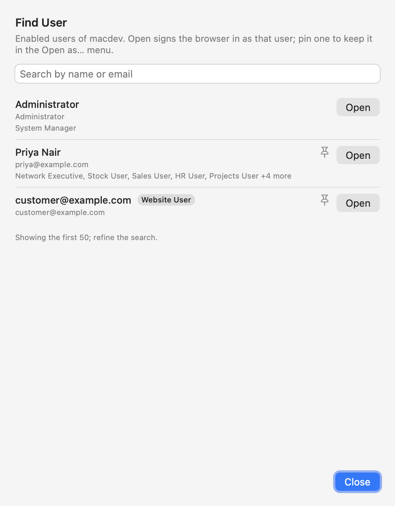

### Quick Switch

**Quick Switch** (⌃⌥U) opens a small list from any app: Switch Back, your
pinned users and Administrator for the sites where Open as works. It is an
experiment, off until you turn it on in **Settings > Labs** (the same switch as
`benchbar labs on quick-switch`). The ⌘0 to ⌘9 and ⇧⌘O keys in the popover work
only while it is on. In the list:

| Keys | Action |
|---|---|
| ↑ ↓ | Select |
| ↩ | Open as the selected user |
| 0 to 9 | Administrator, or a pin, at once (while nothing is typed) |
| ⇥ | The next site: another bench's default site |
| esc | Close |

Typing filters the list, and from two characters it also searches the site's
other users. ⌃⌥U again closes it. It uses no Accessibility permission. If
another app already holds ⌃⌥U, the Labs row says so in red and the lab stays
on, without a key: turn it off and on again once the other app lets go. The
key is the physical key that is U on a US keyboard; on another layout BenchBar
names it by the letter your keyboard shows there.

After a switch the site's row reads `as {name}`: the pin's label, else the
user's full name, else the user id. That is BenchBar's own record of its last
switch, not what the browser shows now.

The link opens a new tab in the browser you used last (Safari, Chrome, Arc,
Brave, Edge or Firefox), so the session cookie lands where you are testing;
other tabs of that site keep the old user's screen, so reload them. If none of
them was frontmost since BenchBar started, it uses your default browser when it
runs, else the first of them that runs, else the default browser. BenchBar
reads no tab and asks for no extra permission.

BenchBar keeps the sessions it created in memory and reuses one while the site
still says it belongs to that user, so switching back is quick. Quitting
BenchBar forgets them. Nothing about a session is written to disk or logged by
BenchBar; the browser keeps the sign-in link in its history.

## Links for Raycast and Shortcuts

`benchbar://up`, `down`, `restart`, `open`, `logs`, `window`, `doctor`,
`console`, `db` and `editor` act on a bench from Raycast, Shortcuts or a script, for example
`open "benchbar://restart?bench=frappe-bench"`. Links never repair,
install or delete anything. The [URL scheme](/reference/url-scheme/) page
has every route and ready to use Raycast and Shortcuts recipes.

**Any web page or app can open a `benchbar://` link.** A browser asks before
it opens an app, but offers "always allow this site", and after that a page
can stop or restart your bench, or open Terminal windows at a Frappe console
or a database prompt, without a click. Nothing in a link deletes or
installs anything, but a stopped bench during a demo or a restart during a
migration is real. **Settings, Links, Ask before a link acts** makes BenchBar
show an alert (the bench and the action, with Cancel) before a link starts,
stops or restarts a bench or opens a console. It is **off by default**,
because an alert on every link would break Raycast and Shortcuts, which exist
to skip clicks. Turn it on if you do not use them, or if you visit pages you
do not control. Links that only show a window, a log, a site or the editor
never ask.

The app logs a link it ignored or could not use with its action only
(`benchbar://down`) and a fixed reason, never the bench, the site, the
query or an address. A link that is not one of its own is logged as a short
hash. The alert asks with Cancel as its default button.

## The BenchBar window

Open it with ⌘M, **Manage Bench…** in the popover, or by
opening BenchBar again from Finder or Spotlight. The sidebar lists your
benches first, each with its state dot and its sites beneath it (a site
opens the bench's Sites tab), then **Team Profiles**, **Find
Benches** and, while the `lan-rooms` Lab is on, **On your network**. A bench that is not running has one line under its name that
says why and offers the next step: Start, View Health, Review Port
Conflict…, Repair… or Set Up Management….

The footer of the sidebar has three buttons:

- **Add Bench** is a menu with **New Bench…**, **Adopt Existing
  Bench…** and **Find Benches…**.
- The gear is a menu with **General** and **Menu Bar** (⌘, opens
  General).
- The **i** opens **About BenchBar**.

On a Mac with no bench the window opens on the [first run
wizard](#a-new-bench-from-the-app). Every wizard page has **Report a Bug…**
in its footer, and Cancel on the first page goes back to where you were.
Every bench has a page:

- **Overview**: start, stop and restart (one group of buttons), **Open
  Site**, the site and ports, and the background jobs: the scheduler
  switch, **Start after login** (`benchbar autostart`) and **Install
  Service…** or **Refresh Service…** (`benchbar service`). **Open in VS
  Code** (or Cursor, chosen in Settings, General) opens the bench folder.
  The ⋯ menu beside Open Site has **Open Console** and **Open Database**
  (Terminal with `benchbar console` and `benchbar db` for the default
  site), Show in Finder and Copy Path. On a stopped bench the same menu
  has **Start Services Only** (`benchbar up --services-only`: the bench's
  Redis and nothing else, for a restore or a migrate) and **Stop
  Services** (`benchbar down`); no plan, your click is the decision. The
  ⋯ menu of each site on the Sites tab has both for that site. **Port Settings & Setup…** sits in
  the header of the Site and ports section. While the bench runs, two small charts show its CPU
  and memory for the last ten minutes (hover for the value at a moment);
  the popover shows the current values under the bench name. They count
  the bench's own processes, not the shared MariaDB, and are kept in
  memory only. A bench with a lockfile (`benchbar.toml`) shows **In
  sync** or **N differences** with the list, from `benchbar lock check`
  (read only); bring it in line with `benchbar lock apply` in Terminal.
- **Sites**: add a site (it asks for the Administrator password) and open
  any of them. The ⋯ menu of a site makes it the default, backs it up
  (with or without files) and shows the last backup in Finder. **Drop
  Site…** deletes the site's database and database user for good; only
  the backup bench takes first (with files) can bring it back. The sheet
  shows that plan, asks you to type the site name, and reports where the
  backup went: the site folder with it moves to `archived/sites/` in the
  bench. The default site can be dropped only by naming the site that
  takes its place, and the only site of a bench cannot be dropped. Removing the site's `/etc/hosts` line needs
  your password, so the sheet shows that command to run in Terminal.
  **Restore a Backup…** (the same menu) puts one of the site's backups
  back, either into the site itself or into a copy under a new name. It
  shows the CLI's plan first (`benchbar site restore --dry-run --json`)
  and runs exactly that plan by its token. Restoring into the site asks
  you to type its name, never sits on Return, and has the CLI back the
  site up with its files first; the backup is listed on the Sites tab
  afterwards. A copy leaves the original alone. Encrypted and partial
  backups are not offered. **Pull…** in the header of the Sites section
  copies a production site over SSH (`HOST:SITE`, a Host of your
  `~/.ssh/config`), or a backup you downloaded, into a new site. It shows
  the plan (`benchbar pull --dry-run --json`) first, and Pull runs exactly
  that plan by its token (`--apply TOKEN --yes`). The copy is
  neutralised, as the command does since 0.9: integrations off and stored
  passwords cleared; the Administrator login is kept. **Keep production's
  passwords and integrations** is off unless you turn it on, and the plan
  says so in orange when it is. When the plan changed after you saw it (a
  newer backup on the server, another set of apps), the CLI refuses the
  run before it changes anything and the sheet says so, with **Review
  Again**.
  Neither sheet asks for a password: the MariaDB password stays with
  `benchbar`. When it does not have it, the restore plan lists the
  password as an error and cannot be run. For a pull, the dry run itself
  stops (exit 2, no plan) and the sheet shows the CLI's message, "The
  MariaDB root password is needed for the restore", in place of a plan.
  Either way, run the command in Terminal with `MARIADB_ROOT_PASSWORD`
  set; the app never asks for it.
- **Apps**: add apps from the registry or any git URL, and update an app
  after reading the changelog. **Add App…** takes one app or several in one
  plan: each has its own branch, an optional commit to pin it to (7 to 40
  hex characters) and the site it is installed on, and **Add Another App**
  adds a row (up to eight). Review shows one plan with one token
  (`benchbar app add A B --dry-run --json`); an app another one needs is
  cloned once, and **Add N Apps** runs exactly that plan. Each app's ⋯ menu installs it on a site
  that lacks it and sets its focus (Auto, Focus, Ignore). The ⋯ menu
  beside **Add App…** has **Refresh Site Lists** and **Check Remotes**.
  An update or an add that stopped part way (a failed migrate, build or
  restart) shows under **Unfinished changes** at the top of the tab, with
  the step it stopped at and the steps left (`pending_operations` of
  `benchbar status --json`). **Resume…** opens the usual Update or Add
  App sheet, which plans only those steps. **Drop the Record…** runs
  `benchbar app update NAME --discard-pending` after asking: none of the
  steps run and the app stays where it is.
  Right click a bench in the sidebar for its actions.
- **Health**: doctor's checks, and Repair with its plan shown before
  anything changes and each step as it runs. **Acknowledge** on a warning
  (`benchbar doctor --ack`) silences it for this bench until its message
  changes; it then sits under **acknowledged**, with **Undo**
  (`--unack`). A failure has no such button, the CLI refuses it.
- **Sharing**: opens a room for this bench's site on your Wi-Fi. It shows
  only while the `lan-rooms` Lab is on. See
  [Share on your network](#share-on-your-network).

Every sheet works the same way: the plan or the form first, then your
confirmation, the run with its progress at the bottom, and the outcome on
top. Return confirms and Esc cancels; a sheet cannot be closed while its
change runs. Drop Site is never on Return: it needs the site name typed.

**Install Service…** and **Refresh Service…** show the plan of `benchbar
service --dry-run --json` (the files it writes, and which step needs your
password) and run exactly that plan by its token. A step that needs the
Mac's password asks in macOS's own dialog; BenchBar never sees it, and a
cancelled dialog skips that step. The window offers a button of a newer
command only when `benchbar commands --json` lists it, so an older
`benchbar` never gets a button that would fail. **Start after login** is
read from the text `benchbar autostart` prints, because the command has no
JSON.

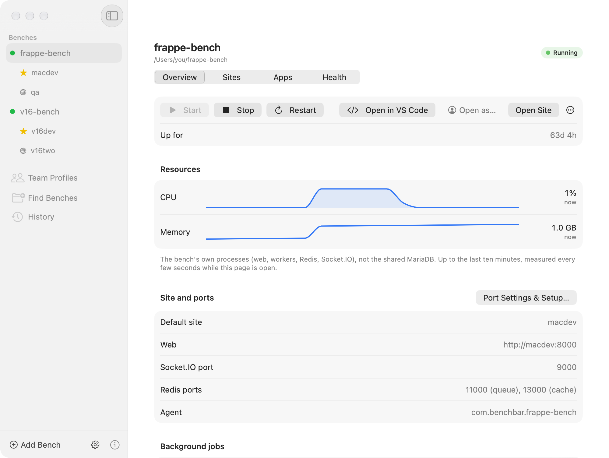

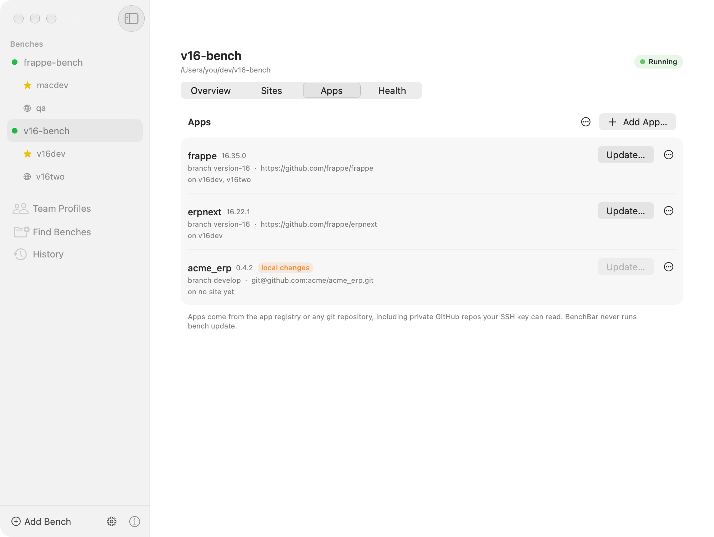

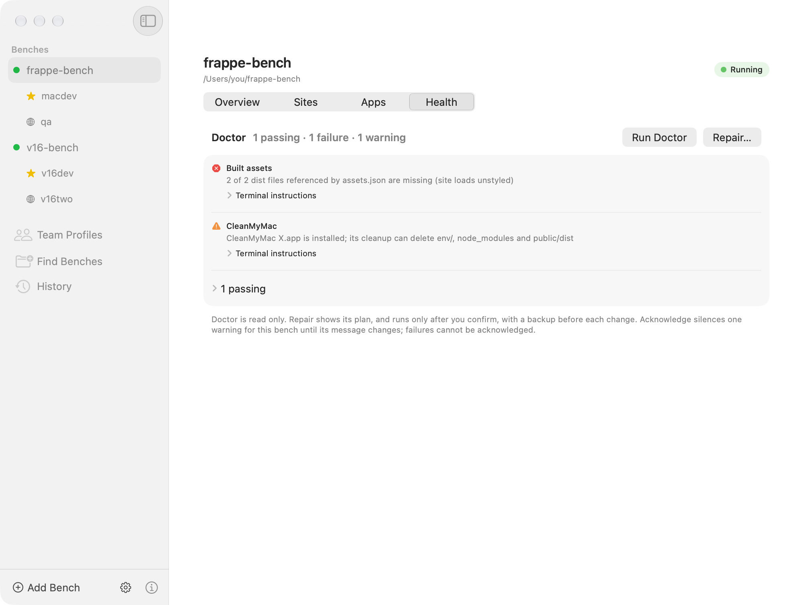

**General**, **Menu Bar** and **About BenchBar** are panes of the same
window, reached from the footer of the sidebar. **Settings…** (⌘,) in the
app menu opens the window on General, and **About BenchBar** opens it on
About.

- **General**: open at login, notifications, which `benchbar` the app
  runs (Automatic, or a path you choose), the editor for **Open in VS
  Code** or Cursor, and the keyboard shortcuts. A build without Sparkle
  (one you built yourself) also has **Check for updates automatically**.
- **Menu Bar**: the runner, with a live preview and custom runners, see
  [Custom runners](runners.md).

**Labs** (the last section of General) lists experiments that can change
or disappear. Each has a switch, what it does, a warning and the version
it first came in. The switch runs `benchbar labs on` or `off`: the command
line tool keeps the flag, so the terminal, coding agents and the app always
agree. With a command line tool that has no `labs` command, the section
says to update it.

**About BenchBar** shows the app's version and the command line tool's
(with its path), **Check for Updates** (with **Update Now** when a newer
release is out, and Copy Update Command and Release Notes in its ⋯
menu), links to the documentation, the release notes and the source,
**Report a Bug…**, and the `claude mcp add` command for coding agents.
Report a Bug and Check for Updates are in the Help and app menus too.

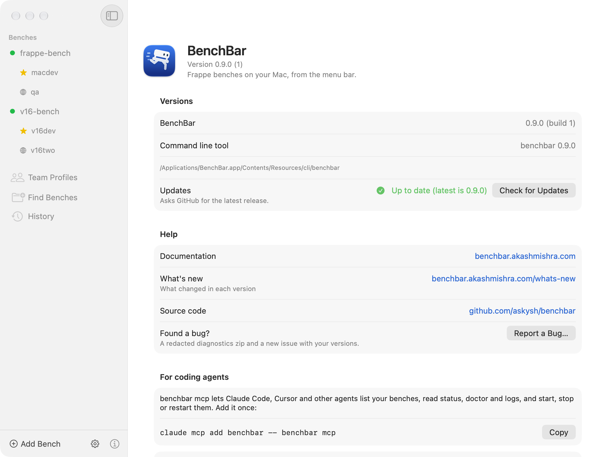

In the sidebar, below the benches:

- **Team Profiles**: every profile with where it comes from (built in,
  local, imported, subscribed), a badge when a subscription is behind and
  a warning when another file with the same name hides one. The **Add
  Profile** menu has **Create from Bench…**, **Import…** (a `.toml` file
  or an https link; or drop the file on the page) and **Subscribe to a
  Repository…** (a team's git repository of profiles). Each profile's ⋯
  menu has Export (pick each app's branch and which apps to share, then
  Copy Import Link), Update (shows the changes first), Check Access
  (which repositories your git credentials reach), Show in Finder and
  Remove (moves the file aside; for a subscribed profile, the whole
  subscription with every profile in it). Import and update show what changes
  before they write, and nothing is installed from this page. See
  [Teams](guides/teams.md#team-profiles).

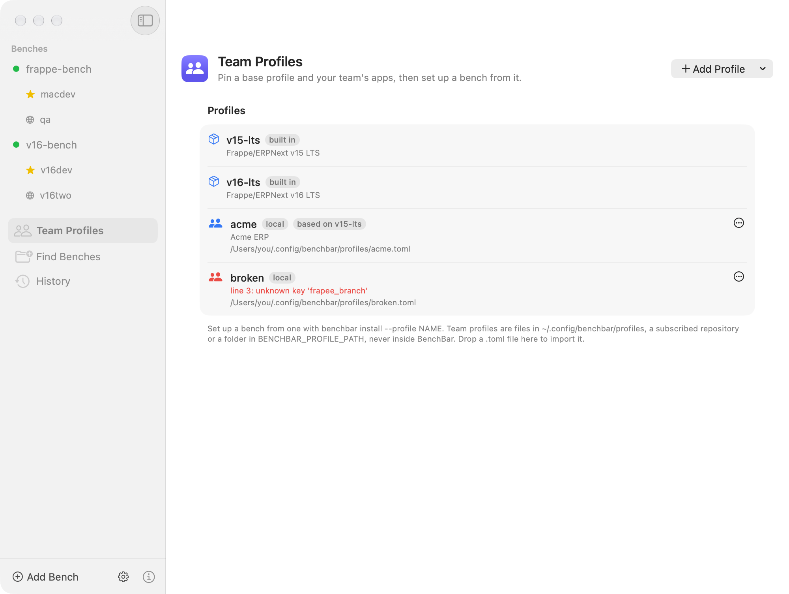

## Share on your network

Sharing lets colleagues on the same Wi-Fi use a copy of one of your dev
sites in their own browser. It is a Lab, so it is off until you turn on
`lan-rooms` in **Settings > Labs** (or run `benchbar labs on lan-rooms`).
While it is off, the Sharing tab, the popover rows and **On your network**
do not show. The safety model is in
[How sharing keeps your bench safe](concepts/sharing-safety.md).

### Host a room: the Sharing tab

The Sharing tab of a bench has one main button for each state:

1. **Set up sharing** makes a hardened copy of the site and picks the seats. A
   seat is a Frappe user that a guest signs in as. Nothing is shared yet.
2. **Turn on network protection** asks for your password in its own macOS
   dialog and installs the LAN guard, a firewall rule that keeps the
   bench's ports closed to other Macs. It shows only when the check fails.
3. **Start sharing** asks once more, then opens the room for the time you
   pick (1, 2, 4, 8 or 12 hours). **Extend** adds 30 minutes or 1 hour, up
   to 12 hours in total.
4. **Stop** ends the room. Every guest session ends with it.

If a setup stopped halfway (for example you quit BenchBar while it ran), the
tab says so and the button reads **Finish setup**. It opens the same sheet as
**Refresh copy…**; `benchbar share setup --refresh` does the same. **Start
sharing** does not work before that.

Turning the `lan-rooms` Lab off while a room runs asks first: it says how many
people are connected and will be signed out, and that the rooms you opened as
a guest close.

While the room is open the tab shows:

- **Room code**: six digits, drawn as dots so a shared screen or a
  screenshot does not leak it. **Show** and **Hide** switch it; Start sharing
  and **New code** show it once, and leaving the tab hides it again. **Copy**
  copies the code. **Copy invite** copies a link that holds the code. **New
  code** makes the old code stop working. **Lock room** stops new joins.
- **Checks**: the protection checks. Sharing ends by itself when they fail
  twice in a row.
- **The copy**: the site that guests see, with **Refresh copy…**.
- **People in the room**: each guest, with their seat. **Remove** ends a
  guest's session. The seat menu moves a guest to another seat.
- **Activity**: the last events of the room.

The popover shows the room with its time left, **Copy invite** and **Stop**.
Guests see changes after a page refresh. The Mac stays awake while the
room is open. Closing the lid still ends it.

### Join a room: On your network

**On your network** is in the sidebar of the window. It has two lists:

- **Your rooms**: the rooms you joined. **Open** opens the room's site,
  **Change Seat** picks another seat, and **Forget** removes the room. Forget
  asks first: this Mac signs out of the room, the saved key is deleted, and a
  new code or invite from the host is needed to join again. If **Open** cannot
  start its local connection, the row says so.
- **Nearby**: rooms that colleagues on this Wi-Fi opened. **Join** asks for
  the room code and then for a seat.

The first time, BenchBar explains why it needs Local Network access and
then asks macOS for it. If you said no, the pane shows a button for System
Settings. **Find rooms** looks again. Got an invite from a colleague?
**Paste invite** joins from it. Browsing runs only while the pane is open.
While the pane is open, or a room is open in your browser, BenchBar asks each
joined room every 10 seconds whether the host is still there. A room that does
not answer is asked less often (every 20 seconds, then 40, up to every 5
minutes) and one that was removed or ended is not asked at all. When you leave
the pane and no room is open in your browser, or when you turn the Lab off, the
asking stops.

## Updates

Every release has Sparkle, the macOS updater (see
[Releasing](releasing.md)). It checks for a new version once a day on
its own and offers it in its own window; **Check for Updates…** in the
app menu and the menu bar menu asks at once. **Check for Updates** in
About asks GitHub for the latest release, one request that downloads
nothing.

A build without Sparkle (one you built yourself) asks GitHub itself, at
most once a day: when it starts, when the Mac wakes, and on an hourly
look at the clock. Turn that off in General with **Check for updates
automatically**; **Check for Updates** in About still works.

When the GitHub check (Check for Updates in About, or the daily check of
a build without Sparkle) finds a newer release, the popover and the menu
bar menu show **Update to X…**, and the BenchBar window shows a banner
with the choices below. Sparkle's own check shows its own window
instead.

- **Update Now**: Sparkle downloads the new version and restarts
  BenchBar. The app carries its command line tool, so the CLI is updated
  with it; nothing runs in Terminal. Your benches keep running. A build
  without Sparkle (one you built yourself) opens the release page.
- **Release Notes**: the release page.
- **Copy Command**, in the banner's ⋯ menu: for an app from the
  `benchbar-app` cask, `brew upgrade askysh/tap/benchbar-app`, the same
  update through Homebrew.

The close button on the banner hides it until the next version; the
menu item stays. See [Updating](install.md#updating).

After an update that changes a default (0.9.0 changes three: the bench
listens on this computer only, an unknown option is an error, and `pull`
neutralises the copy), the BenchBar window also shows a banner for each
one, one at a time: what changed, the command that switches it back and
**Learn More**, which opens [What's new](whats-new.md). **Dismiss** runs
`benchbar notices --dismiss ID`, so the notice is gone in the terminal list
too. A fresh install shows none.

## The command line tool inside the app

BenchBar.app has the `benchbar` CLI inside it
(`BenchBar.app/Contents/Resources/cli`), the same version as the app,
and runs that one unless Settings names another. When the app is in
`/Applications` or `~/Applications`, it links
`~/.local/state/benchbar/bin/benchbar` to its CLI at launch, and
Homebrew's and the one line installer's `benchbar` (0.7.1 or newer) hand
off to it. Every `benchbar` on the Mac, in Terminal, in an MCP client or
in your shell helpers, is then the app's version, and stays in step with
it through every update. Move the app to the Trash and they run
themselves again.

About says when a command line tool named in Settings is two or more
minor versions older than the app, with the command that updates it and
a Copy button.

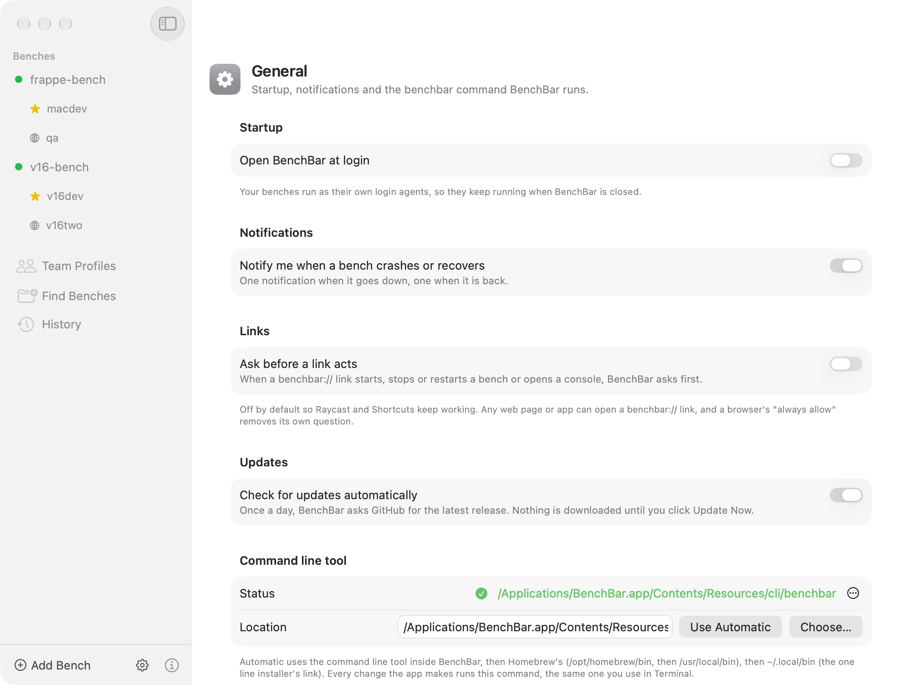

## A new bench from the app

A Mac with no bench opens the window on the first run wizard; later it is
**New Bench…** under the **+** in the sidebar. Return goes on, Esc goes
back.

1. **Welcome**: **Set Up a New Bench**, or **I Already Have a Bench**,
   which opens Find Benches to add it and set up its service. **Just the
   Command Line Tool** shows the Homebrew and installer commands to copy.

   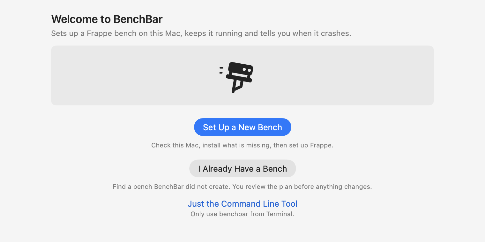

2. **Check Your Mac**: what `benchbar doctor --prerequisites` checks:
   Apple Silicon, macOS 14 or later, the Xcode Command Line Tools,
   Homebrew, free disk space, a bench folder outside iCloud Drive,
   Desktop and Documents, CleanMyMac and Mole, and whether the default
   ports are free. **Install Command Line Tools** opens Apple's
   installer, and the row checks again on its own. Homebrew is installed
   with the command shown, in Terminal; then **Check Again**.

   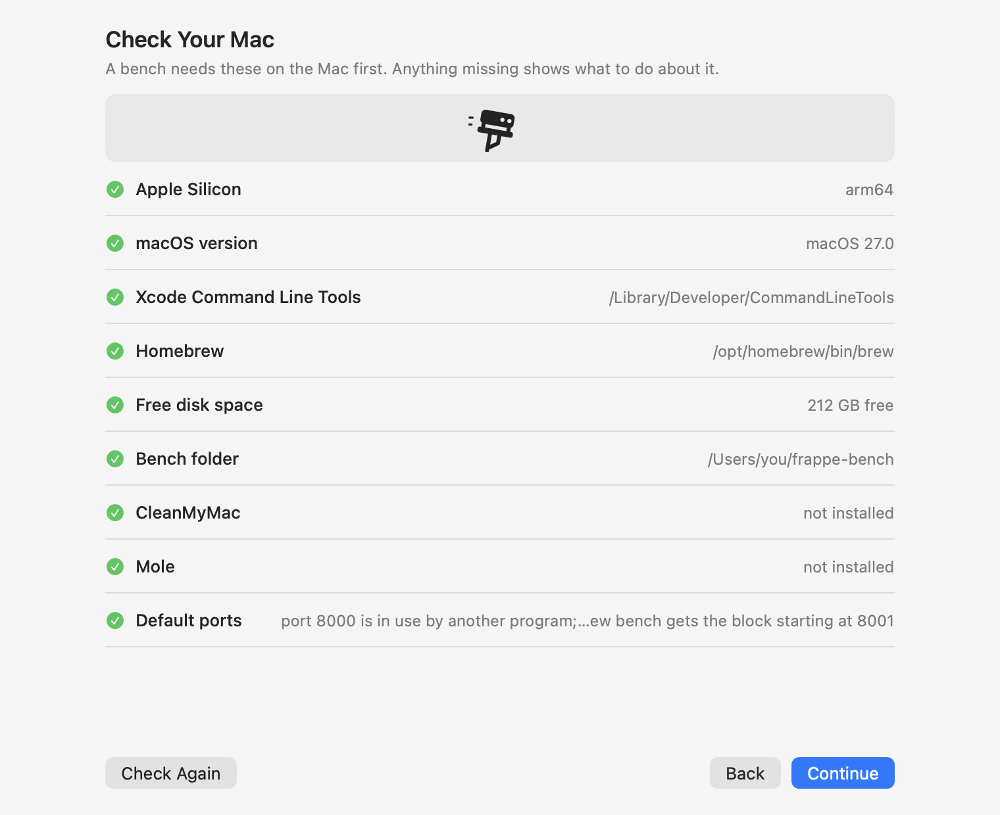

3. **New Bench**: the folder (`~/frappe-bench` by default), the profile
   (v15-lts, v16-lts or a team profile, with the Python, Node and
   MariaDB each brings), the app bundle, the site name and the
   Administrator password. The password goes to that one `benchbar
   install` and nowhere else. A port block appears only when another
   bench has the default ports.
4. **Review**: the plan from `benchbar install --dry-run`. The two steps
   that need your password, the patched wkhtmltopdf package and the
   `/etc/hosts` line, say **Asks for your password**.

   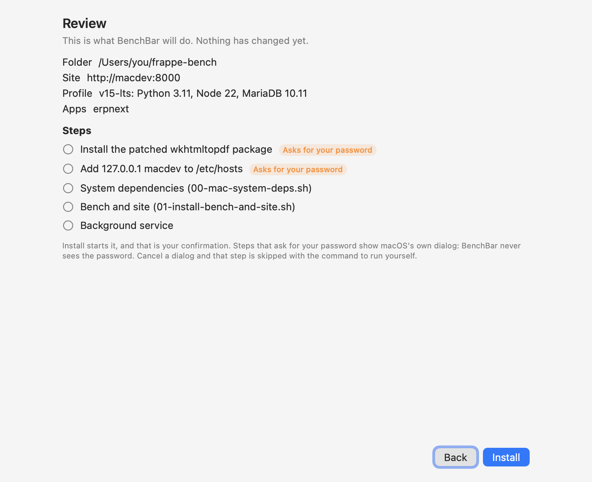

5. **Install**: each step and its own steps as they run, with their
   times and the command output under **Show Output**. macOS asks for
   your password in its own dialog, once for each of the two steps;
   BenchBar never sees it. Cancel a dialog and that step is skipped, with
   its command to run later. **Stop** ends the run; the wizard or
   `benchbar repair` finishes it later. A failed step shows its fix,
   **Retry** and **Open Log**. When MariaDB already has a root password
   that BenchBar does not know, the page asks for it and tries again.
6. **Done**: **Open Site**, a runner for the menu bar, **Open BenchBar
   at Login**, **Allow Notifications**, and the shell helpers (`source
   ~/.zshrc`, then `benchup`) to copy. A skipped step shows its command
   here.

A four step walkthrough of the app follows the wizard: the runner, the
popover, the window, and Terminal with coding agents. **Take the Tour**
on the Done page opens it, and it opens once on its own. Open it again
with **Help > Show Walkthrough**.

## Finding the command line tool

On Automatic the app runs the CLI inside it. A path chosen in General
comes first; one that is gone, such as a Cellar folder after `brew
cleanup`, falls back to Automatic. Only a build that carries no CLI (one
run from Xcode) looks further: Homebrew's folders, `/opt/homebrew/bin`,
then `/usr/local/bin` when that is Homebrew's benchbar too, then
`~/.local/bin`, the one line installer's link. With no CLI at all, the
app says to install one with `brew install askysh/tap/benchbar` and
asks once with a file picker.
BenchBar does not ask about notifications when it starts. macOS asks once,
when the first alert has something to say (a bench crashed), or when you
press **Allow Notifications** in the setup walkthrough or turn the setting on;
allow it for the crash alerts. If you said no, **Settings, Notifications**
says so and opens the macOS pane. An alert macOS refuses to show is
named there too.

## What the app does not do

**A person, not an agent.** A few commands (turning on Open as, printing a
sign-in link, sharing, the firewall guard) are refused to a program that runs
`benchbar` without a person: under `--for-agent`, `benchbar mcp` and
`BENCHBAR_NONINTERACTIVE`. The app runs them for you after its own alert, so
every call it makes this way says that it comes from the app: it sets
`BENCHBAR_NONINTERACTIVE=0` and `BENCHBAR_SUDO=gui`, and its process id in
`BENCHBAR_APP_PID`. The command line tool honors the two variables only
when that process id is a running parent (or grandparent, and so on) of the
`benchbar` process and has a name inside a `BenchBar.app` (the path `ps`
prints). That is a name check on the parent chain, so a shell that only sets
the variables itself is refused, and the refusal says why. This stops an
agent that follows the rules in
[AGENTS.md](https://github.com/askysh/benchbar/blob/main/AGENTS.md), a
script that runs by mistake and a process that copies the variables. It does
not stop a process of the same macOS user that deliberately fakes a parent
named like the app, or that runs inside the app's process tree: such a
process can already read your files and run your commands. It is a safety
rail, not a boundary, on every platform (on Linux and WSL there is no check). The steps that need the Mac's
password still ask in macOS's own dialog, and that dialog is a real barrier.

The app does not write plists, edit bench files, or run `bench`, `brew`,
`git` or `launchctl`. Every button runs `benchbar ... --json` and reads
the answer, plus the state file the runner writes on every transition.
The one other program it starts is `xcode-select --install`, from Check
Your Mac, which only opens Apple's installer. It never asks for your
password itself: for an install, a repair or a hosts line you confirmed,
the CLI shows macOS's own password dialog (`BENCHBAR_SUDO=gui`, see the
[JSON schema](json-schema.md#the-privileged-steps-and-benchbar_sudogui)). That
JSON is a documented API: [JSON schema](json-schema.md).

## Energy

At rest, with the window and the popover closed, BenchBar starts no
process for a running bench. The runner writes a heartbeat file,
`logs/.benchbar/heartbeat`, every 30 seconds, and the app trusts the
bench's `state.json` while that heartbeat is under 90 seconds old.
Starts, stops and crashes reach the app as a change in that folder, at
once. Every 5 minutes, when macOS finds a good moment, the app asks
`benchbar status` about benches it cannot read from their files, for
example a stopped one. On an M4 this is under 0.1 percent of one core,
down from about 6 percent in 0.6.0.

A bench whose runner predates 0.6.1 writes no heartbeat. The app then
asks `benchbar status` once a minute, and `doctor` warns "Runner
heartbeat". `benchbar service` (or `benchbar repair`) writes the new
runner, and `benchbar restart` starts it.

The CPU charts and the running speed are read from the kernel
(libproc), not from the CLI: every 2 seconds for the bench the runner
follows, every 5 seconds for a bench whose charts are on screen, and
only while that bench runs. The runner's speed is not read while the Mac
sleeps, the screen is locked, the menu bar is hidden or Low Power Mode
is on (the runner then plays at one speed).

While the Mac sleeps or the screen is locked, the loops stop but the
folder watchers stay, so a crash is announced at once, as it happens. A
bench that crashed and was restarted by launchd while you were away shows
`running` at wake; the app sees that it has a new start and a failing exit
code, and tells you once.

At most three `benchbar status` calls run at the same time, and opening
the popover and the window together reads the benches once. A bench that
has never run under the runner (no `state.json`) and that `benchbar status`
called stopped is no longer asked every minute: the 5 minute check still
asks, and its first start is heard from the folder.

Two features read more often, and only while they are on screen. While the
Sharing tab is open, the app asks `benchbar share status` every 5 seconds
and runs the protection checks once a minute. While you host a room (a
Labs feature) and the tab is closed, `share status` is asked every 15
seconds. While **On your network** is open, it looks for nearby rooms
every 5 seconds and asks each joined room every 10 seconds (less often
when a room does not answer). All of it stops when you close the pane and
no room runs or is open.

`benchbar status` pings only the default site. `benchbar status --ping`
asks every site once and fills `ping_code` in the JSON; see
[Running a bench](reference/cli/running.md).

## Quitting and two copies

If you quit while a change runs (an install, a repair, an app update, a
site change, port setup, hosts lines, or a start, stop or restart), BenchBar
asks. **Keep running** is the default; **Quit when it finishes** closes
BenchBar as soon as the change is done. Quitting during a change would end
it halfway and could leave a bench half installed or half migrated.

Only one BenchBar runs at a time. Opening a second copy (from another
folder, a DMG, Homebrew or Xcode) brings the running one to the front and
quits the new one. The `benchbar` command line tool follows the copy in
`/Applications`: a copy in `~/Applications` does not take it over, and an
older copy never replaces a newer one on the same level.

When a command times out or is cancelled, the app stops the command and
everything it started (its process group): first SIGTERM, then SIGKILL
after 2 seconds. A cancel is not reported as a timeout.

## Find existing benches in a folder

Choose **Scan Folder…** in the menu bar popover (or its right-click menu),
then select a folder such as `~/Developer`. **Find Benches** in the window
keeps the results and offers **Choose Folder…** and **Scan Again** (the
↻ button beside the folder).

The scanner searches subfolders, up to six levels deep, until it finds a
bench. Hidden folders, symlinks, dependency/build folders, test/fixture
directories and macOS system and media folders (Library, Applications,
Pictures, Music, Movies, Volumes, System) are skipped. Unreadable subfolders,
including ones macOS privacy settings block, produce warnings alongside the
results. Cancel Scan
stops the search. No bench, service, site, or database is changed by scanning.

Review the full paths and sites, select benches, and click **Add Selected**.
The selection is remembered by the CLI and survives app restarts; aliases and
repeat scans do not add duplicates. Already-added benches are labelled.

Select benches and choose **Set Up Selected…** to review all current and proposed
addresses together with each bench’s service and hosts changes. Conflict labels identify overlapping configured ports. The
planner also checks live listeners, retains valid addresses where possible, and
shows blocked running benches. Stop those benches and disable their previous
automatic startup, or deselect them. Applying the preview configures management
through the existing adoption engine and remembers the benches; it does not start
them. Password-requiring hosts entries are reported for Terminal.

**Port Settings & Setup…** in Overview offers Automatic and Fixed mode. Fixed
pins the current ports. Saving a mode takes effect immediately but never moves
ports; address changes require applying a fresh preview. Automatic preserves
working allocations and proposes replacements for conflicts. Stopped managed
benches retain reservations for their current configuration; automatic mode
ignores outdated saved allocations after an external port change. If the configuration changes after preview,
BenchBar refuses the old plan and offers **Refresh Preview**.

Start and Restart check again before proceeding. A conflict exposes **Review
Port Conflict…**; review the proposed change and choose **Resolve & Start**.
For a fixed allocation that overlaps another bench’s claim, switch to Automatic
or reallocate the competing bench. Stopping it alone does not release its claim
for setup. CLI users can instead confirm a stopped overlap to run one bench at
a time without changing addresses.
BenchBar never stops an unrelated listener to obtain a port. Setup output retains
per-bench completion details if a later batch entry fails; completed entries stay
configured and the next preview reflects the actual state.

## Compact menu-bar controls

The popover is as tall as its content and scrolls only past a fixed cap,
so the footer stays reachable. An unmanaged bench offers **Set Up
Management…**, which opens its review only setup preview in the main
window. A port conflict similarly opens **Review Port Conflict…** there.

The popover shows up to three sites: the default site first, then any
site that still needs a hosts line, then the rest in name order (site-2
before site-10). **Manage Sites…**, or **View All** when there are more,
opens the complete Sites tab. A missing hosts line shows **Set Up…** on
the site, which opens the Sites tab and **Add Hosts Lines…**: after you
confirm, macOS asks for your password and the line is added. When you
cancel that dialog, the sheet shows the `benchbar site hosts` command to
copy.
Open is enabled once the bench is running.

Health shows the failure and warning counts and the first two checks
with their message and **Copy Fix**. **View Health…** (⌘K) has the full
report with passing checks and Terminal instructions. A failed refresh
is marked stale in the popover.
