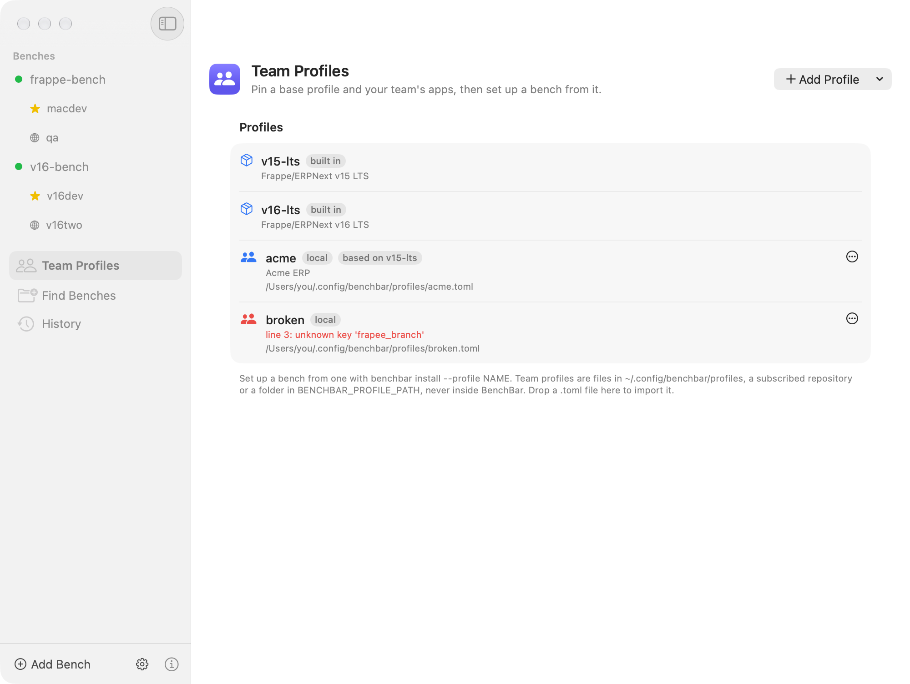
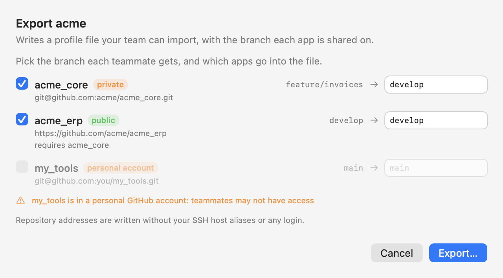
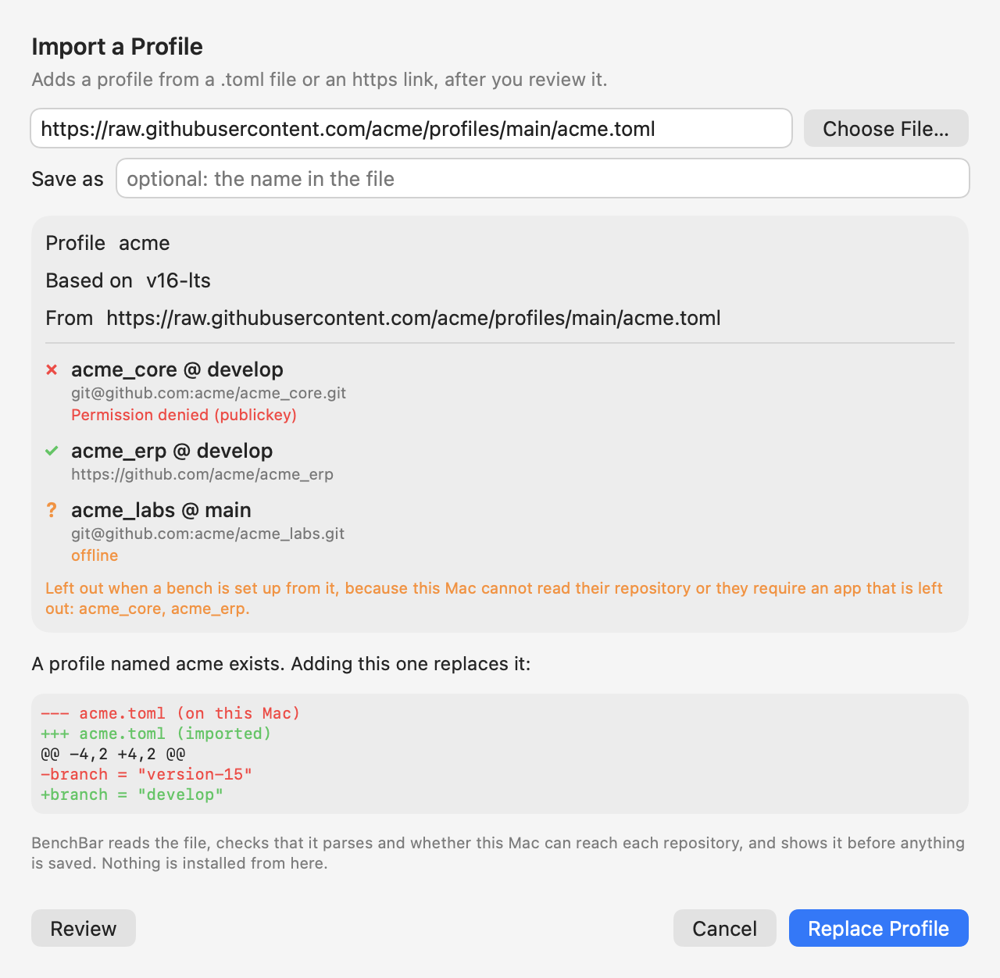

Three tools keep a team's benches alike. A team profile is the recipe for
a new bench. The lockfile pins the exact commits every bench should run.
`benchbar pull` brings a copy of a production site into a local one.

## Team profiles

A team profile is your organisation's bench recipe: a small TOML file
that names a built in base profile and your apps with their repos and
branches. It lives outside BenchBar, in
`~/.config/benchbar/profiles/NAME.toml`, in a team config repo you
[subscribed](#subscribing-to-a-teams-config-repo) to, or in a clone
listed in `BENCHBAR_PROFILE_PATH`.

```toml
# ~/.config/benchbar/profiles/acme.toml
base = "v15-lts"                  # Python, Node and MariaDB come from here
site = "acme.localhost"
scheduler = false

[[apps]]
name = "erpnext"
repo = "https://github.com/frappe/erpnext"
branch = "version-15"

[[apps]]
name = "acme"
repo = "git@github.com:acme/acme.git"
branch = "main"
```

```bash
benchbar profile create acme --from-bench ~/frappe-bench   # write one from a bench you have
benchbar profile list                                     # built in and team profiles
benchbar profile show acme
benchbar install --profile acme                           # a new Mac, the same bench
```

`~/frappe-bench` is an example: use your bench's folder. `profile
create` only reads the bench.

The file is a strict subset of TOML (strings, booleans, integers and
one line lists; no escapes, no inline tables), and a repo URL with a
user name or token is refused, since the file is meant to be committed.
Every key is listed in [Configuration](../reference/configuration.md#team-profile-files).

A built in profile of the same name wins. The BenchBar window's Team
Profiles page lists them too.

## Sharing a profile

A profile that works on your Mac often does not work on a teammate's:
it names your SSH alias (`git@github-work:...`), the feature branch you
happen to be on, or a repo in your personal GitHub account. Export
writes a copy that is safe to hand over, import and subscribe bring it
in on the other side, and check says up front which repos a teammate
cannot read.



### Sending one

```bash
benchbar profile export acme --plan                 # read only: the review, nothing written
benchbar profile export acme --out ~/acme.toml      # review, confirm, write
benchbar profile export acme --branch acme_ecr=main --drop scratch_app --out ~/acme.toml
```

The review lists each app with its access, its branch before and after,
and what it requires:

- Repo URLs lose any user info, and an SSH alias becomes the real host
  (`ssh -G` reads it from your `~/.ssh/config`).
- Each app follows its repo's default branch, read with your own
  credentials (through your SSH alias, if the repo uses one). An app on
  the base's release branch (erpnext, hrms or india_compliance on
  `version-15`) keeps it, since their default branch needs another
  Frappe. `--branch APP=BR` picks another one.
- `access` is `public` when git can read the repo without any
  credentials, `private` otherwise, `personal` when it is private and
  its GitHub owner is a person rather than an organisation (teammates
  must be added to it one by one), `unknown` when offline.
- `requires` comes from each app's `hooks.py` in the bench
  (`--bench-dir`), unless the profile already says it. Dropping an app
  that a kept app requires is refused.

Commit the file to your team's config repo, or send it.

In the app, a profile's ⋯ menu on Team Profiles has **Export…** with the
same review:



### Receiving one

```bash
benchbar profile import ~/Downloads/acme.toml
benchbar profile import https://github.com/acme/bench-config/blob/main/acme.toml --plan
benchbar profile check acme                        # which repos can you read?
benchbar install --profile acme
```

Import takes a local file or an https URL (a GitHub file or gist page is
fetched raw), 64 KB at most, and writes
`~/.config/benchbar/profiles/NAME.toml` with its `source`, only after it
parses. A file of the same name is diffed and replaced only when you
confirm. A profile names the repos `install` clones, and their code runs
in your bench, so import only from people you trust and read the app
list in the plan (`--plan` shows it without writing anything). Reading a
profile runs nothing from it, but installing one does: `bench get-app` runs
`pip install` and a build of every repo it names, and an installed app's
hooks run on your site. So `import`, `subscribe`, `update` and `install`
print `install will run code from these repos` with the host and owner of
each one (`github.com/acme`), and a second line for the owners that no app
of this bench and no line of `config/apps.tsv` uses yet. An update that adds
or changes a `repo` line says so. An imported or subscribed profile may name only `https://`, `ssh://` or `user@host:path` repos; a profile you wrote yourself, or made with `profile create`, may also name a local path or `http://`, with a warning that teammates cannot clone it. `--plan --json` has the same lists as
`runs_code_from` and `new_owners`. `check` asks git, with your own keys and tokens and never a
prompt, whether each repo and branch can be read. The repos are asked
side by side, 8 at a time, so a profile of 20 repos takes about as long as
its slowest repo. `install --profile` does the same and leaves out the
apps it cannot clone, and every app that requires one, and lists them in
its plan and at the end.

A repo that answered yes is remembered for 5 minutes, so `check` and an
`install --profile` straight after it do not ask the same repo twice (a no
or a timeout is never remembered: fix a key and run it again). That answer
can be 5 minutes old, and a branch can go in that time, so `install` asks
the network again for every app it is about to clone, before it plans or
changes anything. If a branch was deleted meanwhile, `install` stops there,
before its plan, with `Branch/tag 'NAME' not found for APP` and the repo; no
bench folder, database or setting has been touched yet. Fix the profile
(or pick another branch) and run it again.

`benchbar profile update acme` fetches the source again, shows the diff
and asks. `benchbar profile remove acme` moves an imported file to
`~/.config/benchbar/removed/`. For a profile that came from a
subscription, it moves the whole subscription aside, with every profile
in it. It never removes a file you wrote yourself.

In the app, **Import…** on Team Profiles takes a file or a link and shows
the same check before anything is written:



### Subscribing to a team's config repo

```bash
benchbar profile subscribe git@github.com:acme/bench-config.git
benchbar profile list                     # its profiles, and how far behind the clone is
benchbar profile update --all             # fetch, show the diff, ask, fast forward
benchbar profile remove acme-bench-config # unsubscribe (moved aside, not deleted)
```

Subscribe clones the repo into
`~/.config/benchbar/sources/OWNER-REPO/`. Its profiles are the `*.toml`
files in its `profiles/` folder, or at its root when it has none; nothing
else in it is read or run. Subscriptions come after your own folder and
before `BENCHBAR_PROFILE_PATH`, in the order you subscribed; `profile
list` warns when a name is hidden by an earlier file. Nothing updates on
its own. When the bench's team profile comes from a subscription that is
behind, doctor warns
([`profile_outdated`](doctor-and-repair.md#profile_outdated)) as of the
last fetch; `benchbar doctor --fetch` checks the remote first.

Every flag is in the [profile reference](../reference/cli/profile.md).

## The team lockfile

A team profile is the recipe; `benchbar.toml` is the exact state, so
every developer's bench runs the same commits. Keep it in your main
custom app and commit it there:

```bash
benchbar lock write --lock apps/acme/benchbar.toml   # once; the path is remembered
benchbar lock check                                  # read only, exit 1 on any difference
benchbar lock apply --dry-run                        # what a teammate's bench would change
benchbar lock apply
```

`lock apply` clones missing apps, switches clean apps to the locked
branch and fast forwards to pinned commits, then runs requirements and
build. A lock that lives in an app repo changes when that app is updated,
so the plan marks each repo that is not in the bench yet (`NEW REPO`) and
names the owners whose code `apply` will run before it asks. A `commit` in
a lock is 12 to 40 hex characters: a short prefix is matched by prefix and
can collide. A lock inside an app repo is read like a file from someone else: its repos must be `https://`, `ssh://` or `user@host:path`. A lock you keep outside `apps/` also takes a local path or `http://`, and `lock write` warns when an app's remote is one teammates cannot clone. It never touches a site (it prints the `site add`, `app install`
and migrate steps instead) and never overwrites local work: an app with
local changes or commits of its own is skipped with a warning. Doctor
reports drift as a warning ([`lock_drift`](doctor-and-repair.md#lock_drift)).

The file pins each app's repo, branch and, optionally, commit, in the
order of `sites/apps.txt`, plus the sites and the apps each one has:

```toml
schema = 1
[bench]
profile = "v15-lts"
frappe_bench = "5.31.0"
[[app]]
name = "erpnext"
repo = "https://github.com/frappe/erpnext"
branch = "version-15"
commit = "b5f784612d5b7969b72848dda5b22f10d3a8f764"
[[site]]
name = "acme.localhost"
default = true
apps = ["erpnext", "acme"]
```

benchbar finds the file from `--lock PATH`, then `BENCHBAR_LOCK`, then the
path remembered for the bench, then `<bench>/benchbar.toml`. A bench is
rarely a git repo itself, which is why the file usually lives in your
custom app.

## A copy of production

```bash
benchbar pull prod:erp.example.com --as erpcopy --dry-run   # read only, prints the plan
benchbar pull prod:erp.example.com --as erpcopy             # asks before it restores
benchbar pull --from-dir ~/Downloads/erp-backup --as erpcopy   # a Frappe Cloud download
```

`prod` is a Host from `~/.ssh/config`. Pull takes the latest backup that
already exists on the server, so nothing is written there (`--new-backup`
runs `bench backup` first, which also deletes older backups on the server,
so it asks you to type the site name). The download resumes when the link
drops. The copy goes into a new local site, which pull creates
(`bench new-site`) as a step of its plan: pull refuses a site name
that exists. `--replace` overwrites that site's database and files
instead, after backing it up and asking again. A name that cannot be
restored into (a folder in `sites/` that is no site) stops the check,
`--dry-run` included. `--no-migrate` stops after the restore, and
`--before-migrate SCRIPT` runs a script of yours between the two. The copy has email muted and the scheduler paused before it
ever starts, is neutralised (see below), and runs `bench migrate` when your apps are newer. When the
bench lacks an app production has, pull stops and prints the
`bench get-app` command; `--skip-app APP` restores without it. Encrypted
backups are decrypted locally with `gpg` (`brew install gnupg`).

Since 0.9 the copy is neutralised by default. After the restore and before
migrate, pull switches off what could reach production or act as it, and
deletes every stored password but the Administrator login: all `Password`
fields (the `__Auth` table, so SMTP, IMAP, LDAP, S3, payment gateway,
OAuth and webhook secrets and the passwords of users), webhooks,
notifications, email accounts, mail that was waiting to be sent, social
logins, OAuth and Connected App tokens, Integration Requests, Google,
Dropbox, S3, LDAP, push and payment settings, Slack and SMS gateway URLs,
API keys, webhook URLs and headers, Automation Flows, and the scheduled jobs and server scripts that call out.
Without `ADMIN_PASSWORD`, production's Administrator password works on the copy. The
output says how many of each (`neutralised erpcopy: 2 webhooks switched off,
41 stored secrets cleared`) and the `done` line of `--json` carries the
counts. The [pull reference](../reference/cli/pull.md#what-the-copy-loses)
lists every part. Customer data is not scrubbed: names, emails, phones
and documents are in the copy.

To keep production's integrations and stored passwords, pass
`--keep-secrets`. The copy then keeps them (and the encryption key
decrypts them), so keep its scheduler and workers off. A copy that was
neutralised cannot be switched back: pull again with `--replace
--keep-secrets`. The flag is yours to pass: a pull started by an agent
(`--for-agent`, `benchbar mcp`, `BENCHBAR_NONINTERACTIVE=1`) is refused
with it.

The encryption key and the passwords never appear on a command line, in
the output or in the log. The download is kept in
`<bench>/.benchbar/pulls/` after a failed run, so the next run resumes;
a successful run removes it unless you pass `--keep-staging`.

Every flag is in the [pull reference](../reference/cli/pull.md). When
passwords do not decrypt after a restore by hand, see
[Troubleshooting](../troubleshooting.md).
