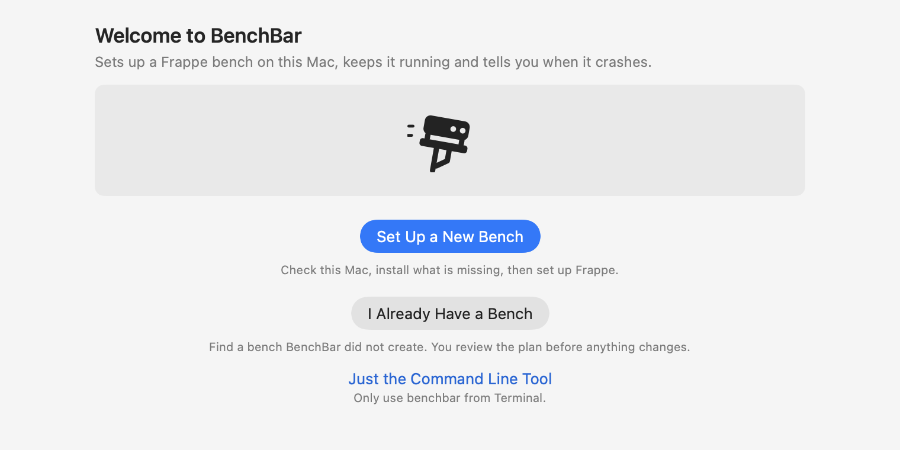

There are four ways in. Homebrew installs the CLI and the app together
and is the one most people want. The one line installer does the same
without Homebrew's formula and cask. The DMG gives you the app, which
carries its own copy of the CLI but puts no `benchbar` command in
Terminal. Building from source is for contributors.

Check the [requirements](index.md#requirements) first: macOS 14 or later
on Apple Silicon, Homebrew and the Xcode Command Line Tools, about 5 GB
of free disk. On Linux and Windows, see [Linux](#linux) and
[Windows](#windows).

## Homebrew

```bash
brew install askysh/tap/benchbar askysh/tap/benchbar-app
benchbar install                   # sets up this Mac: asks for sudo once
source ~/.zshrc && benchup
```

The first line installs the CLI, the `benchbar` formula, and the menu bar
app, the `benchbar-app` cask, from the `askysh/tap` tap. Type both names:
Homebrew trusts a third party tap only for the names you type, so the
cask alone cannot pull in its formula. `benchbar install` sets up the
bench, the site and the background service as in the
[Quick start](quick-start.md); with a bench you already have, run
`benchbar adopt` instead. To check a Mac before installing, without a
bench, run `benchbar doctor --prerequisites` (Apple Silicon, macOS 14,
Command Line Tools, Homebrew, free disk, the bench folder, cleanup tools
and the default ports; each check that is not ok names its fix). The BenchBar app drives `install` and `adopt`
through `--json --yes`, which prints one JSON event per line; the format
is in the [JSON API](json-schema.md).

The cask needs Apple Silicon and macOS Sonoma or later. For the CLI
alone, on an Intel Mac too (written for it, not checked on real
hardware):

```bash
brew install askysh/tap/benchbar
```

The CLI keeps its state (the remembered benches, per bench settings, the
logs and backups of every run) in `~/.local/state/benchbar`, outside
Homebrew's folders, so `brew upgrade` and `brew cleanup` never touch it.
`benchbar where` shows how the CLI was installed and where its state is.

## The one line installer

```bash
curl --proto '=https' --tlsv1.2 -fsSL https://raw.githubusercontent.com/askysh/benchbar/main/install.sh | bash
```

The installer checks macOS, the Command Line Tools and Homebrew, clones
the CLI into `~/.local/share/benchbar` with links in `~/.local/bin`, adds
that folder to `~/.zshrc`, and installs the BenchBar app from the latest
release into `~/Applications` after checking its sha256. It then offers
`benchbar adopt` for a bench it finds, or `benchbar install`. The
installer itself never runs `sudo`. It leaves to Homebrew what Homebrew
installed: with the `benchbar` formula it skips the CLI, with the
`benchbar-app` cask the app, and prints the brew command instead.

In more detail, in this order, and it says so before each step:

1. It checks macOS (the app needs 14 or later; on an older macOS only the
   CLI is installed) and Apple Silicon (it warns on Intel), the Xcode
   Command Line Tools (it offers `xcode-select --install` and waits) and
   Homebrew (it offers the official installer: Homebrew publishes no
   pinned version of it, so it is always the current one from
   `raw.githubusercontent.com/Homebrew/install/HEAD`, and benchbar does
   not check it. Run it yourself first if you want to read it).
2. It clones the CLI into `~/.local/share/benchbar`, or pulls when the
   clone exists, links `benchbar` and `frappe-mac` into `~/.local/bin`,
   and adds that folder to `PATH` in `~/.zshrc` inside a
   `# >>> benchbar-path >>>` marker block.
3. It installs or updates the BenchBar app from the latest GitHub
   release. The zip is checked against the release's `SHA256SUMS`. When
   `gh` (the GitHub CLI) is installed and signed in, it is also checked
   against its build provenance (`gh attestation verify`, pinned to this
   repository's release workflow), and a failure stops the install.
   Without `gh`, with `gh` signed out, or when `gh` does not answer within
   30 seconds, it says that only the checksum was checked and prints the
   command to run by hand. The same goes for a release older than 0.9.0,
   which has no attestation. The running BenchBar is quit and replaced only
   after every check passed. The unpacked app must
   pass `codesign --verify --deep --strict` and `spctl --assess`, which
   is Gatekeeper's check of the Developer ID signature and the
   notarization: `curl` sets no quarantine flag, so macOS never checks an
   app it downloaded. The app is copied next to the old one and renamed
   over it. This step is skipped when no release exists yet.
4. It offers `benchbar adopt` for a bench it finds, or `benchbar install`.

The installer never runs `sudo` itself. Homebrew's own installer, if
you accept it in step 1, asks for your password and says so first. If
you accept `benchbar install` or `benchbar adopt` in step 4, that
command asks for it once too, for the `/etc/hosts` line and the
wkhtmltopdf package. Prompts read from the terminal, so the installer
works when piped from `curl`.

### The installer on Linux

The same line works on Ubuntu 24.04 and in WSL. It installs the command
line tool only, since there is no app on Linux:

```bash
curl --proto '=https' --tlsv1.2 -fsSL https://raw.githubusercontent.com/askysh/benchbar/main/install.sh | bash
```

It needs `git`; when `git` is missing it stops and prints
`sudo apt update && sudo apt install -y git`. It never runs `sudo`. It
clones the CLI into `~/.local/share/benchbar` (or pulls), links
`benchbar` into `~/.local/bin` and adds that folder to `PATH` in
`~/.bashrc` (`~/.zshrc` when your login shell is zsh) inside the same
`# >>> benchbar-path >>>` block. It asks nothing, with or without a
terminal, and `BENCHBAR_NONINTERACTIVE=1` says so explicitly. It then
prints the next step: open a new terminal and run `benchbar install`. In
WSL it adds that the BenchBar tray on Windows can continue the setup.
`--version vX.Y.Z` checks out that release of the CLI instead of `main`
(a detached checkout; a run without it goes back to `main`). `--dry-run`
and `--uninstall` work as on a Mac; `--app-only` is refused.

### Verify a download by hand

A checksum from the same release only finds a damaged download. The build
provenance says the file was built by this repository's release workflow
on GitHub Actions. Every file of a release from 0.9.0 on (the DMG, the
app zip, the CLI tarball and `SHA256SUMS`) has an attestation. With the
[GitHub CLI](https://cli.github.com), signed in (`gh auth login`):

```bash
gh attestation verify BenchBar-<version>.dmg -R askysh/benchbar \
  --signer-workflow askysh/benchbar/.github/workflows/release.yml
shasum -a 256 -c SHA256SUMS --ignore-missing
```

For the app itself, after you copied it to `/Applications`:

```bash
codesign --verify --deep --strict --verbose=2 /Applications/BenchBar.app
spctl --assess --type execute --verbose=2 /Applications/BenchBar.app
```

The first checks the signature, the second asks Gatekeeper, which also
checks the notarization. Releases before 0.9.0 have no attestation, so
`install.sh --version v0.8.3` finds none (`gh` answers HTTP 404), says
that only the checksum was checked and goes on. For 0.9.0 and later, and
for any other error from `gh`, it stops.

On Linux the installer downloads no file: git fetches the CLI from
`github.com/askysh/benchbar` over https, and `--version vX.Y.Z` checks
out that tag.

### Installer flags

Pass flags after `bash -s --`, for example
`curl --proto '=https' --tlsv1.2 -fsSL .../install.sh | bash -s -- --no-app`.

| Flag | What it does |
|---|---|
| `--yes` | Accept every default, no questions (no terminal needed). On a Mac that already has the CLI in `~/.local/share/benchbar` this is an update: the CLI and the app only, no bench is adopted or installed and the Homebrew installer is never run |
| `--dry-run` | Print the plan and every command, change nothing |
| `--no-app` | The CLI only |
| `--app-only` | The app only |
| `--version vX.Y.Z` | Install that release of the app instead of the latest. On Linux, with `--no-app` and for a release candidate: also check out that release of the CLI (a detached checkout; a run without `--version` goes back to `main`). A release candidate (`v0.9.0-rc.1`) is installed only when you name it: the latest never is one, and Homebrew and `benchbar self-update` cannot install one |
| `--uninstall` | Remove the app, the links and the PATH block; see [Uninstall](#uninstall) |

## The app from the DMG

Download `BenchBar-<version>.dmg` from the
[releases page](https://github.com/askysh/benchbar/releases), open it and
drag BenchBar to Applications. Since 0.6.1 the app and the DMG are
signed with a Developer ID, notarized by Apple and stapled, so BenchBar
opens like any other download, and later versions arrive through
**Check for Updates…** (Sparkle). Verify a download with
`shasum -a 256 -c SHA256SUMS` from the same release, and see
[Verify a download by hand](#verify-a-download-by-hand) for the
attestation.

Since 0.7.1 the app carries its own copy of the CLI and runs it, so its
buttons work without anything else. For `benchbar` and the `bench*`
helpers in Terminal, add the CLI too: `brew install askysh/tap/benchbar`,
or the one line installer with `--no-app`. Either one hands off to the
app's CLI once the app is in `/Applications` or `~/Applications` (an app
run straight from the DMG does not register its CLI), see
[Updating](#updating).

### Releases before 0.6.1

Releases up to 0.6.0 were not signed with an Apple Developer ID, and
macOS 15 and later stopped their first launch:

1. Double click BenchBar. A dialog says "BenchBar" Not Opened: Apple
   could not verify it is free of malware. Click **Done**. The highlighted
   button is **Move to Trash** (Move to Bin in British English), so do not
   press Return.
2. Open **System Settings > Privacy & Security**, scroll to the Security
   section: "BenchBar was blocked to protect your Mac".
3. Click **Open Anyway**, confirm with your password or Touch ID, then
   **Open Anyway** once more.

This happened once per install. The one line installer avoided it,
because `curl` sets no quarantine flag on the download.

## From source

The CLI runs straight from the clone. Building the app needs full Xcode
26 or newer, not only the Command Line Tools.

```bash
git clone https://github.com/askysh/benchbar.git && cd benchbar
./benchbar install                 # optional: sets up a bench and a site, as in the Quick start
brew install xcodegen
scripts/release-local.sh           # the app: dist/BenchBar-<version>.zip and .dmg
scripts/macos-install-local.sh     # or build it and copy it to ~/Applications
```

`./benchbar install` is the full setup: Homebrew packages, a bench, a
site and the background service. It asks for passwords and `sudo`, and
the first run takes a while. Skip it when you only want to work on the
app or adopt a bench you have.

## Linux

From 0.8 the same CLI runs on Linux: Ubuntu 24.04 (the only system it is tested on and supports), Windows through WSL
first. `install` takes the v15-lts and v16-lts profiles and team profiles (a team profile follows its base). On another system, for
example Ubuntu 22.04 (MariaDB 10.6) or Debian, `doctor` warns about it and `install` stops before sudo and before it installs any
package; with `--allow-unsupported-distro` you can try anyway, at your own risk. There is no menu bar app on Linux; on Windows a tray
app shows the benches of the distro: see [Windows](windows.md).

```bash
curl --proto '=https' --tlsv1.2 -fsSL https://raw.githubusercontent.com/askysh/benchbar/main/install.sh | bash
benchbar install          # in a new terminal
```

The first line is the [installer on Linux](#the-installer-on-linux). To
work on benchbar itself, clone the repository and run `./benchbar install`
from the clone. If `install` stops, see
[First run problems](first-run-problems.md).

`install` runs `00-linux-system-deps.sh`: MariaDB and Redis from apt,
Python from uv, Node from fnm, the pinned wkhtmltopdf `.deb`, and
`libnss-myhostname` so `*.localhost` names resolve. The uv and fnm
installers are pinned to a version and checked against a sha256 before
they run, so a changed file at their web address is refused, not run. It asks for `sudo`
once up front and not at all on a second run. Each bench runs as its own
`systemd --user` unit, and `loginctl enable-linger` brings a running
bench back after a reboot. The default site is `linuxdev.localhost`, and
benchbar never edits `/etc/hosts` there. The `bench*` helpers go to
`~/.bashrc`. `benchbar doctor --prerequisites` on Linux checks, without a bench and
without sudo: the distro (Ubuntu 24.04 is tested: `--prerequisites` warns about another system, and `install` stops before it changes anything unless you pass `--allow-unsupported-distro`), the CPU
(x86_64 or arm64 is needed for the PDF package), that you are not root, sudo (your
user is in the sudo group), apt, systemd, linger, the user bus (`systemctl --user` answers), memory, free disk, the
bench folder, the default ports and the MariaDB root password state. Each
check that is not ok names its fix.

Run `install` from a shell that has a user session. Under `sudo -iu USER`,
`su -` or cron there is no login session, so `systemctl --user` cannot find
its bus. `install` turns on lingering (`loginctl enable-linger`), which starts
the user manager, and points `XDG_RUNTIME_DIR` at `/run/user/UID`. When the
manager still cannot be reached it stops before it changes anything and says
what to run: `sudo loginctl enable-linger USER`, then run it again from a
login shell or with `XDG_RUNTIME_DIR=/run/user/$(id -u)`. `benchbar status`
says `unknown (no user bus)` in that case, not `loaded: no`.

`install` first checks that ports 3306 (MariaDB) and 6379 (the system
Redis) are free, or held by this distro's own services. In WSL 2 every
distro shares one network, so only one of them can run MariaDB. When
another distro or program holds the port, the plan lists it as a blocker
and the run stops before it asks for sudo, with error id
`port_3306_in_use` (or `port_6379_in_use`) and the fix: stop MariaDB in
the other distro (`sudo systemctl stop mariadb`), or install in that
distro. benchbar stops nothing for you.

After the install, run `source ~/.bashrc` (or open a new terminal), then
`benchup`. The helpers are in `~/.bashrc`, not in `~/.zshrc`.

### Homebrew on Linux

The CLI formula installs on Linux with Homebrew (Linuxbrew) too. The
app cask is macOS only, so on Linux you install the formula alone:

```bash
brew install askysh/tap/benchbar
benchbar install                   # sets up this machine: asks for sudo once
source ~/.bashrc && benchup
```

The formula adds only `git` and `curl` on Linux. MariaDB, Redis, Python
and Node are not Homebrew's here: `benchbar install` gets them from apt,
uv and fnm, exactly as after the one line installer, and the bench runs
as a `systemd --user` unit. The state folder is the same too,
`$XDG_STATE_HOME/benchbar` (`~/.local/state/benchbar` by default), so
moving between the one line installer and Homebrew keeps your benches.
`benchbar where --json` says `"install":"homebrew"`, and
`benchbar self-update` runs `brew upgrade askysh/tap/benchbar` instead
of the installer. The prefix is usually `/home/linuxbrew/.linuxbrew`.

### Profiles on Linux

Python comes from uv and Node from fnm, so each profile gets its own:
`v15-lts` runs Python 3.11 and Node 22, `v16-lts` runs Python 3.14 and
Node 24. MariaDB is the one apt gives, 10.11 on Ubuntu 24.04. That is
inside the range both profiles accept (v15: 10.6 to 10.11, v16: 10.6 to
11.8), so `v16-lts` does not install the 11.8 its Mac formula names. A
MariaDB that is already running and inside the range is used as it is.
A profile whose range does not include what apt gives is refused before
anything is installed, and the message names the numbers.

### Crash notifications on Linux

When the crash guard pauses a bench (three starts in ten minutes), or the
bench cannot start because its ports are taken or its env is missing, the
runner writes the pause to `logs/.benchbar/state.json` and to the bench
log. `benchbar status` and `doctor` read it from there. What else you get
depends on where you run:

| Where | What you see |
| --- | --- |
| Desktop Linux | A desktop notification from `notify-send` (package `libnotify-bin`), sent through your session bus. Nothing is sent when `notify-send` is missing or there is no desktop session. |
| WSL | A Windows notification from the tray, which reads the same record. The runner adds none, so there is one. |
| Headless server | The record and the log only. Run `benchbar status` or `benchlogs`. |

There is no menu bar app on Linux, so no other notification exists. A
runner written before this change has no notification: `benchbar repair`
(or `benchbar service`) writes the new one.

## Windows

A beta. The benches run inside WSL 2, with the same CLI as on Linux.
In PowerShell, as yourself, without administrator rights:

```powershell
irm https://raw.githubusercontent.com/askysh/benchbar/main/install.ps1 | iex
```

This installs `benchbar.exe`, which forwards every command to the
distro, and BenchBar Tray, the notification area app. It checks the zip
against its SHA256, puts the folder on your PATH, adds a Start menu
shortcut, starts the tray and ends with `benchbar.exe doctor`. Run it
again to update. On our Windows 11 test PC it showed no SmartScreen
warning. The Windows programs are not signed, and 0.9.0 has no signed or
Microsoft Store route. Smart App Control blocks unsigned programs: when
it is on, the installer stops first and says what to do. The command line
inside WSL still works then (see
[Smart App Control](windows.md#smart-app-control)). Every release has
SHA256SUMS and build provenance you can verify (see
[Signing and verification](windows.md#signing-and-verification)). The
installer removes Windows' "downloaded from the internet" mark only when
`gh` is signed in and verifies the zip's provenance; otherwise the mark
stays and Windows asks once.

When the tray starts and finds no bench, its
[first run wizard](windows.md#first-run) checks the PC and sets up WSL,
the Linux distro, the bench and the keepalive. [Windows](windows.md) has
the requirements, what Windows may show, the flags, the tray, Report a
Bug, uninstall (`-Uninstall`) and how to verify a download.

## Updating

Updating is on its own page: [Update and migrate](upgrade.md). It covers
the app, Homebrew, the one line installer and the move from the one line
installer to Homebrew.

## After installing

Open a new Terminal tab, or run `source ~/.zshrc`, so `benchbar` and the
`bench*` helpers are on your `PATH`. Then follow the
[Quick start](quick-start.md), or open BenchBar: on a Mac with no bench
its window starts the [first run wizard](app.md#a-new-bench-from-the-app).



## Supported platforms

| | The CLI | The app |
|---|---|---|
| macOS 14 (Sonoma) or later, Apple Silicon | supported | supported |
| macOS 14 or later, Intel | written for it, **not verified** | not built (Apple Silicon only) |
| macOS 13 or older | not supported | does not open |
| Ubuntu 24.04, WSL 2 included | supported | none, the tray on Windows |

- **Intel Macs.** The CLI is written to run there: Homebrew's prefix is
  `/usr/local`, and the patched wkhtmltopdf package is an Intel binary, so
  PDFs need no Rosetta 2. A check on a real Intel Mac is not part of 0.9.0,
  so nobody has run `install` on one yet; the mocked tests cover it. Tell
  us in an issue if it works or not. The one line installer skips the app
  there and says so.
- **macOS 13 and older.** The app needs macOS 14 (its deployment target,
  and the cask's `depends_on`). The one line installer checks the version
  and skips the app on an older macOS, with a warning, and installs the CLI.
  `benchbar doctor --prerequisites` fails the macOS check there.
- **Shells.** The one line installer writes the `PATH` block to `~/.zshrc`
  (`$ZDOTDIR/.zshrc` when set). A fish user gets `fish_add_path` printed at
  the end, a bash user on a Mac the line for `~/.bash_profile`. On Linux
  the block goes to `~/.bashrc`, or `~/.zshrc` when your login shell is zsh.
  The `bench*` helpers follow your login shell (`$SHELL`). zsh gets them in
  `~/.zshrc`. fish gets its own file, `~/.config/fish/conf.d/benchbar.fish`,
  written as fish functions. bash on a Mac gets them in the file a login
  shell reads: `~/.bash_profile` (or `~/.bash_login` or `~/.profile` when
  that is the one you have), and `~/.bashrc` only when that file loads it.
  nushell, xonsh, elvish, tcsh and PowerShell get no file: use `benchbar up`,
  `benchbar down` and the other long forms there. A helper file that is read
  only is never replaced: `repair` says so and names the `chmod`.

## Uninstall

Uninstalling has its own page: [Uninstall](uninstall.md). It removes
BenchBar, not your benches.
