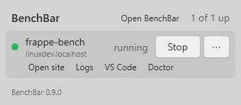
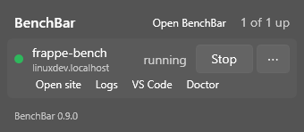
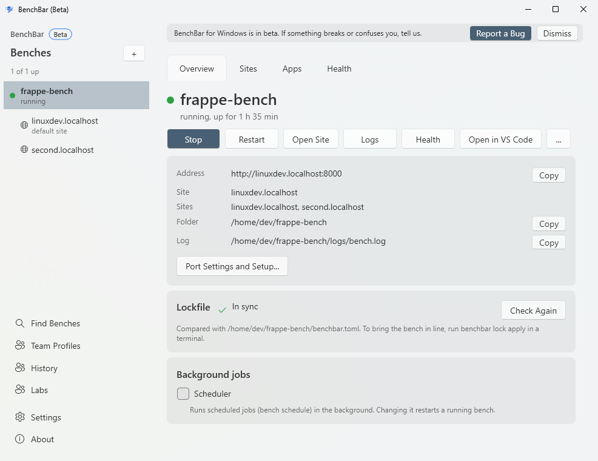
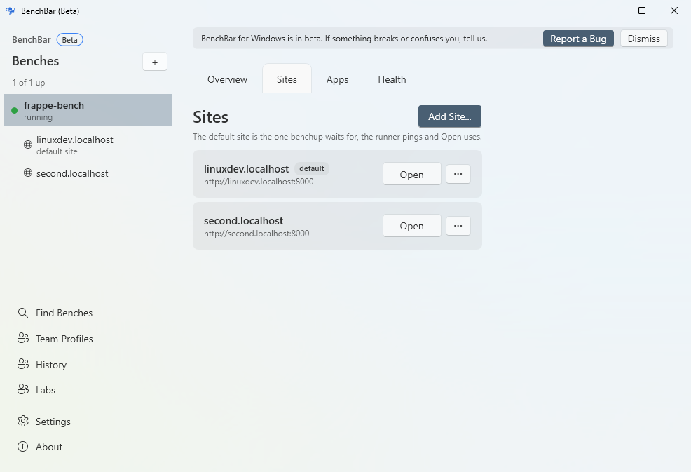

This page is the reference for the BenchBar tray. To install it, see
[Windows](windows.md).

## The tray



The runner in the notification area sleeps when the benches are stopped,
runs while one is up, stumbles when a bench crashes and holds a paused
pose when the crash guard paused it or its ports are taken. With
Windows animation effects off it shows still poses. It is tinted for a
light or a dark taskbar.

Left click opens the flyout, one row per bench:

- the state, the name and the default site, with **Start** or **Stop**,
  and **Restart** in the ⋯ menu;
- **Open site** in your default browser (see
  [`*.localhost` names](windows.md#localhost-names));
- **Logs**: the last lines of the bench log in a read only window, with
  Clear, Copy and Open in Terminal (Windows Terminal, which follows the
  log with `tail -f`);
- **VS Code**: the bench folder through the WSL extension
  (`code --remote wsl+DISTRO PATH`). Without `code` on PATH the row says
  how to get it;
- **Doctor**: the checks of `benchbar doctor` with their fix lines and a
  Copy button. It changes nothing.

Esc closes the flyout, Enter on a row opens the site.



Right click opens the menu: Open BenchBar, Settings, Open BenchBar at
logon (a shortcut in your Startup folder, no admin needed), Notifications,
Appearance (System, Light or Dark), Runner (the seven built in runners, as
on the Mac, and your own), Check for Updates, Help, Report a Bug and Quit.

### The BenchBar window

Open BenchBar (the tray menu, the button at the top of the flyout, or a
double click on the tray icon) opens the window. The sidebar lists your
benches with their sites, then Find Benches and Team Profiles, a **+**
menu (New Bench, I Already Have a Bench), and Settings and About at the
foot. A banner says when a newer release is out, and a beta banner stays
until you dismiss it once. Ctrl+N starts a new bench, Ctrl+, opens
Settings and F5 checks again.



A bench has four tabs:

- **Overview**: state, address and uptime, Start or Stop, Restart, Open
  Site, Logs, Health and **Open in <editor>**, and a line that says why a
  bench is stopped and what to do next. The Scheduler switch, the lockfile
  state, Port Settings and Setup, and Console and Database (in Windows
  Terminal) are here too.
- **Sites**: Add Site (the plan first, then the Administrator password
  goes to the CLI in its environment), Make Default, Back Up (with or
  without files), **Backups...**, **Restore...**, **Drop Site...** (type
  the site's name to confirm) and Open. Browsers open `*.localhost` names
  without a hosts line, so BenchBar never edits a hosts file (see
  [`*.localhost` names](windows.md#localhost-names)). **Allow Open as...** in a
  site's menu turns Open as on for that site, after the Mac app's question
  (it signs in as any user without a password, and each sign in is a real
  login that the apps' hooks and the Activity Log see). Turning it on is
  your decision: nothing in BenchBar does it for you, and **Turn Off Open
  as** needs no question. While it is on the site says "Open as is on", or
  why it cannot be used (developer mode off, not the default site, the bench
  stopped), and **Open as...** opens **Find User**: the site's enabled users,
  searched by name or email, each with **Open**, which opens the site in your
  Windows browser signed in as that user. `benchbar.exe` opens the browser
  itself, so the sign in link, which holds a session, never passes through
  the tray, a log or the screen. A site whose name Windows cannot find has no
  Open as. **Pin** in Find User keeps a user (nine at most per site,
  Administrator is always there) for Quick Switch.
- **Apps**: Add App (from a git URL, with a branch or a commit, and the
  sites to install it on; **Add Another App** puts several apps in one
  plan, each with its own branch, commit and sites, under one token),
  Update after the dry run, Install on a site, focus pins and Check
  Remotes. An app with local changes cannot be updated from the window.
- **Unfinished updates and adds**: when an `app update` or an `app add`
  stopped part way, the bench page shows a banner above the tabs with
  what stopped, why, the fix command and two buttons. **Finish Update**
  or **Finish Add** shows the plan of the same command, which lists only
  the steps left. **Discard** asks first, then runs
  `benchbar app update NAME --discard-pending`, which drops the record
  and runs nothing; it does not undo what already ran. The banner reads
  `pending_operations` of `benchbar.exe status --json`.
- **Health**: the doctor checks with the Windows setup checks, Copy fix,
  and Repair, which shows the plan first and asks for your Linux password
  once when a step uses sudo.



A fifth tab, **Sharing**, is there only while the **Share with people on
the same Wi-Fi** experiment (`lan-rooms`) is on in Labs. It is the host
side of a room, with the Mac app's words: **Set up sharing** (the people
who get a seat, the source of the copy, the plan sheet with what the copy
holds, and your tick that it holds real data), **Start sharing** for 1 to
12 hours after a question, **Stop**, **Extend**, **Lock room**, the room
code (hidden until you press **Show**), **Copy invite** and **New code**,
the checks, the copy and **Refresh copy**, and the people in the room with
**Remove**. Every one of those calls is made from your click and asks
first; nothing runs when the tab opens, it only reads. The room code and
the invite are read only on your click, kept in memory, never written to a
log and copied with a mark that keeps them out of the Windows clipboard
history. The network protection (`benchbar lan-guard install`, and
`allow-node`) is a button with its own question and runs only when you
press it; the tray never runs it by itself. Where the command line tool
has no network protection yet (Linux), the tab shows what `benchbar.exe`
says and nothing else. While the experiment says it is not on Windows yet
in Labs, the tab does not appear.

Start and Restart check the bench's ports first, from the window and from
the flyout. A port another program holds stops the start with the reason
and Review Port Conflict; BenchBar never stops that program.

The **...** menu of a bench's Overview shows a command only when the CLI
inside the distro lists it (`benchbar.exe commands --json`, asked once), so
an older CLI never gets a call it would refuse. **Start Services Only**
starts the bench's Redis and nothing else, for a restore or a migrate, on a
stopped bench (`up --services-only`); **Stop Services** puts it away
(`down`). **Install Service...** (or **Refresh Service...**) and the
Scheduler box show the plan of `benchbar service` first and run it with its
token only after your yes. **Write Lockfile...** and **Apply Lockfile...**
show the text of `lock write --dry-run` or `lock apply --dry-run` and run
`lock write --yes` or `lock apply --yes` only after your yes; the CLI has no
plan token for them yet, so a change between the preview and the yes is not
refused by a token. **Start again after Ubuntu restarts** is `autostart on`
and `off`. **Watch Assets in Terminal** and **Run in Foreground in
Terminal** open `benchbar watch` or `benchbar fg` in Windows Terminal inside
the distro; closing that window ends them. The tray does not run either one
as a child of its own: they have no way to be stopped from outside, and
ending `benchbar.exe` on Windows can leave `bench watch` running in the
distro. On the Health tab a warning has **Acknowledge** (`doctor --ack`),
which silences it for this bench until its message changes, and an
acknowledged one has **Undo Acknowledge**; nothing acknowledges by itself and
a failure has no button. On the New Bench page of the setup wizard the
warnings and failures of `doctor --prerequisites` for the folder are listed
with the fix to copy; they stop nothing, the plan on the Review page still
decides.

When an update changes a default (0.9.0 does: the bench listens on this
computer only, an option a command does not take is an error, `pull`
neutralises the copy), the CLI lists it in `status --json` as `notices[]`
and the window shows one banner for each above the tabs: what changed, the
command that switches it back, a link to the page that explains it, and
**Dismiss**, which runs `benchbar notices --dismiss ID`. Nothing dismisses a
notice but your click. Under the state line of a running bench the Overview
says **Ready**, **Needs restart (code changed)** or **Running, not ready**
from the `ready` object of `status --json`, with what the bench waits on
(the realtime server, Redis, the site, a worker), the Python file that
changed, and the CLI's own fix line with **Copy**. A CLI older than 0.9 sends
neither member, and the window shows neither.

When a command fails or is refused, the window shows the CLI's error and,
after it, the CLI's own hint (the fix) in one line, instead of the error
alone. A plan or a run that ends with next steps lists each command with
**Copy**. Every command's result is read by one decoder of the result
envelope (`docs/json-schema.md`), so the Sites, Apps, Health and plan pages
all show a failure the same way. A field a newer CLI adds, or one of an
unexpected type, is ignored and costs nothing else.

**Pull...** on the Sites tab copies a production site into a new site of the
bench (`benchbar pull`). Give `HOST:SITE`, where HOST is a Host of
`~/.ssh/config` inside Ubuntu and its key must work without a prompt, or tick
the box for a backup folder inside Ubuntu, and a name for the new site (the
name follows the server until you type over it; a name that is already a
site is refused, Pull never overwrites one). **Review Plan...** runs
`pull --dry-run --json` and shows the backup (name, size, age), whether the
site is created, the apps that differ from production, what the copy loses
and the steps; **Pull** then runs `pull --apply TOKEN --yes` with the token
from that plan, so a newer backup on the server or a changed app list
stops the run with nothing changed and asks for a fresh plan. A restore is
not stopped part way: **Stop Waiting** closes the sheet and the run goes on.
The copy is neutralised by default (integrations off, stored passwords
cleared except the Administrator's). **Keep production's passwords and
integrations** is off until you tick it, and ticking it says that the copy
can still reach the outside and that its scheduler and workers should stay
off. The button is offered when the CLI lists `pull` with `--apply`; the
tray does not add a hosts line, so a name that does not end in `.localhost`
shows a note. **Watch Assets in Terminal** and **Run in Foreground in
Terminal** (above) are the tray's `watch` and `fg`; **Logs** follows the log.

**Move to Another Bench...** in the menu of a site (offered when the CLI has
`site move` and another bench is registered; off for the default site) asks
which bench the site goes to, with **Skip migrate** as the one option, then
shows the plan of `site move --dry-run --json`: the steps, the apps, the new
address (the name stays, the port is the other bench's), what stays and any
error. A running bench shows **Stop Bench**, which stops it and reads the plan
again. **Move** stays off until you type the site name, and runs `--apply
TOKEN --yes` with the token of that plan, with the progress of each step and
the CLI's next steps at the end. A plan that changed in between asks you to
**Review Again**.

**Snapshots...** in the menu of a site (offered when the CLI has `site
snapshots` and `site rollback`) takes a snapshot of the site, with a label if
you like (`benchbar site snapshot`; nothing in the site changes), lists the
snapshots with their age, size and whether the bench's apps are still the
same, and has **Roll Back...** and **Remove...** on each. Roll Back asks you
to type the site name, then shows the plan of `site rollback --dry-run --json`
(a snapshot of the site as it is now is taken first, so the rollback can be
undone; migrate runs only when the apps differ) and runs `--apply TOKEN
--yes` with the token of that plan. The default site can be rolled back too,
as you, and the plan says so. Remove asks first and is never offered for the
undo point of the last rollback; that stays a Terminal command.

While an agent holds a lease on the bench or one of its sites, the Overview
says who holds it and until when (`benchbar lease list`). BenchBar never
takes, renews or releases a lease. A start, stop or restart, and an app
change, a restore or a rollback that a lease refuses, shows the holder and
until when and changes nothing. **Break Lease...** is your own choice: it
asks, then runs the same command again with `--break-lease`, which the CLI
allows only to a person, and the run is in the History. The Overview also
charts the CPU and memory of a running bench, with its process count and the
runner speed (`benchbar stats`), and lists the background operations of the
bench (`benchbar op list`). They are read every five seconds, only while
the Overview is on screen and the CLI has the command, and nothing runs
while the window is closed or another page is shown. **History** below the
benches lists what ran on this computer and changed something
(`benchbar history`), newest first: who started it (BenchBar, the tray,
Terminal, an agent through MCP, a script), how it ended and what it changed.
It is the CLI's record and read only; nothing there runs anything again.

**Run Bench Command...** in the More menu of the Overview (offered when the CLI
has `run`) runs one command of the allow list of `benchbar run`: `migrate`,
`clear-cache`, `clear-website-cache`, `build`, `run-tests` and the reads
`doctor`, `list-apps` and `version`, with the flags the command takes. A read
runs at once and shows its output. A change shows the plan of `run --dry-run
--json` (the exact command, what it touches, whether a backup comes first and
the deadline) and runs `--apply TOKEN --yes` with the token of that plan. The
output of a change is in the run's log, which the result shows.

**Tidy Up...**, **Forget Bench...**, **Remove Bench...** and **Remove Service...**
in the More menu of the Overview (each offered when the CLI lists its command)
are the end of a bench's life. **Tidy Up...** marks the bench scratch for 1 to 90
days (`bench scratch`) or not, lists the scratch benches that expired (`bench gc
--dry-run`, read when it opens) and the databases that no site of any bench
refers to (`db orphans`, which needs the MariaDB root password the CLI already
keeps). **Remove Expired...** shows the plan of `bench gc` and runs `--apply
TOKEN --yes` with that plan's token. **Forget Bench...** shows the plan of
`bench forget` (the folder, sites and databases stay); **Remove Bench...** asks
you to type the folder name, then shows the plan of `bench remove`: each site is
backed up and its database dropped, and the folder is moved to a trash folder
next to it, never deleted. **Remove Service...** is `uninstall-service` for that
one bench, never `--all`, after its dry run. The tray never drops an orphan
database: you drop one in Terminal after a backup.

**Quick Switch...** in the tray menu opens a small panel over any window:
Administrator, your pinned users and, when you type two letters or more,
the site's other users. Up, Down and Enter choose, **0** to **9** open a row
at once while the field is empty, and Esc closes it. It opens the site of a
running bench that has Open as on (a list picks the site when there are
several) in your browser signed in as that user, with the same
`benchbar.exe open --as` call as Find User, and says why when there is
nothing to open, for example that Open as is off for the site. The row of the
last user it opened this run says "last opened". It never turns Open as on.

A global shortcut is opt in: **Settings > General > Open Quick Switch with a
shortcut**. It is off until you turn it on, and the default is Ctrl+Alt+U.
Click the shortcut to record another one (Esc keeps the current one, and
**Reset** goes back to the default). A shortcut must contain Ctrl or Alt;
Ctrl with a letter or a digit needs Alt as well, so it never takes Ctrl+C,
Ctrl+V or another app's shortcut; Alt+F4 and Alt+Space are Windows'. If
another app holds the key, BenchBar keeps the old one and says so under the
row. The shortcut is given back to Windows when you turn it off and when
BenchBar quits, and it is paused while you record.

**Find Benches** scans a folder inside the distro (default your Linux
home), adds the benches it finds, sets up their ports and their
management. **Team Profiles** creates a profile from a bench, imports or
subscribes to one, exports, updates, checks access and removes. A Windows
file path for import or export is converted with `wslpath`.

**Labs** lists the experiments of `benchbar.exe labs list`, one row each,
with a switch, a warning, the version it came in and what it is. The
switch runs `benchbar.exe labs on NAME` or `labs off NAME`, the same calls
as **Settings > Labs** in the Mac app, so the state is the same in the
tray, in PowerShell and for an agent. Turning an experiment on is your
decision, and the click is it: the warning is on the row. An experiment
that does not list Linux among its platforms (the benches run in WSL)
stays off and says why; `benchbar labs list` shows each experiment's
platforms. Turning one off stops what it started.

The log window filters by process, searches, follows the log (while the
window is open), shows the previous log and opens `tail -f` in Windows
Terminal. Follow asks every 2 seconds while lines arrive and waits up to 10
seconds while none do. It asks nothing while the PC is locked or asleep or
the window is minimized, and catches up with one request when you are
back. In Windows battery saver it asks at most every 30 seconds. With
the bench running, the tray's own poll is 60 seconds instead of 30 on
battery. While the distro is up and every bench was stopped on the last
poll, the tray only asks Windows whether the distro runs (no `benchbar.exe`
call, which would keep WSL awake); it reads the benches again after an
unlock, an action or when the flyout opens, and at least every 20 minutes.

The tray reads the passwords of an install or an adopt (the Administrator
password, the Linux password for `sudo`) once and hands them to
`benchbar.exe` in its environment for that one run, because the command
line tool takes them from `ADMIN_PASSWORD`, `BENCHBAR_SUDO_PASSWORD` and
`MARIADB_ROOT_PASSWORD` and nowhere else. They are never on a command
line, in a file or in the tray's logs, and the output of the run is
cleaned of them. An install can last up to 90 minutes, so for that time the
values can be read by another program of your own user. The command line
tool can now take them on standard input (`--secrets-stdin`, which
`benchbar commands --json` lists); the tray moves to it in a later change.
Until then it uses the environment.

Settings: Open BenchBar at logon, notifications, check for updates when the window
opens, **Ask before a link acts** (see [benchbar:// links](#benchbar-links)), the distro (switching runs `benchbar.exe adopt-distro`), the editor
(VS Code, Cursor or VS Code Insiders), the command line tool's path, and
the tray's appearance and runner. About: the versions of the tray,
`benchbar.exe` and the CLI inside the distro, Check for Updates, Report a
Bug and the MCP line (`claude mcp add benchbar -- benchbar.exe mcp`, and the
same server as a JSON entry for Cursor, Claude Desktop and other clients),
each with **Copy**.

When a bench crashes, is paused by the crash guard or meets a port
conflict, the tray shows one Windows notification with the bench and
the command that fixes it. It does not repeat it until the state
changes again. The tray reads the pause the runner records in the bench's
`state.json` (the same record `benchbar status` shows), and the runner
inside the distro sends no desktop notification of its own in WSL, so
there is one notification, not two.

### When the distro is stopped

The tray asks WSL which distros run (`wsl.exe --list --running`), which
does not start one, and asks `benchbar.exe status` only while the distro
runs. A stopped distro shows the sleeping runner and a **Start** button
in the flyout, which starts `benchbar.exe keepalive run`. This keeps the
tray from waking a distro that WSL shut down after its idle time.

One keepalive runs at a time, for one distro. While it keeps one distro
awake, Start cannot start a second distro, and the tray says so. Switch
the distro in Settings, or stop the other keepalive first. This is a
limit of the beta.

A package update stops a running keepalive, and the task starts only at
logon. `benchbar.exe keepalive start` runs the installed task again when
its run process is not alive. It prints nothing and exits 0 when there is
no task or the run is alive, and it never creates or changes the task. The
tray calls it after an update.

### Settings

The tray keeps its settings under a `tray` key in
`%LOCALAPPDATA%\BenchBar\config.json`, the file `benchbar.exe` uses for
the distro. Custom runners go in `%LOCALAPPDATA%\BenchBar\runners\<id>\`,
in the format of [Custom runners](runners.md); the frames are scaled to
the notification area's square slot.

**Check for updates when the BenchBar window opens** is on by default.
When the window opens, the tray asks GitHub for the latest release, at
most every six hours, and shows a banner when a newer one is out. Turn it
off in Settings to stop those checks. Check for Updates in the menu and
About always asks GitHub, and asks before it opens the release page.

### benchbar:// links

The tray answers `benchbar://` links, so a launcher, a script or a
bookmark can start, stop and open a bench:

```powershell
Start-Process "benchbar://up?bench=frappe-bench"
```

The routes and the `bench=` and `site=` queries are the Mac app's: `up`,
`down`, `restart`, `open`, `logs`, `window`, `doctor`, `console`, `db`
and `editor`, plus the two profile links. They are listed in the
[URL scheme](reference/url-scheme.md) page. On Windows `bench=` takes a
name or the Linux path of the bench (`/home/you/frappe-bench`, or
`~/frappe-bench` for a bench in your home folder in the distro).
`console` and `db` open Windows Terminal inside the distro, like the
More menu of a bench.

The tray registers the scheme for your user (under
`HKEY_CURRENT_USER\Software\Classes\benchbar`, so no administrator
rights) the first time it starts, and the installer writes the same
values. Uninstalling removes them. If another program already owns
`benchbar://` (for you or for the whole PC), or another copy of
`BenchBarTray.exe` that is still there does, the tray leaves it alone, and
so does the installer. A registration of a copy that is gone is replaced.

If the tray is running, a second start with a link hands the link to it
and quits; if not, the link starts the tray first and the link waits for
its first look at your benches. A link that is not one of the routes, or
is not well formed, does nothing and is logged by its action only (or a
short hash), never with the bench, the site or the address it carried.
A link that holds a double quote, a backslash or one of `^ | < >` is
ignored too; a real link writes those as `%22`, `%5C` and so on.

Any web page can open a `benchbar://` link, and a browser can remember
"always allow". **Settings > Ask before a link acts** makes the tray ask
first for `up`, `down`, `restart`, `console` and `db`, with Cancel as the
default. It is off by default, so launchers and scripts keep working.

Share links (`benchbar://share/...`) are not acted on by the tray yet: it
shows a short note and does nothing else. In a WSL terminal, `benchbar share
join` joins the room (see [Join a room from a terminal](guides/share-on-your-network.md#join-a-room-from-a-terminal)).

### What it costs

At rest the tray polls `benchbar.exe status` every 30 seconds while a
bench runs and backs off to every 5 minutes when nothing is up. It
starts nothing at all while the computer sleeps or is locked.

Measured on a Ryzen 7 6800H laptop: about 17 MB of private memory and
under 0.1 percent of one core at rest, 0.6 percent while the runner
runs. Once the flyout has been open, WPF keeps its graphics stack
loaded and the tray stays at about 43 MB.
