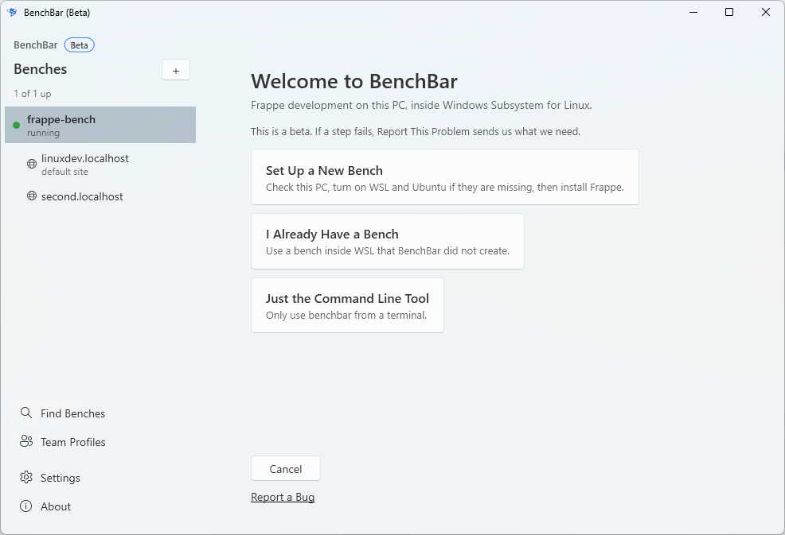
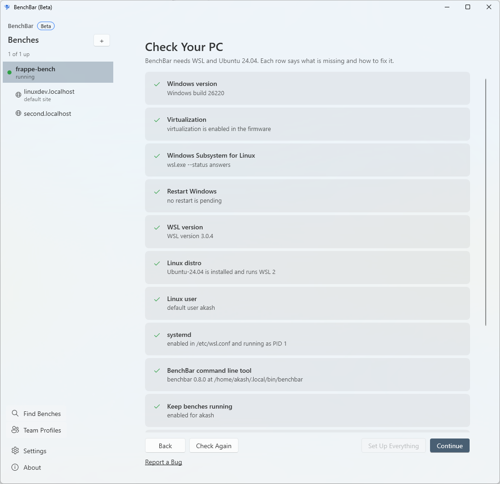
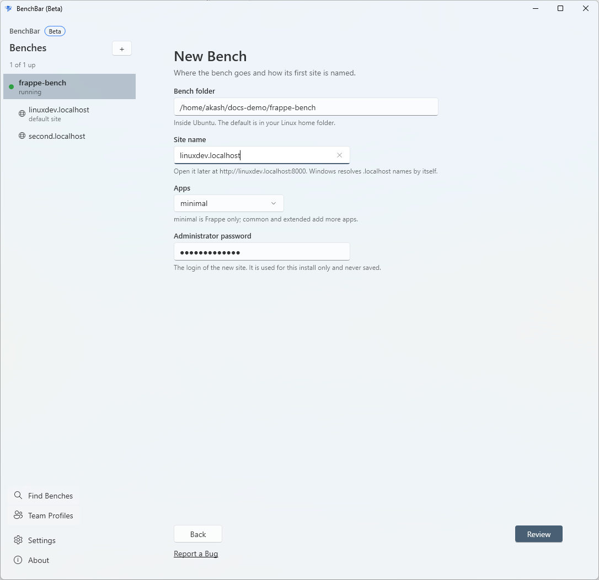
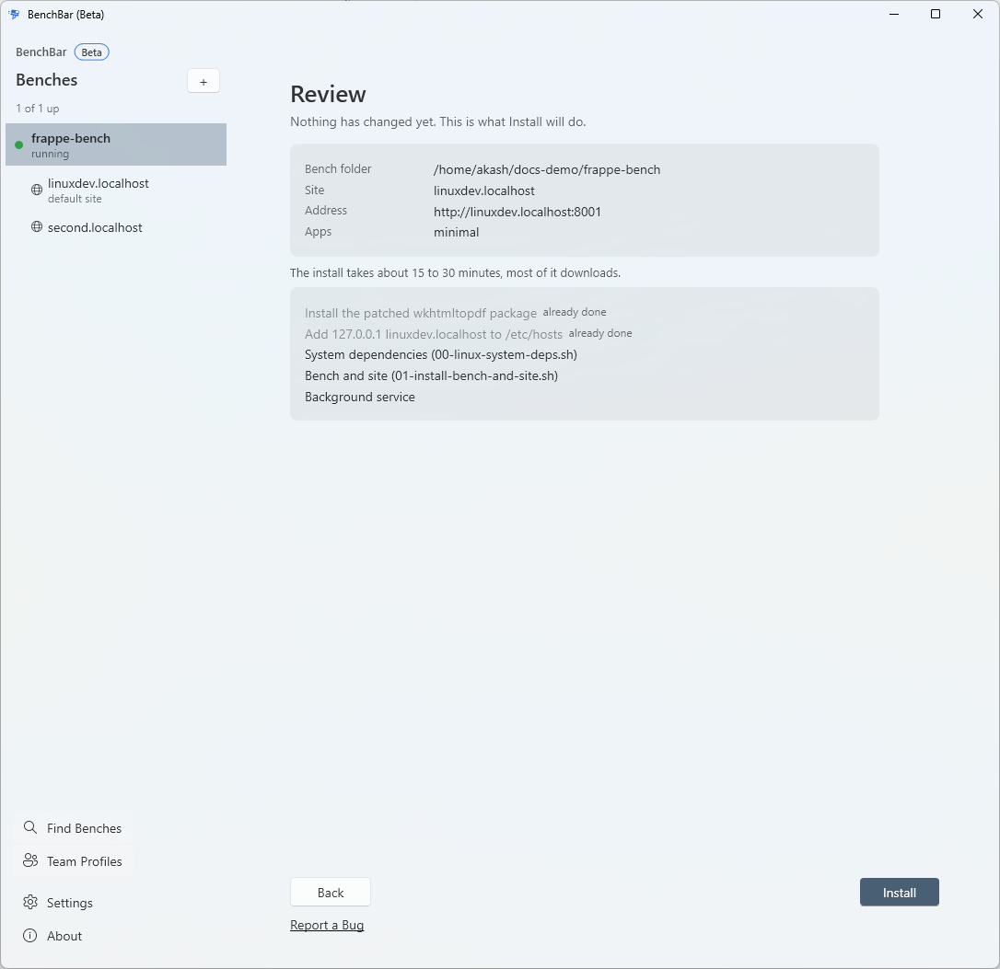
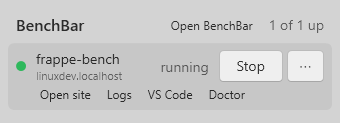
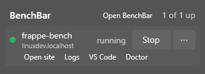
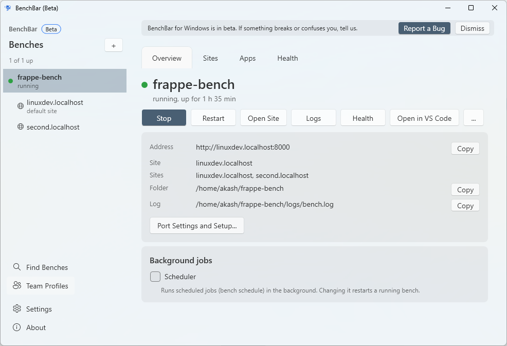
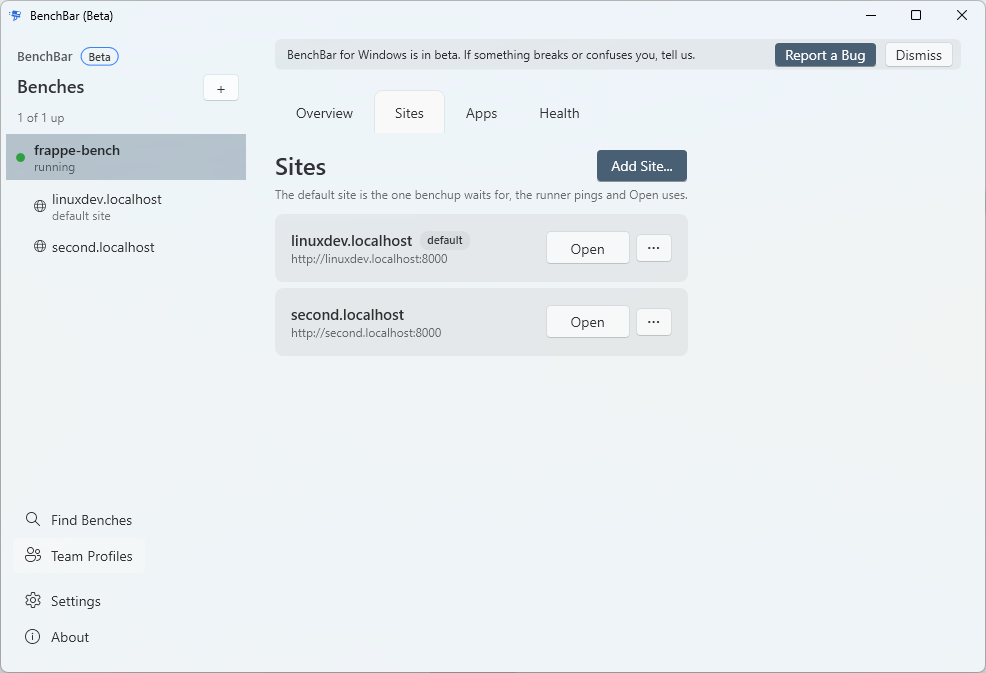

On Windows, benches run inside WSL 2, never on Windows itself. Two small
programs bring them to the Windows side:

- `benchbar.exe`, the shim: every command forwards to `benchbar` inside
  the distro, so `benchbar.exe status`, `up`, `down` and `doctor` work
  from PowerShell.
- BenchBar Tray, a notification area app: the runner shows the state of
  your benches, and a click opens them.

BenchBar for Windows is in beta. It works, and you may find rough edges.
The tray and the window say so: a **Beta** pill, the window title
"BenchBar (Beta)" and a banner that you can dismiss. Both programs are
not signed yet. On our Windows 11 test PC (Smart App Control off) the one
line installer needed no click through a warning. Smart App Control, when
it is on, blocks unsigned programs: see
[Before you install](#before-you-install) and
[Signing and verification](#signing-and-verification).

## What you need

- Windows 11, or Windows 10 version 22H2 (build 19045) or later, with
  virtualization on in the firmware.
- Smart App Control off (see [Smart App Control](#smart-app-control)).
- For the tray: the .NET 10 Desktop Runtime. The installer offers to
  install it with `winget`
  (`winget install --id Microsoft.DotNet.DesktopRuntime.10 -e`).

Everything else the first run wizard sets up for you (see
[First run](#first-run)): WSL 2, Ubuntu 24.04 with systemd, your Linux
user, `benchbar` inside the distro, linger, the keepalive task and
`benchbar.exe` on your PATH. To do it by hand instead, see
[Set up from PowerShell](#set-up-from-powershell).

## Before you install

What Windows may show depends on how the files reach your PC. The one
line installer is the quiet route. A zip you download yourself is
marked by Windows as "from the internet", and that mark brings dialogs.

| Route | What Windows may show | What to do |
| --- | --- | --- |
| One line installer (`irm ... \| iex`) | On our Windows 11 test PC (one PC, Smart App Control off): nothing. No SmartScreen dialog, no Defender block and no administrator prompt. The files it writes carry no internet mark, and starting them shows no dialog. | Nothing. |
| Zip, started with `.\install.ps1` | With the default execution policy: "cannot be loaded because running scripts is disabled on this system". `Unblock-File` does not change that. | Start it with `powershell -ExecutionPolicy Bypass -File .\install.ps1`. |
| Zip saved by a browser | Edge saves it without a warning, but marks it as downloaded (`Zone.Identifier`, ZoneId 3). Extract All in Explorer marks every file in it. `Expand-Archive` marks none. | Nothing, if you run the installer from the zip. It removes the mark from the files it installs. |
| Starting a marked program yourself | "Open File - Security Warning: The publisher could not be verified. Are you sure you want to run this software?" with **Run** and **Cancel**. The dialog can open behind other windows. | Click **Run**. If nothing seems to happen, look for a flashing icon in the taskbar. |
| The tray without the .NET runtime | Microsoft's dialog "You must install .NET Desktop Runtime to run this application." | Install the runtime: see [If Windows blocks it](#if-windows-blocks-it). |

The installer removes the internet mark from every file it installs, for
every route, so the programs in the install folder start without the
Open File dialog. It checks every file against `SHA256SUMS` first.

### Smart App Control

Smart App Control is a Windows 11 feature. When it is on, it blocks
programs that are not signed and have no known reputation, and it has no
exception for one program. BenchBar is not signed yet, so with Smart App
Control on, Windows blocks `benchbar.exe` and BenchBar Tray.

To check: open Windows Security, then **App & browser control**, then
**Smart App Control**. It says **On**, **Evaluation** or **Off**.

What the installer does:

- **On**: it stops before it downloads or writes anything, says what
  Smart App Control is and that BenchBar is not signed yet, and links
  here.
- **Evaluation**: it warns and goes on. Windows may turn Smart App
  Control on later and block BenchBar then.
- **Off**, or a Windows without it: it goes on.

To use BenchBar while it is on, you have to turn it off in Windows
Security > App & browser control > Smart App Control settings. On some
versions of Windows you cannot turn it back on without resetting Windows.
Think about that first.

The installer also stops early when PowerShell runs in Constrained
Language Mode, which a company policy can set. Ask whoever manages the PC.

## First run

When BenchBar Tray starts and finds no bench, it opens the BenchBar
window at Welcome: **Set Up a New Bench**, **I Already Have a Bench** or
**Just the Command Line Tool**. **+** > New Bench opens it again later.
The command line tool step runs the
[Linux installer](install.md#the-installer-on-linux) of the same release
as `benchbar.exe` inside the distro (`install.sh` from the `v<version>`
tag, with `--version v<version>`); a development build uses `main`. To
do it by hand, run in Ubuntu:
`curl -fsSL https://raw.githubusercontent.com/askysh/benchbar/main/install.sh | bash`.



1. **Check Your PC** lists every step with its state and a button to fix
   it: Windows version, virtualization, WSL, a pending restart, WSL
   version, the distro, the Linux user, systemd, the command line tool,
   linger, keepalive, the WSL idle settings and PATH. **Set Up
   Everything** runs the missing steps in order.
2. Turning on WSL is the only step that needs administrator rights. It
   has a shield on its button, and Windows asks for permission once. If
   you say no, nothing changes and you can try again.
3. When Windows needs a restart, **Restart Now** asks first, restarts in
   15 seconds (`shutdown /a` cancels it) and opens the wizard where it
   was when you sign in again.
4. **Linux User**: the name and password of your user in Ubuntu. The
   password is used to create the user and later for the `sudo` steps of
   the install, and is never stored.
5. **New Bench**: the folder (default `~/frappe-bench`), the site and the
   Administrator password; **Review** shows the plan of
   `benchbar install --dry-run`, with the steps that use sudo marked.
6. **Install** streams every step. Stop, Retry and Open Log are there;
   when MariaDB already has a root password BenchBar does not know, a
   field asks for it.
7. **Done**: Open Site, notifications, Open BenchBar at logon, and the
   `claude mcp add benchbar -- benchbar.exe mcp` line to copy.

Some rows in Check Your PC are advice: linger, keepalive, the WSL idle
settings and PATH. They never block **Continue**. The other rows must be
ok first.



For a distro whose user the wizard did not create, BenchBar asks for
your Linux password right before the steps that use sudo.





Every wizard page has a **Report a Bug** button in its footer, and a
failed step has **Report This Problem** next to it. See
[Report a bug](#report-a-bug).

## Set up from PowerShell

The wizard runs these, and you can too:

```powershell
benchbar.exe setup check --json            # every step, read only
benchbar.exe setup check --json --probe    # also starts a stopped distro to check inside it
benchbar.exe setup run distro_install --jsonl
```

`setup run` takes one action at a time: `wsl_enable` (asks Windows for
permission), `wsl_update`, `distro_install`, `distro_wsl2` (converts a
distro that runs as WSL 1 to WSL 2; it stops that distro), `distro_user`
(the password in `BENCHBAR_SETUP_PASSWORD`), `systemd`, `cli_install`
(installs the command line tool in the distro, or updates an older one), `linger`,
`keepalive`, `wslconfig` and `path`. With `--jsonl` it prints only JSON
lines, and ends with one `done` line (`exit`, `changed`, `reboot_required`,
`cancelled`, `warnings`, `next_actions`). `setup` never runs `wsl --shutdown` or
`--unregister`; `systemd`, `distro_user` and `distro_wsl2` stop only that one distro.

The older commands still work: `benchbar.exe path install`,
`benchbar.exe adopt-distro`, `benchbar.exe keepalive install` and
`benchbar.exe wslconfig --apply --yes`.

## Install

In PowerShell, as yourself (no administrator rights):

```powershell
irm https://raw.githubusercontent.com/askysh/benchbar/main/install.ps1 | iex
```

The installer checks this PC first (the CPU, PowerShell's language mode
and [Smart App Control](#smart-app-control)), then looks at the GitHub
releases for the newest published one that has a Windows zip for your CPU
(x64 or Arm64). It checks the zip against the release's
`benchbar-windows-<version>-SHA256SUMS.txt` and installs it to
`%LOCALAPPDATA%\Programs\BenchBar`. Then it:

1. removes the internet mark from the installed files;
2. puts that folder on your user PATH (`benchbar.exe path install`);
3. checks the .NET 10 Desktop Runtime and, when `winget` is there, offers
   to install it (Windows asks for permission);
4. makes a Start menu shortcut named BenchBar, and offers a Startup
   shortcut so the tray opens at logon;
5. runs `benchbar.exe doctor`;
6. starts the tray, which opens the setup, and prints what to do next.

The tray is not started when the .NET runtime is still missing, and the
installer says why. It writes nothing inside a WSL distro; the final
doctor starts the distro if it is stopped. It uses your Windows proxy
settings, with your Windows sign in, for its downloads. When GitHub's API
says too many requests, it falls back to the release page, which needs no
API call.

After it finishes, find BenchBar in the Start menu, or as the tray icon
near the clock. Windows may hide that icon under the ^ arrow. In a
terminal, `benchbar.exe setup check` shows what is ready.

Run as a file it takes `-Version X.Y.Z` (a given release), `-NoTray`
(only `benchbar.exe`: no runtime check, no shortcuts, no tray), `-Yes` (no
questions), `-Zip PATH` (a zip you downloaded) and `-Uninstall`. To pass
them without saving a file, run the script as a script block, which sets
nothing in your session:

```powershell
& ([scriptblock]::Create((irm https://raw.githubusercontent.com/askysh/benchbar/main/install.ps1))) -Version X.Y.Z
```

Piped into `iex`, set `BENCHBAR_VERSION`, `BENCHBAR_NO_TRAY=1`,
`BENCHBAR_YES=1`, `BENCHBAR_ZIP=PATH` or `BENCHBAR_UNINSTALL=1` first.
These variables stay set in that PowerShell window, so remove them
afterwards (for example `Remove-Item Env:BENCHBAR_VERSION`).

To run it as a file, download `install.ps1` and start it with
`powershell -ExecutionPolicy Bypass -File .\install.ps1 ...`. The default
execution policy refuses a script file, and `Unblock-File` does not
change that.

Without the script: download `benchbar-windows-<version>-amd64.zip` (or
`-arm64.zip`) from the [releases](https://github.com/askysh/benchbar/releases),
check it (see [Verify a download](#verify-a-download)), unpack it into a
folder of your choice and run `benchbar.exe path install` from there.

### A test build you were sent

Every zip carries `install.ps1`, so a build that is not on a release
installs the same way, from its own folder:

1. Unpack the whole zip (right click, Extract All) into a new folder, for
   example in Downloads. `benchbar-windows-<version>-amd64.zip` is for
   Intel and AMD PCs, `-arm64.zip` for Arm PCs.
2. Open PowerShell in that folder and run:

   ```powershell
   powershell -ExecutionPolicy Bypass -File .\install.ps1
   ```

It checks every file against the `SHA256SUMS` in the zip, installs to
`%LOCALAPPDATA%\Programs\BenchBar` as above, and ends with
`benchbar.exe doctor`. To keep the zip unpacked, pass it instead:
`.\install.ps1 -Zip .\benchbar-windows-<version>-amd64.zip`. A checksums
file next to the zip is checked too when there is one.

Extract All in Explorer marks every file as downloaded. The installer
removes that mark from the copies it installs, so the programs start
without a dialog. Start a program from the unpacked folder yourself, and
Windows shows the Open File dialog (see [Before you install](#before-you-install)).

### Verify a download

Each release has `benchbar-windows-<version>-SHA256SUMS.txt`. Compare it
with the zip:

```powershell
(Get-FileHash .\benchbar-windows-<version>-amd64.zip -Algorithm SHA256).Hash
```

The installer does this for you. Releases after 0.8.2 also carry a build
provenance attestation, made by the release workflow. It proves that the
zip was built from this repository by GitHub Actions. With the
[GitHub CLI](https://cli.github.com):

```powershell
gh attestation verify benchbar-windows-<version>-amd64.zip -R askysh/benchbar
```

## If Windows blocks it

**Smart App Control** says BenchBar is blocked, or the installer stops
with "Smart App Control is on". See [Smart App Control](#smart-app-control).

**"Open File - Security Warning: The publisher could not be verified."**
The file carries an internet mark, for example because you started a
program from an unpacked zip. Click **Run**. The dialog can open behind
other windows. The installer removes the mark from what it installs, so
you should not see this for the installed programs. If you do, run the
installer again, or run
`Get-ChildItem "$env:LOCALAPPDATA\Programs\BenchBar" -Recurse | Unblock-File`.

**Microsoft Defender or another antivirus removes a file**, or the
installer says a file "contains a virus or potentially unwanted software"
(error 0x800700E1). BenchBar is not malware, but a new program without a
signature is sometimes flagged by mistake. On our Windows 11 test PC,
Defender scans of the zip and the install folder were clean, and Defender
sent `benchbar.exe` to Microsoft for cloud analysis once.

1. Open Windows Security > Virus & threat protection > **Protection
   history**.
2. Find the BenchBar item, choose **Actions**, then **Allow on device**.
3. Run the installer again.

To tell Microsoft it is a false positive, send the file at
<https://www.microsoft.com/wdsi/filesubmission>.

**"You must install .NET Desktop Runtime to run this application."**
BenchBar Tray needs the .NET 10 Desktop Runtime, and this dialog is
Microsoft's. Install it, then start BenchBar again:

```powershell
winget install --id Microsoft.DotNet.DesktopRuntime.10 -e
```

Without `winget`, download the **.NET 10 Desktop Runtime** (x64 or Arm64,
like your PC) from <https://dotnet.microsoft.com/download/dotnet/10.0>.
The installer offers to run the `winget` line and does not start the
tray while the runtime is missing.

## Signing and verification

The Windows programs (`benchbar.exe`, `BenchBarTray.exe` and the tray's
own DLLs) are not signed yet. In practice that means: Smart App Control
blocks them, and a program you start from an unpacked zip shows the "Open
File - Security Warning" dialog. See [Before you install](#before-you-install)
for what to expect on each route.

You can still check what you download:

- Every release has `benchbar-windows-<version>-SHA256SUMS.txt`, and every
  zip holds a `SHA256SUMS` file. The installer checks them.
- From the next release on, each zip also has a build provenance
  attestation that you can verify. See [Verify a download](#verify-a-download).
- Check a signature in PowerShell:
  `Get-AuthenticodeSignature "$env:LOCALAPPDATA\Programs\BenchBar\benchbar.exe"`
  shows `NotSigned` today.

Privacy: neither program sends data anywhere except to GitHub's release
list, for the update check described under [Settings](#settings). Report
a Bug writes its zip on your PC, and sends nothing until you post the
issue yourself.

## The tray



The runner in the notification area sleeps when the benches are stopped,
runs while one is up, stumbles when a bench crashes and holds a paused
pose when the crash guard paused it or its ports are taken. With
Windows animation effects off it shows still poses. It is tinted for a
light or a dark taskbar.

Left click opens the flyout, one row per bench:

- the state, the name and the default site, with **Start** or **Stop**,
  and **Restart** in the ⋯ menu;
- **Open site** in your default browser (see
  [`*.localhost` names](#localhost-names));
- **Logs**: the last lines of the bench log in a read only window, with
  Clear, Copy and Open in Terminal (Windows Terminal, which follows the
  log with `tail -f`);
- **VS Code**: the bench folder through the WSL extension
  (`code --remote wsl+DISTRO PATH`). Without `code` on PATH the row says
  how to get it;
- **Doctor**: the checks of `benchbar doctor` with their fix lines and a
  Copy button. It changes nothing.

Esc closes the flyout, Enter on a row opens the site.



Right click opens the menu: Open BenchBar, Settings, Open BenchBar at
logon (a shortcut in your Startup folder, no admin needed), Notifications,
Appearance (System, Light or Dark), Runner (the seven built in runners, as
on the Mac, and your own), Check for Updates, Help, Report a Bug and Quit.

### The BenchBar window

Open BenchBar (the tray menu, the button at the top of the flyout, or a
double click on the tray icon) opens the window. The sidebar lists your
benches with their sites, then Find Benches and Team Profiles, a **+**
menu (New Bench, I Already Have a Bench), and Settings and About at the
foot. A banner says when a newer release is out, and a beta banner stays
until you dismiss it once. Ctrl+N starts a new bench, Ctrl+, opens
Settings and F5 checks again.



A bench has four tabs:

- **Overview**: state, address and uptime, Start or Stop, Restart, Open
  Site, Logs, Health and **Open in <editor>**, and a line that says why a
  bench is stopped and what to do next. The Scheduler switch, the lockfile
  state, Port Settings and Setup, and Console and Database (in Windows
  Terminal) are here too.
- **Sites**: Add Site (the plan first, then the Administrator password
  goes to the CLI in its environment), Make Default, Back Up (with or
  without files), **Backups...**, **Restore...**, **Drop Site...** (type
  the site's name to confirm) and Open. Browsers open `*.localhost` names
  without a hosts line, so BenchBar never edits a hosts file (see
  [`*.localhost` names](#localhost-names)).
- **Apps**: Add App (from a git URL, with a branch or a commit, and the
  sites to install it on), Update after the dry run, Install on a site,
  focus pins and Check Remotes. An app with local changes cannot be
  updated from the window.
- **Health**: the doctor checks with the Windows setup checks, Copy fix,
  and Repair, which shows the plan first and asks for your Linux password
  once when a step uses sudo.



Start and Restart check the bench's ports first, from the window and from
the flyout. A port another program holds stops the start with the reason
and Review Port Conflict; BenchBar never stops that program.

**Find Benches** scans a folder inside the distro (default your Linux
home), adds the benches it finds, sets up their ports and their
management. **Team Profiles** creates a profile from a bench, imports or
subscribes to one, exports, updates, checks access and removes. A Windows
file path for import or export is converted with `wslpath`.

The log window filters by process, searches, follows the log (while the
window is open), shows the previous log and opens `tail -f` in Windows
Terminal.

Settings: Open BenchBar at logon, notifications, check for updates when the window
opens, the distro (switching runs `benchbar.exe adopt-distro`), the editor
(VS Code, Cursor or VS Code Insiders), the command line tool's path, and
the tray's appearance and runner. About: the versions of the tray,
`benchbar.exe` and the CLI inside the distro, Check for Updates, Report a
Bug and the MCP line.

When a bench crashes, is paused by the crash guard or meets a port
conflict, the tray shows one Windows notification with the bench and
the command that fixes it. It does not repeat it until the state
changes again.

### When the distro is stopped

The tray asks WSL which distros run (`wsl.exe --list --running`), which
does not start one, and asks `benchbar.exe status` only while the distro
runs. A stopped distro shows the sleeping runner and a **Start** button
in the flyout, which starts `benchbar.exe keepalive run`. This keeps the
tray from waking a distro that WSL shut down after its idle time.

One keepalive runs at a time, for one distro. While it keeps one distro
awake, Start cannot start a second distro, and the tray says so. Switch
the distro in Settings, or stop the other keepalive first. This is a
limit of the beta.

### Settings

The tray keeps its settings under a `tray` key in
`%LOCALAPPDATA%\BenchBar\config.json`, the file `benchbar.exe` uses for
the distro. Custom runners go in `%LOCALAPPDATA%\BenchBar\runners\<id>\`,
in the format of [Custom runners](runners.md); the frames are scaled to
the notification area's square slot.

**Check for updates when the BenchBar window opens** is on by default.
When the window opens, the tray asks GitHub for the latest release, at
most every six hours, and shows a banner when a newer one is out. Turn it
off in Settings to stop those checks. Check for Updates in the menu and
About always asks GitHub, and asks before it opens the release page.

### What it costs

At rest the tray polls `benchbar.exe status` every 30 seconds while a
bench runs and backs off to every 5 minutes when nothing is up. It
starts nothing at all while the computer sleeps or is locked.

Measured on a Ryzen 7 6800H laptop: about 17 MB of private memory and
under 0.1 percent of one core at rest, 0.6 percent while the runner
runs. Once the flyout has been open, WPF keeps its graphics stack
loaded and the tray stays at about 43 MB.

## Report a bug

Report a Bug is in the tray menu, in About, in the beta banner, in the
footer of every wizard page, and next to each failed step (Report This
Problem). All of them do the same thing:

1. They run `benchbar.exe report-windows --json`. It writes a redacted
   zip to `%LOCALAPPDATA%\BenchBar\reports` and keeps the newest 10.
2. A small window says that the report is ready. It selects the zip in
   Explorer and opens a GitHub issue with the Windows bug form filled in
   (versions, Windows edition, distro and what you did). Show Zip and
   Open Issue do this again, and Copy Path copies the zip path.
3. Drag the zip from Explorer into the last box of the form, say what
   happened, and submit.

The zip holds the versions, the Windows edition and build, the WSL status
and distro list, the setup check (run without starting a distro) and,
when the distro runs, the CLI's own report. User names and home paths
become `<user>`, and it holds no passwords. The full list is in
[windows/shim/README.md](https://github.com/askysh/benchbar/blob/main/windows/shim/README.md#bug-report-zip).

Report a Bug works with no WSL, with a stopped distro (it never starts
one) and with no CLI installed. If `benchbar.exe` cannot start, the tray
writes a smaller zip with its own log only.

For a security problem, do not use the form. See
[SECURITY.md](https://github.com/askysh/benchbar/blob/main/SECURITY.md).

## Update

Run the one line installer again. It finds the newest release that has a
Windows zip, closes the tray (it asks the tray to close first), replaces
the files, removes files the new version no longer has, and starts the
tray again. Your settings and benches stay as they are.

The installer updates `benchbar.exe` and the tray. It does not change
anything inside the distro. The setup check tells you when the command
line tool in the distro is older than `benchbar.exe` and offers to update
it. Run `benchbar.exe setup check`, or open the tray's setup. To update it
yourself, run `benchbar.exe setup run cli_install`. The tray
does not update itself: Check for Updates asks, then opens the release
page.

## Uninstall

Uninstalling BenchBar for Windows removes the two programs and what
belongs to them. It keeps WSL, the distro and your benches.

```powershell
powershell -ExecutionPolicy Bypass -File .\install.ps1 -Uninstall
```

Run it from a copy of `install.ps1` (a zip carries one, and so does the
install folder of a full install), or through the one line installer with
`$env:BENCHBAR_UNINSTALL = '1'` set first. It asks once, and `-Yes` skips
the question. With no terminal to answer on (input is redirected) and no
`-Yes`, the answer is no and nothing is removed: add `-Yes` (or set
`BENCHBAR_YES=1`) to confirm. Then it:

1. closes the tray;
2. removes the keepalive task (`benchbar.exe keepalive remove`);
3. removes the Start menu shortcut, the Startup shortcut and the setup
   resume shortcut. It removes only a `.lnk` file in the Start menu, the
   Startup folder or the install folder that points to the installed tray
   app; any other shortcut stays;
4. removes the install folder from your user PATH;
5. removes the files it installed (the list is `.installed-files.txt` in
   the install folder) and the folder, when it is empty.

It never touches WSL, your distro, your benches or
`%USERPROFILE%\.wslconfig`. Your settings, runners and reports stay in
`%LOCALAPPDATA%\BenchBar`. Delete that folder too when you no longer want
them.

To do it by hand instead:

1. Run `benchbar.exe keepalive remove` while `benchbar.exe` is still
   there. It removes the keepalive task.
2. Quit the tray from its right click menu.
3. Delete the **BenchBar Tray** shortcut in your Startup folder (open it
   with Run, `shell:startup`), the **BenchBar Setup Resume** shortcut if
   there is one, and the **BenchBar** shortcut in the Start menu (Run,
   `shell:programs`).
4. Remove `%LOCALAPPDATA%\Programs\BenchBar` from your user PATH: run
   `benchbar.exe path remove` while `benchbar.exe` is still there, or open
   Environment Variables (search for it in Start), edit the user `Path`
   and delete the entry for that folder.
5. Delete the folder `%LOCALAPPDATA%\Programs\BenchBar`.

### Removing the distro

To remove the Linux distro as well, run this in PowerShell:

```powershell
wsl --unregister Ubuntu-24.04
```

Warning: this deletes everything inside the distro, including every bench,
site and database in it, and it cannot be undone. Copy what you need out
of the distro first. `wsl --list --verbose` shows the distro names.

## `*.localhost` names

A site on a `*.localhost` name (for example `mysite.localhost:8000`)
opens in Edge, Chrome and `curl.exe` on Windows, because WSL forwards
`localhost` to the distro. PowerShell's `Invoke-WebRequest`, `ping` and the
Windows resolver do not resolve such a name. In PowerShell, use
`curl.exe`, with the `.exe`, because `curl` is an alias of
`Invoke-WebRequest` there:

```powershell
curl.exe http://mysite.localhost:8000
curl.exe -H "Host: mysite.localhost" http://localhost:8000
```

The second line asks `localhost` for the site by its name, which is the
same request.

If you set `localhostForwarding=false` under `[wsl2]` in
`%USERPROFILE%\.wslconfig`, Windows cannot reach any bench at all. Remove
the line, or set it to `true`, and restart WSL (`wsl --shutdown` stops
every distro, so stop your benches first).

## Troubleshooting

- **Docker Desktop is the default distro.** `wsl --list` can show
  `docker-desktop` as the default. BenchBar skips it, and the other tool
  distros that Docker Desktop, Rancher Desktop and Podman add, and uses
  your Ubuntu. Choose another distro in Settings, or run
  `benchbar.exe adopt-distro`.
- **The distro runs as WSL 1.** Benches need WSL 2. The setup check says
  so. Run `benchbar.exe setup run distro_wsl2` to convert it. It stops
  that distro, so stop your benches first.
- **The distro is not Ubuntu 24.04.** Only Ubuntu 24.04 is supported. The
  setup check says so. Install it next to the other one with
  `wsl --install -d Ubuntu-24.04` and choose it with
  `benchbar.exe adopt-distro`.
- **A Windows path as an argument.** `benchbar.exe adopt C:\Users\you\bench`
  is accepted as a path: the shim turns a drive path such as `C:\...` into
  `/mnt/c/...`, and a `\\wsl.localhost\Ubuntu-24.04\...` path of the same
  distro into its Linux path. But `adopt` and `install` refuse a bench on
  the Windows file system (error `bench_on_windows_fs`), because it is
  slow and file watching does not work there. Keep benches in the distro's
  own file system, under your Linux home. If you accept the problems,
  `--allow-windows-fs` overrides the refusal.
- **The tray does not open at logon.** The tray's **Open BenchBar at
  logon** makes a shortcut in your Startup folder. Windows can switch a Startup
  entry off in Settings > Apps > Startup. Turn **BenchBar Tray** on there.
- **The PC went to sleep during the setup.** Sleep, or a closed lid, stops
  the steps that run inside WSL. Keep the PC awake (Settings > System >
  Power) until the wizard says Done. Every step can be run again, so
  start **Set Up Everything** again.

## What the tray does not do

- It does not update itself. Check for Updates asks, then opens the
  release page.
- It has no `benchbar://` links yet, and no CPU source for the runner, so
  the runner runs at one speed. Team Profiles copies a
  `benchbar://profile/import` link for a team chat, but Windows has no
  handler for that address yet, so the link does not open BenchBar.
- It never reads files inside the distro: every fact comes from
  `benchbar.exe`.
- It has no Open as menu yet. From PowerShell, `benchbar.exe site open-as on
  NAME` turns it on for a site (it asks first), then `benchbar.exe open --as
  USER` opens the site signed in as that user in your Windows browser. The
  site needs a `*.localhost` name, which the Windows browser reaches without
  a hosts line (see [`*.localhost` names](#localhost-names)). See [benchbar open](reference/cli/other.md).
- It cannot join a room. Rooms (`benchbar share`) are Mac only for now:
  WSL 2 does not expose a port to the Wi-Fi by default and Windows has no
  pf.

## Labs

Labs work the same on Windows. `benchbar.exe labs list` shows them, and the
ones that are not on Windows yet say so. `benchbar.exe labs on NAME` asks
first in PowerShell. Turning one on is a person's decision, so an agent with
`BENCHBAR_NONINTERACTIVE=1` is refused. See
[labs](reference/cli/labs.md).
