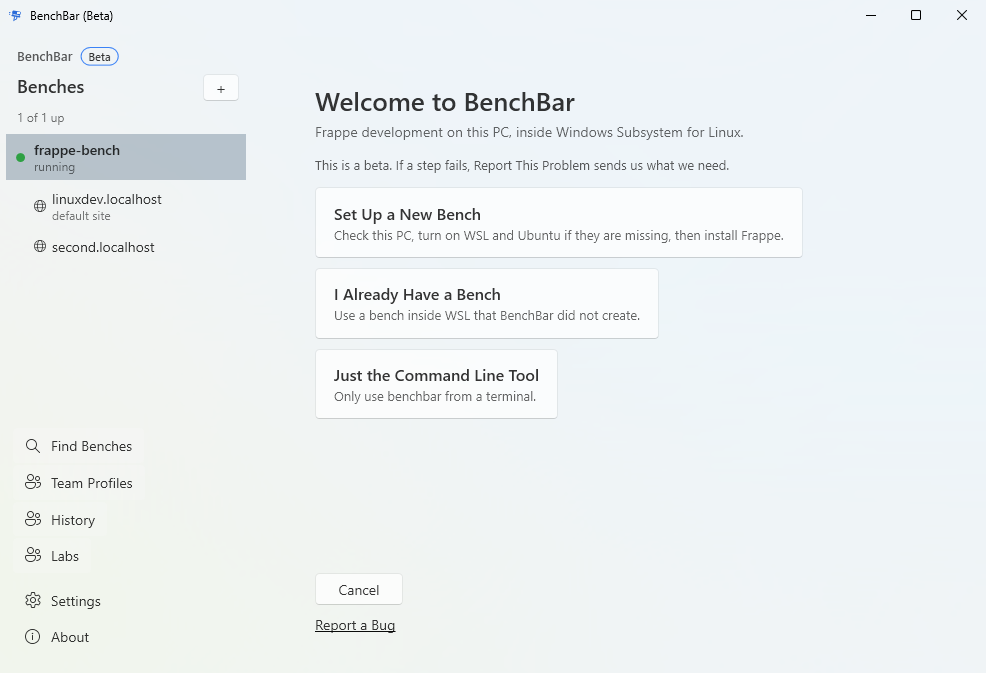
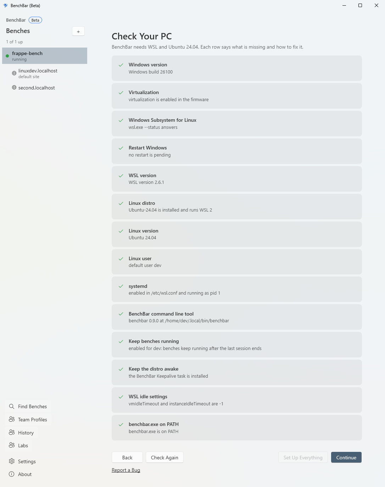
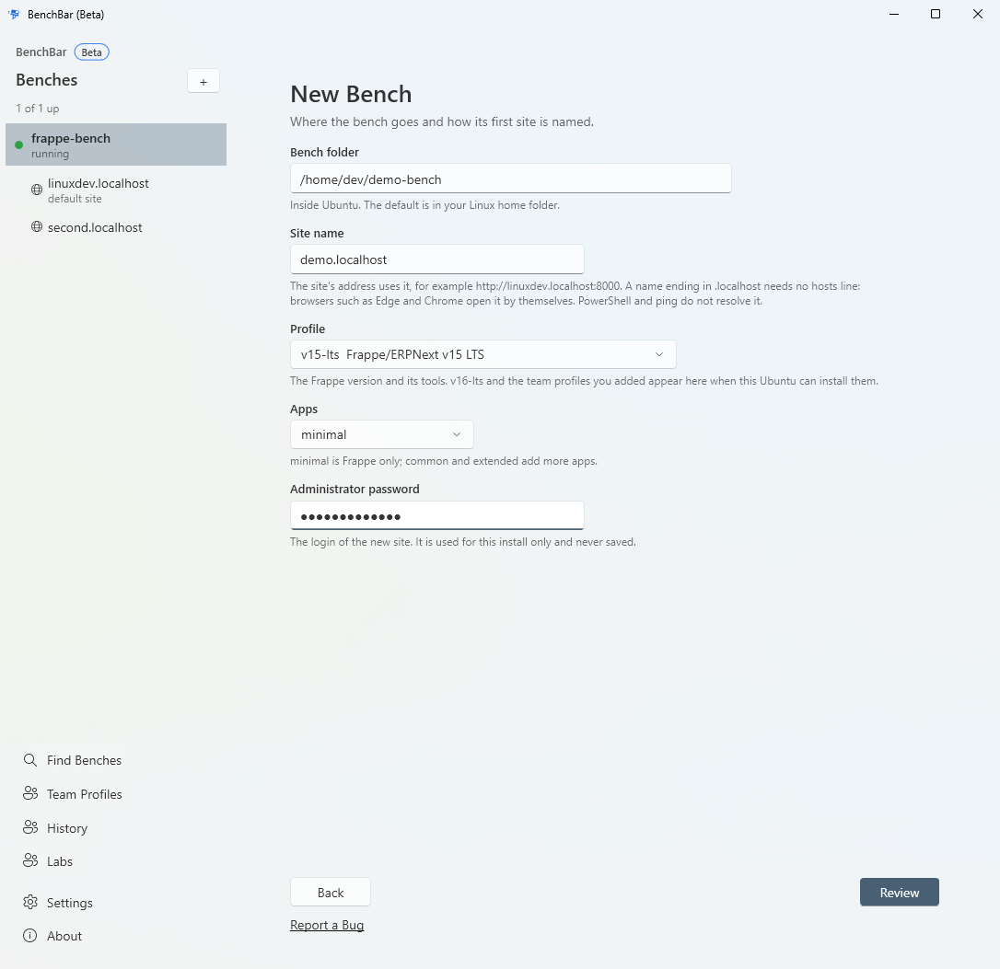
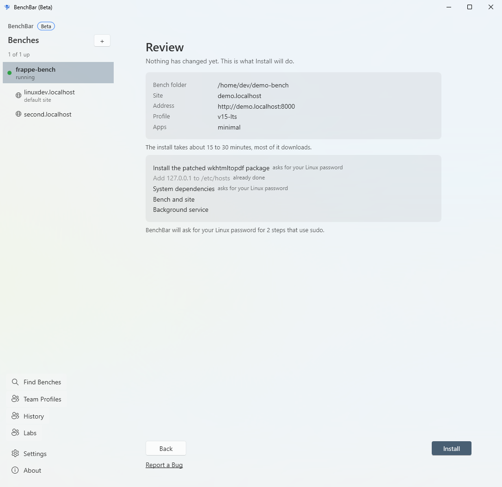
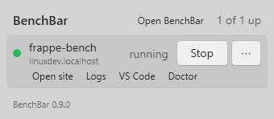
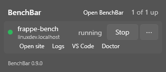
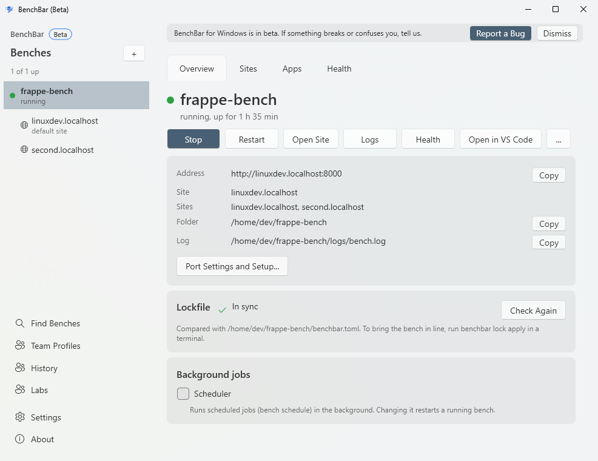
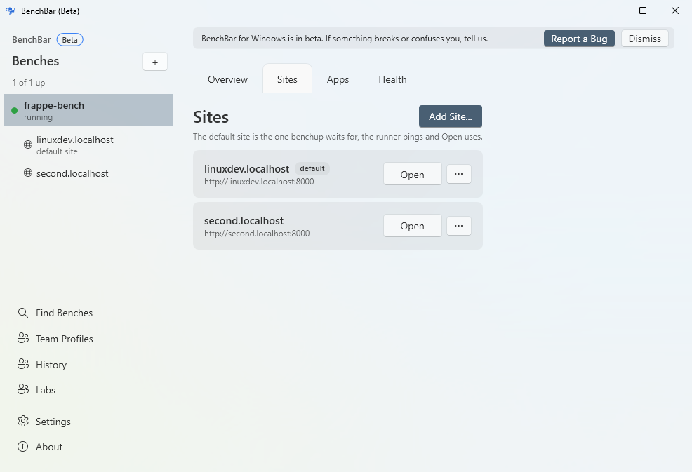

On Windows, benches run inside WSL 2, never on Windows itself. Two small
programs bring them to the Windows side:

- `benchbar.exe`, the shim: every command forwards to `benchbar` inside
  the distro, so `benchbar.exe status`, `up`, `down` and `doctor` work
  from PowerShell.
- BenchBar Tray, a notification area app: the runner shows the state of
  your benches, and a click opens them.

BenchBar for Windows is in beta. It works, and you may find rough edges.
The tray and the window say so: a **Beta** pill, the window title
"BenchBar (Beta)" and a banner that you can dismiss. Both programs are
not signed, and 0.9.0 has no signed or Microsoft Store route. On our
Windows 11 test PC (Smart App Control off) the one line installer needed
no click through a warning. Smart App Control, when it is on, blocks the
tray and `benchbar.exe`: see [Smart App Control](#smart-app-control) for
what you can do, and [Signing and verification](#signing-and-verification).

## What you need

- Windows 11, or Windows 10 version 22H2 (build 19045) or later, with
  virtualization on in the firmware.
- Smart App Control off (see [Smart App Control](#smart-app-control)).
- For the tray: the .NET 10 Desktop Runtime. The installer offers to
  install it with `winget`
  (`winget install --id Microsoft.DotNet.DesktopRuntime.10 -e`).

Everything else the first run wizard sets up for you (see
[First run](#first-run)): WSL 2, Ubuntu 24.04 with systemd, your Linux
user, `benchbar` inside the distro, linger, the keepalive task and
`benchbar.exe` on your PATH. To do it by hand instead, see
[Set up from PowerShell](#set-up-from-powershell).

## Before you install

What Windows may show depends on how the files reach your PC. The one
line installer is the quiet route. A zip you download yourself is
marked by Windows as "from the internet", and that mark brings dialogs.

| Route | What Windows may show | What to do |
| --- | --- | --- |
| One line installer (`irm ... \| iex`) | On our Windows 11 test PC (one PC, Smart App Control off): nothing. No SmartScreen dialog, no Defender block and no administrator prompt. The files it writes carry no internet mark when it could verify the build provenance (`gh` signed in), and starting them shows no dialog then. | Nothing. |
| Zip, started with `.\install.ps1` | With the default execution policy: "cannot be loaded because running scripts is disabled on this system". `Unblock-File` does not change that. | Start it with `powershell -ExecutionPolicy Bypass -File .\install.ps1`. |
| Zip saved by a browser | Edge saves it without a warning, but marks it as downloaded (`Zone.Identifier`, ZoneId 3). Extract All in Explorer marks every file in it. `Expand-Archive` marks none. | Nothing, if you run the installer from the zip. It removes the mark from the files it installs. |
| Starting a marked program yourself | "Open File - Security Warning: The publisher could not be verified. Are you sure you want to run this software?" with **Run** and **Cancel**. The dialog can open behind other windows. | Click **Run**. If nothing seems to happen, look for a flashing icon in the taskbar. |
| The tray without the .NET runtime | Microsoft's dialog "You must install .NET Desktop Runtime to run this application." | Install the runtime: see [If Windows blocks it](#if-windows-blocks-it). |

The installer checks every file against `SHA256SUMS` first. It removes
the internet mark from the files it installs only when the zip's build
provenance verified, which needs the [GitHub CLI](https://cli.github.com)
(`gh`) signed in. The checksums come from the same release as the zip,
so they find a damaged download, not a swapped one, and they are no reason
to drop a mark that Windows put there. Without `gh`, or when the check
fails, the installer keeps the mark and says so, and Windows shows the
Open File dialog once for each program: click **Run**. A zip you run
`install.ps1` from after unpacking it has no zip left to verify, so the
mark stays there too.

### Smart App Control

Smart App Control is a Windows 11 feature. When it is on, it blocks
programs that are not signed and have no known reputation, and it has no
exception for one program. BenchBar 0.9.0 is not signed and has no
Microsoft Store package, so with Smart App Control on, Windows blocks
`benchbar.exe` and BenchBar Tray. There is no signed route in this
release.

To check: open Windows Security, then **App & browser control**, then
**Smart App Control**. It says **On**, **Evaluation** or **Off**.

What the installer does:

- **On**: it stops before it downloads or writes anything, says what
  Smart App Control is and that BenchBar is not signed, and links here.
- **Evaluation**: it warns and goes on. Windows may turn Smart App
  Control on later and block BenchBar then.
- **Off**, or a Windows without it: it goes on.

What you can do when it is on:

- **Use the command line inside WSL.** `benchbar` runs inside your Ubuntu
  24.04 distro, where Smart App Control does not apply, and it does all
  the work: install it there with the line in
  [The installer on Linux](install.md#the-installer-on-linux), then run
  `benchbar install`. You lose only the Windows parts: `benchbar.exe` in
  PowerShell and the tray. Run `wsl.exe -d Ubuntu-24.04 -- benchbar
  status` from PowerShell instead.
- **Turn Smart App Control off** in Windows Security > App & browser
  control > Smart App Control settings, then run the one line installer
  again. On some versions of Windows you cannot turn it back on without
  resetting Windows. Think about that first.
- **Wait for a signed build.** There is none in 0.9.0 and no date. See the
  [roadmap](https://github.com/askysh/benchbar/blob/main/ROADMAP.md).

With Smart App Control off, or in evaluation mode, the one line installer
is the route to use.

The installer also stops early when PowerShell runs in Constrained
Language Mode, which a company policy can set. Ask whoever manages the PC.

## First run

When BenchBar Tray starts and finds no bench, it opens the BenchBar
window at Welcome: **Set Up a New Bench**, **I Already Have a Bench** or
**Just the Command Line Tool**. **+** > New Bench opens it again later.
The command line tool step runs the
[Linux installer](install.md#the-installer-on-linux) of the same release
as `benchbar.exe` inside the distro (`install.sh` from the `v<version>`
tag, with `--version v<version>`); a development build uses `main`. To
do it by hand, run in Ubuntu:
`curl --proto '=https' --tlsv1.2 -fsSL https://raw.githubusercontent.com/askysh/benchbar/main/install.sh | bash`.



1. **Check Your PC** lists every step with its state and a button to fix
   it: Windows version, virtualization, WSL, a pending restart, WSL
   version, the distro, the Linux user, systemd, the command line tool,
   linger, keepalive, the WSL idle settings and PATH. **Set Up
   Everything** runs the missing steps in order.
2. Turning on WSL is the only step that needs administrator rights. It
   has a shield on its button, and Windows asks for permission once. If
   you say no, nothing changes and you can try again.
3. When Windows needs a restart, **Restart Now** asks first, restarts in
   15 seconds (`shutdown /a` cancels it) and opens the wizard where it
   was when you sign in again.
4. **Linux User**: the name and password of your user in Ubuntu. The
   password is used to create the user and later for the `sudo` steps of
   the install, and is never stored.
5. **New Bench**: the folder (default `~/frappe-bench`), the site and the
   Administrator password; **Review** shows the plan of
   `benchbar install --dry-run`, with the steps that use sudo marked.
6. **Install** streams every step. Stop, Retry and Open Log are there;
   when MariaDB already has a root password BenchBar does not know, a
   field asks for it.
7. **Done**: Open Site, notifications, Open BenchBar at logon, and the
   `claude mcp add benchbar -- benchbar.exe mcp` line to copy.

Some rows in Check Your PC are advice: linger, keepalive, the WSL idle
settings and PATH. They never block **Continue**. The other rows must be
ok first.



For a distro whose user the wizard did not create, BenchBar asks for
your Linux password right before the steps that use sudo.



The **Profile** list on the New Bench page holds the built in profiles
(`v15-lts`, `v16-lts`) and the valid team profiles from
`benchbar.exe profile list`. It starts on `v15-lts`; the choice goes to
the install as `--profile NAME`. BenchBar asks the CLI about each
profile with a dry run (`install --dry-run --json --offline --profile
NAME`), so a profile that this Ubuntu cannot install shows off, with the
CLI's own reason under the list. If the list cannot be read, `v15-lts` is
the only choice and **Try Again** reads it again.



Every wizard page has a **Report a Bug** button in its footer, and a
failed step has **Report This Problem** next to it. See
[Report a bug](#report-a-bug).

## Set up from PowerShell

The wizard runs these, and you can too:

```powershell
benchbar.exe setup check --json            # every step, read only
benchbar.exe setup check --json --probe    # also starts a stopped distro to check inside it
benchbar.exe setup run distro_install --jsonl
```

`setup run` takes one action at a time: `wsl_enable` (asks Windows for
permission), `wsl_update`, `distro_install`, `distro_wsl2` (converts a
distro that runs as WSL 1 to WSL 2; it stops that distro), `distro_user`
(the password in `BENCHBAR_SETUP_PASSWORD`), `systemd`, `cli_install`
(installs the command line tool in the distro, or updates an older one), `linger`,
`keepalive`, `wslconfig` and `path`. With `--jsonl` it prints only JSON
lines, and ends with one `done` line (`exit`, `changed`, `reboot_required`,
`cancelled`, `warnings`, `next_actions`). `setup` never runs `wsl --shutdown` or
`--unregister`; `systemd`, `distro_user` and `distro_wsl2` stop only that one distro.

The older commands still work: `benchbar.exe path install`,
`benchbar.exe adopt-distro`, `benchbar.exe keepalive install` and
`benchbar.exe wslconfig --apply --yes`.

## Install

In PowerShell, as yourself (no administrator rights):

```powershell
irm https://raw.githubusercontent.com/askysh/benchbar/main/install.ps1 | iex
```

The installer checks this PC first (the CPU, PowerShell's language mode
and [Smart App Control](#smart-app-control)), then looks at the GitHub
releases for the newest published one that has a Windows zip for your CPU
(x64 or Arm64). It checks the zip against the release's
`benchbar-windows-<version>-SHA256SUMS.txt` and installs it to
`%LOCALAPPDATA%\Programs\BenchBar`. Then it:

1. removes the internet mark from the installed files when the zip's build
   provenance verified (`gh attestation verify`), and keeps it otherwise;
2. puts that folder on your user PATH (`benchbar.exe path install`);
3. checks the .NET 10 Desktop Runtime and, when `winget` is there, offers
   to install it (Windows asks for permission);
4. makes a Start menu shortcut named BenchBar, and offers a Startup
   shortcut so the tray opens at logon;
5. runs `benchbar.exe doctor`;
6. starts the tray, which opens the setup, and prints what to do next.

The tray is not started when the .NET runtime is still missing, and the
installer says why. It writes nothing inside a WSL distro; the final
doctor starts the distro if it is stopped. It uses your Windows proxy
settings, with your Windows sign in, for its downloads. When GitHub's API
says too many requests, it falls back to the release page, which needs no
API call.

After it finishes, find BenchBar in the Start menu, or as the tray icon
near the clock. Windows may hide that icon under the ^ arrow. In a
terminal, `benchbar.exe setup check` shows what is ready.

Run as a file it takes `-Version X.Y.Z` (a given release), `-NoTray`
(only `benchbar.exe`: no runtime check, no shortcuts, no tray), `-Yes` (no
questions), `-Zip PATH` (a zip you downloaded) and `-Uninstall`. To pass
them without saving a file, run the script as a script block, which sets
nothing in your session:

```powershell
& ([scriptblock]::Create((irm https://raw.githubusercontent.com/askysh/benchbar/main/install.ps1))) -Version X.Y.Z
```

Piped into `iex`, set `BENCHBAR_VERSION`, `BENCHBAR_NO_TRAY=1`,
`BENCHBAR_YES=1`, `BENCHBAR_ZIP=PATH` or `BENCHBAR_UNINSTALL=1` first.
These variables stay set in that PowerShell window, so remove them
afterwards (for example `Remove-Item Env:BENCHBAR_VERSION`).

To run it as a file, download `install.ps1` and start it with
`powershell -ExecutionPolicy Bypass -File .\install.ps1 ...`. The default
execution policy refuses a script file, and `Unblock-File` does not
change that.

Without the script: download `benchbar-windows-<version>-amd64.zip` (or
`-arm64.zip`) from the [releases](https://github.com/askysh/benchbar/releases),
check it (see [Verify a download](#verify-a-download)), unpack it into a
folder of your choice and run `benchbar.exe path install` from there.

### A test build you were sent

Every zip carries `install.ps1`, so a build that is not on a release
installs the same way, from its own folder:

1. Unpack the whole zip (right click, Extract All) into a new folder, for
   example in Downloads. `benchbar-windows-<version>-amd64.zip` is for
   Intel and AMD PCs, `-arm64.zip` for Arm PCs.
2. Open PowerShell in that folder and run:

   ```powershell
   powershell -ExecutionPolicy Bypass -File .\install.ps1
   ```

It checks every file against the `SHA256SUMS` in the zip, installs to
`%LOCALAPPDATA%\Programs\BenchBar` as above, and ends with
`benchbar.exe doctor`. To keep the zip unpacked, pass it instead:
`.\install.ps1 -Zip .\benchbar-windows-<version>-amd64.zip`. A checksums
file next to the zip is checked too when there is one.

Extract All in Explorer marks every file as downloaded. The installer
removes that mark from the copies it installs, so the programs start
without a dialog. Start a program from the unpacked folder yourself, and
Windows shows the Open File dialog (see [Before you install](#before-you-install)).

### Verify a download

Each release has `benchbar-windows-<version>-SHA256SUMS.txt`. Compare it
with the zip:

```powershell
(Get-FileHash .\benchbar-windows-<version>-amd64.zip -Algorithm SHA256).Hash
```

The installer does this for you. Releases after 0.8.2 also carry a build
provenance attestation, made by the release workflow. It proves that the
zip was built from this repository by GitHub Actions. The installer
checks it when `gh` is installed and signed in, and says so when it
cannot. The checksums file is attested too. With the
[GitHub CLI](https://cli.github.com):

```powershell
gh attestation verify benchbar-windows-<version>-amd64.zip -R askysh/benchbar `
  --signer-workflow askysh/benchbar/.github/workflows/release-windows.yml
```

## If Windows blocks it

**Smart App Control** says BenchBar is blocked, or the installer stops
with "Smart App Control is on". See [Smart App Control](#smart-app-control).

**"Open File - Security Warning: The publisher could not be verified."**
The file carries an internet mark, for example because you started a
program from an unpacked zip. Click **Run**. The dialog can open behind
other windows. The installer removes the mark from what it installs when it verified
the zip's build provenance (`gh` signed in). Without that, you see this
once for each program. To remove the mark yourself, once you have checked
the zip, run
`Get-ChildItem "$env:LOCALAPPDATA\Programs\BenchBar" -Recurse | Unblock-File`.

**Microsoft Defender or another antivirus removes a file**, or the
installer says a file "contains a virus or potentially unwanted software"
(error 0x800700E1). BenchBar is not malware, but a new program without a
signature is sometimes flagged by mistake. On our Windows 11 test PC,
Defender scans of the zip and the install folder were clean, and Defender
sent `benchbar.exe` to Microsoft for cloud analysis once.

1. Open Windows Security > Virus & threat protection > **Protection
   history**.
2. Find the BenchBar item, choose **Actions**, then **Allow on device**.
3. Run the installer again.

To tell Microsoft it is a false positive, send the file at
<https://www.microsoft.com/wdsi/filesubmission>.

**"You must install .NET Desktop Runtime to run this application."**
BenchBar Tray needs the .NET 10 Desktop Runtime, and this dialog is
Microsoft's. Install it, then start BenchBar again:

```powershell
winget install --id Microsoft.DotNet.DesktopRuntime.10 -e
```

Without `winget`, download the **.NET 10 Desktop Runtime** (x64 or Arm64,
like your PC) from <https://dotnet.microsoft.com/download/dotnet/10.0>.
The installer offers to run the `winget` line and does not start the
tray while the runtime is missing.

## Signing and verification

The Windows programs (`benchbar.exe`, `BenchBarTray.exe` and the tray's
own DLLs) are not signed, and 0.9.0 has no signed or Microsoft Store
route: SignPath Foundation declined the project on 2026-11-13, and a
Store package is not part of this release. In practice that means: Smart
App Control blocks them (see [Smart App Control](#smart-app-control)),
and a program you start from an unpacked zip shows the "Open File -
Security Warning" dialog. See [Before you install](#before-you-install)
for what to expect on each route.

You can still check what you download:

- Every release has `benchbar-windows-<version>-SHA256SUMS.txt`, and every
  zip holds a `SHA256SUMS` file. The installer checks them.
- From the next release on, each zip also has a build provenance
  attestation that you can verify. See [Verify a download](#verify-a-download).
- Check a signature in PowerShell:
  `Get-AuthenticodeSignature "$env:LOCALAPPDATA\Programs\BenchBar\benchbar.exe"`
  shows `NotSigned` today.

Privacy: neither program sends data anywhere except to GitHub's release
list, for the update check described under [Settings](#settings). Report
a Bug writes its zip on your PC, and sends nothing until you post the
issue yourself.

## The tray



The runner in the notification area sleeps when the benches are stopped,
runs while one is up, stumbles when a bench crashes and holds a paused
pose when the crash guard paused it or its ports are taken. With
Windows animation effects off it shows still poses. It is tinted for a
light or a dark taskbar.

Left click opens the flyout, one row per bench:

- the state, the name and the default site, with **Start** or **Stop**,
  and **Restart** in the ⋯ menu;
- **Open site** in your default browser (see
  [`*.localhost` names](#localhost-names));
- **Logs**: the last lines of the bench log in a read only window, with
  Clear, Copy and Open in Terminal (Windows Terminal, which follows the
  log with `tail -f`);
- **VS Code**: the bench folder through the WSL extension
  (`code --remote wsl+DISTRO PATH`). Without `code` on PATH the row says
  how to get it;
- **Doctor**: the checks of `benchbar doctor` with their fix lines and a
  Copy button. It changes nothing.

Esc closes the flyout, Enter on a row opens the site.



Right click opens the menu: Open BenchBar, Settings, Open BenchBar at
logon (a shortcut in your Startup folder, no admin needed), Notifications,
Appearance (System, Light or Dark), Runner (the seven built in runners, as
on the Mac, and your own), Check for Updates, Help, Report a Bug and Quit.

### The BenchBar window

Open BenchBar (the tray menu, the button at the top of the flyout, or a
double click on the tray icon) opens the window. The sidebar lists your
benches with their sites, then Find Benches and Team Profiles, a **+**
menu (New Bench, I Already Have a Bench), and Settings and About at the
foot. A banner says when a newer release is out, and a beta banner stays
until you dismiss it once. Ctrl+N starts a new bench, Ctrl+, opens
Settings and F5 checks again.



A bench has four tabs:

- **Overview**: state, address and uptime, Start or Stop, Restart, Open
  Site, Logs, Health and **Open in <editor>**, and a line that says why a
  bench is stopped and what to do next. The Scheduler switch, the lockfile
  state, Port Settings and Setup, and Console and Database (in Windows
  Terminal) are here too.
- **Sites**: Add Site (the plan first, then the Administrator password
  goes to the CLI in its environment), Make Default, Back Up (with or
  without files), **Backups...**, **Restore...**, **Drop Site...** (type
  the site's name to confirm) and Open. Browsers open `*.localhost` names
  without a hosts line, so BenchBar never edits a hosts file (see
  [`*.localhost` names](#localhost-names)). **Allow Open as...** in a
  site's menu turns Open as on for that site, after the Mac app's question
  (it signs in as any user without a password, and each sign in is a real
  login that the apps' hooks and the Activity Log see). Turning it on is
  your decision: nothing in BenchBar does it for you, and **Turn Off Open
  as** needs no question. While it is on the site says "Open as is on", or
  why it cannot be used (developer mode off, not the default site, the bench
  stopped), and **Open as...** opens **Find User**: the site's enabled users,
  searched by name or email, each with **Open**, which opens the site in your
  Windows browser signed in as that user. `benchbar.exe` opens the browser
  itself, so the sign in link, which holds a session, never passes through
  the tray, a log or the screen. A site whose name Windows cannot find has no
  Open as. **Pin** in Find User keeps a user (nine at most per site,
  Administrator is always there) for Quick Switch.
- **Apps**: Add App (from a git URL, with a branch or a commit, and the
  sites to install it on; **Add Another App** puts several apps in one
  plan, each with its own branch, commit and sites, under one token),
  Update after the dry run, Install on a site, focus pins and Check
  Remotes. An app with local changes cannot be updated from the window.
- **Unfinished updates and adds**: when an `app update` or an `app add`
  stopped part way, the bench page shows a banner above the tabs with
  what stopped, why, the fix command and two buttons. **Finish Update**
  or **Finish Add** shows the plan of the same command, which lists only
  the steps left. **Discard** asks first, then runs
  `benchbar app update NAME --discard-pending`, which drops the record
  and runs nothing; it does not undo what already ran. The banner reads
  `pending_operations` of `benchbar.exe status --json`.
- **Health**: the doctor checks with the Windows setup checks, Copy fix,
  and Repair, which shows the plan first and asks for your Linux password
  once when a step uses sudo.



A fifth tab, **Sharing**, is there only while the **Share with people on
the same Wi-Fi** experiment (`lan-rooms`) is on in Labs. It is the host
side of a room, with the Mac app's words: **Set up sharing** (the people
who get a seat, the source of the copy, the plan sheet with what the copy
holds, and your tick that it holds real data), **Start sharing** for 1 to
12 hours after a question, **Stop**, **Extend**, **Lock room**, the room
code (hidden until you press **Show**), **Copy invite** and **New code**,
the checks, the copy and **Refresh copy**, and the people in the room with
**Remove**. Every one of those calls is made from your click and asks
first; nothing runs when the tab opens, it only reads. The room code and
the invite are read only on your click, kept in memory, never written to a
log and copied with a mark that keeps them out of the Windows clipboard
history. The network protection (`benchbar lan-guard install`, and
`allow-node`) is a button with its own question and runs only when you
press it; the tray never runs it by itself. Where the command line tool
has no network protection yet (Linux), the tab shows what `benchbar.exe`
says and nothing else. While the experiment says it is not on Windows yet
in Labs, the tab does not appear.

Start and Restart check the bench's ports first, from the window and from
the flyout. A port another program holds stops the start with the reason
and Review Port Conflict; BenchBar never stops that program.

The **...** menu of a bench's Overview shows a command only when the CLI
inside the distro lists it (`benchbar.exe commands --json`, asked once), so
an older CLI never gets a call it would refuse. **Start Services Only**
starts the bench's Redis and nothing else, for a restore or a migrate, on a
stopped bench (`up --services-only`); **Stop Services** puts it away
(`down`). **Install Service...** (or **Refresh Service...**) and the
Scheduler box show the plan of `benchbar service` first and run it with its
token only after your yes. **Write Lockfile...** and **Apply Lockfile...**
show the text of `lock write --dry-run` or `lock apply --dry-run` and run
`lock write --yes` or `lock apply --yes` only after your yes; the CLI has no
plan token for them yet, so a change between the preview and the yes is not
refused by a token. **Start again after Ubuntu restarts** is `autostart on`
and `off`. **Watch Assets in Terminal** and **Run in Foreground in
Terminal** open `benchbar watch` or `benchbar fg` in Windows Terminal inside
the distro; closing that window ends them. The tray does not run either one
as a child of its own: they have no way to be stopped from outside, and
ending `benchbar.exe` on Windows can leave `bench watch` running in the
distro. On the Health tab a warning has **Acknowledge** (`doctor --ack`),
which silences it for this bench until its message changes, and an
acknowledged one has **Undo Acknowledge**; nothing acknowledges by itself and
a failure has no button. On the New Bench page of the setup wizard the
warnings and failures of `doctor --prerequisites` for the folder are listed
with the fix to copy; they stop nothing, the plan on the Review page still
decides.

When an update changes a default (0.9.0 does: the bench listens on this
computer only, an option a command does not take is an error, `pull`
neutralises the copy), the CLI lists it in `status --json` as `notices[]`
and the window shows one banner for each above the tabs: what changed, the
command that switches it back, a link to the page that explains it, and
**Dismiss**, which runs `benchbar notices --dismiss ID`. Nothing dismisses a
notice but your click. Under the state line of a running bench the Overview
says **Ready**, **Needs restart (code changed)** or **Running, not ready**
from the `ready` object of `status --json`, with what the bench waits on
(the realtime server, Redis, the site, a worker), the Python file that
changed, and the CLI's own fix line with **Copy**. A CLI older than 0.9 sends
neither member, and the window shows neither.

**Pull...** on the Sites tab copies a production site into a new site of the
bench (`benchbar pull`). Give `HOST:SITE`, where HOST is a Host of
`~/.ssh/config` inside Ubuntu and its key must work without a prompt, or tick
the box for a backup folder inside Ubuntu, and a name for the new site (the
name follows the server until you type over it; a name that is already a
site is refused, Pull never overwrites one). **Review Plan...** runs
`pull --dry-run --json` and shows the backup (name, size, age), whether the
site is created, the apps that differ from production, what the copy loses
and the steps; **Pull** then runs `pull --apply TOKEN --yes` with the token
from that plan, so a newer backup on the server or a changed app list
stops the run with nothing changed and asks for a fresh plan. A restore is
not stopped part way: **Stop Waiting** closes the sheet and the run goes on.
The copy is neutralised by default (integrations off, stored passwords
cleared except the Administrator's). **Keep production's passwords and
integrations** is off until you tick it, and ticking it says that the copy
can still reach the outside and that its scheduler and workers should stay
off. The button is offered when the CLI lists `pull` with `--apply`; the
tray does not add a hosts line, so a name that does not end in `.localhost`
shows a note. **Watch Assets in Terminal** and **Run in Foreground in
Terminal** (above) are the tray's `watch` and `fg`; **Logs** follows the log.

**Move to Another Bench...** in the menu of a site (offered when the CLI has
`site move` and another bench is registered; off for the default site) asks
which bench the site goes to, with **Skip migrate** as the one option, then
shows the plan of `site move --dry-run --json`: the steps, the apps, the new
address (the name stays, the port is the other bench's), what stays and any
error. A running bench shows **Stop Bench**, which stops it and reads the plan
again. **Move** stays off until you type the site name, and runs `--apply
TOKEN --yes` with the token of that plan, with the progress of each step and
the CLI's next steps at the end. A plan that changed in between asks you to
**Review Again**.

**Snapshots...** in the menu of a site (offered when the CLI has `site
snapshots` and `site rollback`) takes a snapshot of the site, with a label if
you like (`benchbar site snapshot`; nothing in the site changes), lists the
snapshots with their age, size and whether the bench's apps are still the
same, and has **Roll Back...** and **Remove...** on each. Roll Back asks you
to type the site name, then shows the plan of `site rollback --dry-run --json`
(a snapshot of the site as it is now is taken first, so the rollback can be
undone; migrate runs only when the apps differ) and runs `--apply TOKEN
--yes` with the token of that plan. The default site can be rolled back too,
as you, and the plan says so. Remove asks first and is never offered for the
undo point of the last rollback; that stays a Terminal command.

While an agent holds a lease on the bench or one of its sites, the Overview
says who holds it and until when (`benchbar lease list`). BenchBar never
takes, renews or releases a lease. A start, stop or restart, and an app
change, a restore or a rollback that a lease refuses, shows the holder and
until when and changes nothing. **Break Lease...** is your own choice: it
asks, then runs the same command again with `--break-lease`, which the CLI
allows only to a person, and the run is in the History. The Overview also
charts the CPU and memory of a running bench, with its process count and the
runner speed (`benchbar stats`), and lists the background operations of the
bench (`benchbar op list`). They are read every five seconds, only while
the Overview is on screen and the CLI has the command, and nothing runs
while the window is closed or another page is shown. **History** below the
benches lists what ran on this computer and changed something
(`benchbar history`), newest first: who started it (BenchBar, the tray,
Terminal, an agent through MCP, a script), how it ended and what it changed.
It is the CLI's record and read only; nothing there runs anything again.

**Run Bench Command...** in the More menu of the Overview (offered when the CLI
has `run`) runs one command of the allow list of `benchbar run`: `migrate`,
`clear-cache`, `clear-website-cache`, `build`, `run-tests` and the reads
`doctor`, `list-apps` and `version`, with the flags the command takes. A read
runs at once and shows its output. A change shows the plan of `run --dry-run
--json` (the exact command, what it touches, whether a backup comes first and
the deadline) and runs `--apply TOKEN --yes` with the token of that plan. The
output of a change is in the run's log, which the result shows.

**Tidy Up...**, **Forget Bench...**, **Remove Bench...** and **Remove Service...**
in the More menu of the Overview (each offered when the CLI lists its command)
are the end of a bench's life. **Tidy Up...** marks the bench scratch for 1 to 90
days (`bench scratch`) or not, lists the scratch benches that expired (`bench gc
--dry-run`, read when it opens) and the databases that no site of any bench
refers to (`db orphans`, which needs the MariaDB root password the CLI already
keeps). **Remove Expired...** shows the plan of `bench gc` and runs `--apply
TOKEN --yes` with that plan's token. **Forget Bench...** shows the plan of
`bench forget` (the folder, sites and databases stay); **Remove Bench...** asks
you to type the folder name, then shows the plan of `bench remove`: each site is
backed up and its database dropped, and the folder is moved to a trash folder
next to it, never deleted. **Remove Service...** is `uninstall-service` for that
one bench, never `--all`, after its dry run. The tray never drops an orphan
database: you drop one in Terminal after a backup.

**Quick Switch...** in the tray menu opens a small panel over any window:
Administrator, your pinned users and, when you type two letters or more,
the site's other users. Up, Down and Enter choose, **0** to **9** open a row
at once while the field is empty, and Esc closes it. It opens the site of a
running bench that has Open as on (a list picks the site when there are
several) in your browser signed in as that user, with the same
`benchbar.exe open --as` call as Find User, and says why when there is
nothing to open, for example that Open as is off for the site. The row of the
last user it opened this run says "last opened". It never turns Open as on.

A global shortcut is opt in: **Settings > General > Open Quick Switch with a
shortcut**. It is off until you turn it on, and the default is Ctrl+Alt+U.
Click the shortcut to record another one (Esc keeps the current one, and
**Reset** goes back to the default). A shortcut must contain Ctrl or Alt;
Ctrl with a letter or a digit needs Alt as well, so it never takes Ctrl+C,
Ctrl+V or another app's shortcut; Alt+F4 and Alt+Space are Windows'. If
another app holds the key, BenchBar keeps the old one and says so under the
row. The shortcut is given back to Windows when you turn it off and when
BenchBar quits, and it is paused while you record.

**Find Benches** scans a folder inside the distro (default your Linux
home), adds the benches it finds, sets up their ports and their
management. **Team Profiles** creates a profile from a bench, imports or
subscribes to one, exports, updates, checks access and removes. A Windows
file path for import or export is converted with `wslpath`.

**Labs** lists the experiments of `benchbar.exe labs list`, one row each,
with a switch, a warning, the version it came in and what it is. The
switch runs `benchbar.exe labs on NAME` or `labs off NAME`, the same calls
as **Settings > Labs** in the Mac app, so the state is the same in the
tray, in PowerShell and for an agent. Turning an experiment on is your
decision, and the click is it: the warning is on the row. An experiment
that does not list Linux among its platforms (the benches run in WSL)
stays off and says why; `benchbar labs list` shows each experiment's
platforms. Turning one off stops what it started.

The log window filters by process, searches, follows the log (while the
window is open), shows the previous log and opens `tail -f` in Windows
Terminal. Follow asks every 2 seconds while lines arrive and waits up to 10
seconds while none do. It asks nothing while the PC is locked or asleep or
the window is minimized, and catches up with one request when you are
back. In Windows battery saver it asks at most every 30 seconds. With
the bench running, the tray's own poll is 60 seconds instead of 30 on
battery. While the distro is up and every bench was stopped on the last
poll, the tray only asks Windows whether the distro runs (no `benchbar.exe`
call, which would keep WSL awake); it reads the benches again after an
unlock, an action or when the flyout opens, and at least every 20 minutes.

The tray reads the passwords of an install or an adopt (the Administrator
password, the Linux password for `sudo`) once and hands them to
`benchbar.exe` in its environment for that one run, because the command
line tool takes them from `ADMIN_PASSWORD`, `BENCHBAR_SUDO_PASSWORD` and
`MARIADB_ROOT_PASSWORD` and nowhere else. They are never on a command
line, in a file or in the tray's logs, and the output of the run is
cleaned of them. An install can last up to 90 minutes, so for that time the
values can be read by another program of your own user. This stays so until
the command line tool can take a secret from standard input or a file.

Settings: Open BenchBar at logon, notifications, check for updates when the window
opens, **Ask before a link acts** (see [benchbar:// links](#benchbar-links)), the distro (switching runs `benchbar.exe adopt-distro`), the editor
(VS Code, Cursor or VS Code Insiders), the command line tool's path, and
the tray's appearance and runner. About: the versions of the tray,
`benchbar.exe` and the CLI inside the distro, Check for Updates, Report a
Bug and the MCP line (`claude mcp add benchbar -- benchbar.exe mcp`, and the
same server as a JSON entry for Cursor, Claude Desktop and other clients),
each with **Copy**.

When a bench crashes, is paused by the crash guard or meets a port
conflict, the tray shows one Windows notification with the bench and
the command that fixes it. It does not repeat it until the state
changes again. The tray reads the pause the runner records in the bench's
`state.json` (the same record `benchbar status` shows), and the runner
inside the distro sends no desktop notification of its own in WSL, so
there is one notification, not two.

### When the distro is stopped

The tray asks WSL which distros run (`wsl.exe --list --running`), which
does not start one, and asks `benchbar.exe status` only while the distro
runs. A stopped distro shows the sleeping runner and a **Start** button
in the flyout, which starts `benchbar.exe keepalive run`. This keeps the
tray from waking a distro that WSL shut down after its idle time.

One keepalive runs at a time, for one distro. While it keeps one distro
awake, Start cannot start a second distro, and the tray says so. Switch
the distro in Settings, or stop the other keepalive first. This is a
limit of the beta.

A package update stops a running keepalive, and the task starts only at
logon. `benchbar.exe keepalive start` runs the installed task again when
its run process is not alive. It prints nothing and exits 0 when there is
no task or the run is alive, and it never creates or changes the task. The
tray calls it after an update.

### Settings

The tray keeps its settings under a `tray` key in
`%LOCALAPPDATA%\BenchBar\config.json`, the file `benchbar.exe` uses for
the distro. Custom runners go in `%LOCALAPPDATA%\BenchBar\runners\<id>\`,
in the format of [Custom runners](runners.md); the frames are scaled to
the notification area's square slot.

**Check for updates when the BenchBar window opens** is on by default.
When the window opens, the tray asks GitHub for the latest release, at
most every six hours, and shows a banner when a newer one is out. Turn it
off in Settings to stop those checks. Check for Updates in the menu and
About always asks GitHub, and asks before it opens the release page.

### benchbar:// links

The tray answers `benchbar://` links, so a launcher, a script or a
bookmark can start, stop and open a bench:

```powershell
Start-Process "benchbar://up?bench=frappe-bench"
```

The routes and the `bench=` and `site=` queries are the Mac app's: `up`,
`down`, `restart`, `open`, `logs`, `window`, `doctor`, `console`, `db`
and `editor`, plus the two profile links. They are listed in the
[URL scheme](reference/url-scheme.md) page. On Windows `bench=` takes a
name or the Linux path of the bench (`/home/you/frappe-bench`, or
`~/frappe-bench` for a bench in your home folder in the distro).
`console` and `db` open Windows Terminal inside the distro, like the
More menu of a bench.

The tray registers the scheme for your user (under
`HKEY_CURRENT_USER\Software\Classes\benchbar`, so no administrator
rights) the first time it starts, and the installer writes the same
values. Uninstalling removes them. If another program already owns
`benchbar://` (for you or for the whole PC), or another copy of
`BenchBarTray.exe` that is still there does, the tray leaves it alone, and
so does the installer. A registration of a copy that is gone is replaced.

If the tray is running, a second start with a link hands the link to it
and quits; if not, the link starts the tray first and the link waits for
its first look at your benches. A link that is not one of the routes, or
is not well formed, does nothing and is logged by its action only (or a
short hash), never with the bench, the site or the address it carried.
A link that holds a double quote, a backslash or one of `^ | < >` is
ignored too; a real link writes those as `%22`, `%5C` and so on.

Any web page can open a `benchbar://` link, and a browser can remember
"always allow". **Settings > Ask before a link acts** makes the tray ask
first for `up`, `down`, `restart`, `console` and `db`, with Cancel as the
default. It is off by default, so launchers and scripts keep working.

Share links (`benchbar://share/...`) need rooms, which are not on Windows
yet: the tray shows a short note and does nothing else.

### What it costs

At rest the tray polls `benchbar.exe status` every 30 seconds while a
bench runs and backs off to every 5 minutes when nothing is up. It
starts nothing at all while the computer sleeps or is locked.

Measured on a Ryzen 7 6800H laptop: about 17 MB of private memory and
under 0.1 percent of one core at rest, 0.6 percent while the runner
runs. Once the flyout has been open, WPF keeps its graphics stack
loaded and the tray stays at about 43 MB.

## Report a bug

Report a Bug is in the tray menu, in About, in the beta banner, in the
footer of every wizard page, and next to each failed step (Report This
Problem). All of them do the same thing:

1. They run `benchbar.exe report-windows --json`. It writes a redacted
   zip to `%LOCALAPPDATA%\BenchBar\reports` and keeps the newest 10.
2. A small window says that the report is ready. It selects the zip in
   Explorer and opens a GitHub issue with the Windows bug form filled in
   (versions, Windows edition, distro and what you did). Show Zip and
   Open Issue do this again, and Copy Path copies the zip path.
3. Drag the zip from Explorer into the last box of the form, say what
   happened, and submit.

The zip holds the versions, the Windows edition and build, the WSL status
and distro list, the setup check (run without starting a distro) and,
when the distro runs, the CLI's own report. User names and home paths
become `<user>`, and it holds no passwords. The full list is in
[windows/shim/README.md](https://github.com/askysh/benchbar/blob/main/windows/shim/README.md#bug-report-zip).

Report a Bug works with no WSL, with a stopped distro (it never starts
one) and with no CLI installed. If `benchbar.exe` cannot start, the tray
writes a smaller zip with its own log only.

For a security problem, do not use the form. See
[SECURITY.md](https://github.com/askysh/benchbar/blob/main/SECURITY.md).

## Update

In the app: when a newer release is out, the BenchBar window, the tray
menu and About show **Update Now**. It runs the update in its own window,
closes BenchBar, and starts it again when the update is done.

In a terminal:

```powershell
benchbar.exe self-update
```

It shows the version you have and the newest release, asks once, then
updates all of BenchBar for Windows to that release: `benchbar.exe`, the
tray app and the BenchBar CLI inside WSL. It runs the installer of that
release for you: `install.ps1` of the release's tag, downloaded and
compared with the release's SHA256 sums before it runs, not whatever is on
`main`. The installer checks the new files against the same sums, and
Windows shows no SmartScreen dialog for them when the zip's build
provenance verified (see [Verify a download](#verify-a-download)). The tray app closes and starts
again. It ends with one line for each part. Your settings, benches and sites
stay as they are.

- `benchbar.exe self-update --check` only looks: the version you have, the
  newest release and the CLI in WSL. `--json` gives the same as JSON.
- `--yes` does not ask. `--version X.Y.Z` installs that release, also an
  older one, or a release candidate (`0.9.0-rc.1`), which the check and a
  plain `self-update` never offer.
- With no distro set up yet, the CLI part is skipped: the setup installs it.
- BenchBar is not in the Microsoft Store. A copy that runs from an MSIX
  package, which no release ships yet, is updated by its package, and
  `self-update` changes nothing there.

Running the one line installer again does the same for `benchbar.exe` and
the tray. It finds the newest release that has a Windows zip, closes the
tray (it asks the tray to close first), replaces the files, removes files
the new version no longer has, and starts the tray again when it was
running. An update keeps your choices: it adds no Startup shortcut and does
not open the setup again. It ends with the version it updated from and to.
It does not change anything inside the distro: run `benchbar.exe
self-update` afterwards, or `benchbar.exe setup run cli_install`, to bring
the CLI in WSL to the same release. `benchbar.exe setup check` and
`benchbar.exe doctor` say when the two differ.

## Uninstall

Uninstalling BenchBar for Windows removes the two programs and what
belongs to them. It keeps WSL, the distro and your benches.

```powershell
powershell -ExecutionPolicy Bypass -File .\install.ps1 -Uninstall
```

Run it from a copy of `install.ps1` (a zip carries one, and so does the
install folder of a full install), or through the one line installer with
`$env:BENCHBAR_UNINSTALL = '1'` set first. It asks once, and `-Yes` skips
the question. With no terminal to answer on (input is redirected) and no
`-Yes`, the answer is no and nothing is removed: add `-Yes` (or set
`BENCHBAR_YES=1`) to confirm. Then it:

1. closes the tray;
2. removes the keepalive task (`benchbar.exe keepalive remove`);
3. removes the Start menu shortcut, the Startup shortcut and the setup
   resume shortcut. It removes only a `.lnk` file in the Start menu, the
   Startup folder or the install folder that points to the installed tray
   app; any other shortcut stays;
4. removes the `benchbar://` registration, when it points to the installed
   tray app;
5. removes the install folder from your user PATH;
6. removes the files it installed (the list is `.installed-files.txt` in
   the install folder) and the folder, when it is empty.

It never touches WSL, your distro, your benches or
`%USERPROFILE%\.wslconfig`. Your settings, runners and reports stay in
`%LOCALAPPDATA%\BenchBar`. Delete that folder too when you no longer want
them.

To do it by hand instead:

1. Run `benchbar.exe keepalive remove` while `benchbar.exe` is still
   there. It removes the keepalive task.
2. Quit the tray from its right click menu.
3. Delete the **BenchBar Tray** shortcut in your Startup folder (open it
   with Run, `shell:startup`), the **BenchBar Setup Resume** shortcut if
   there is one, and the **BenchBar** shortcut in the Start menu (Run,
   `shell:programs`).
4. Delete the registry key `HKEY_CURRENT_USER\Software\Classes\benchbar`
   (Registry Editor), when its command points to `BenchBarTray.exe`.
5. Remove `%LOCALAPPDATA%\Programs\BenchBar` from your user PATH: run
   `benchbar.exe path remove` while `benchbar.exe` is still there, or open
   Environment Variables (search for it in Start), edit the user `Path`
   and delete the entry for that folder.
6. Delete the folder `%LOCALAPPDATA%\Programs\BenchBar`.

### Removing the distro

To remove the Linux distro as well, run this in PowerShell:

```powershell
wsl --unregister Ubuntu-24.04
```

Warning: this deletes everything inside the distro, including every bench,
site and database in it, and it cannot be undone. Copy what you need out
of the distro first. `wsl --list --verbose` shows the distro names.

## `*.localhost` names

A site on a `*.localhost` name (for example `mysite.localhost:8000`)
opens in Edge, Chrome and `curl.exe` on Windows, because WSL forwards
`localhost` to the distro. PowerShell's `Invoke-WebRequest`, `ping` and the
Windows resolver do not resolve such a name. In PowerShell, use
`curl.exe`, with the `.exe`, because `curl` is an alias of
`Invoke-WebRequest` there:

```powershell
curl.exe http://mysite.localhost:8000
curl.exe -H "Host: mysite.localhost" http://localhost:8000
```

The second line asks `localhost` for the site by its name, which is the
same request.

Since 0.9.0 a bench's web server and socketio listen on 127.0.0.1 inside the
distro, not on every interface. That does not change this: WSL 2 forwards
`localhost` from Windows to a port bound to 127.0.0.1 in the distro, and so
does mirrored networking mode (`localhostForwarding`, Microsoft's
documentation of the `[wsl2]` settings says ports bound to the wildcard or to
localhost are forwarded). What stops working is reaching the bench by the
distro's own address, or from another device: run `benchbar listen all` in
the distro for that, and see the [warning on `listen`](reference/cli/other.md#listen).

If you set `localhostForwarding=false` under `[wsl2]` in
`%USERPROFILE%\.wslconfig`, Windows cannot reach any bench at all. Remove
the line, or set it to `true`, and restart WSL (`wsl --shutdown` stops
every distro, so stop your benches first).

## Troubleshooting

- **Docker Desktop is the default distro.** `wsl --list` can show
  `docker-desktop` as the default. BenchBar skips it, and the other tool
  distros that Docker Desktop, Rancher Desktop and Podman add, and uses
  your Ubuntu. Choose another distro in Settings, or run
  `benchbar.exe adopt-distro`.
- **The distro runs as WSL 1.** Benches need WSL 2. The setup check says
  so. Run `benchbar.exe setup run distro_wsl2` to convert it. It stops
  that distro, so stop your benches first.
- **The distro is not Ubuntu 24.04.** Only Ubuntu 24.04 is supported. The
  setup check says so. Install it next to the other one with
  `wsl --install -d Ubuntu-24.04` and choose it with
  `benchbar.exe adopt-distro`.
- **"Do not run benchbar as root or with sudo."** The distro's default user
  is `root`, so every command runs as root and `benchbar` refuses (exit 64,
  `error_id` `root_refused`; with `--json` the refusal is JSON). This happens
  when the distro was imported from a tarball or set up without a user. Create
  a normal user and make it the default. In PowerShell:
  `wsl -d Ubuntu-24.04 -u root -- adduser --gecos "" YOURNAME`, then
  `wsl -d Ubuntu-24.04 -u root -- usermod -aG sudo YOURNAME`, then
  `wsl -d Ubuntu-24.04 -u root -- sh -c "printf '[user]\ndefault=YOURNAME\n' >> /etc/wsl.conf"`,
  then `wsl --terminate Ubuntu-24.04`. Install BenchBar again for that user
  (`benchbar.exe setup run` or the install line from inside the distro), as
  the files `root` made are not the new user's.
- **A `benchbar://` link does nothing.** The tray has to be installed
  (or have started once) so that it registered the scheme, and the link
  must be one of the routes. Open the [URL scheme](reference/url-scheme.md)
  page for the list. A link that is ignored is written to
  `%LOCALAPPDATA%\BenchBar\tray.log` with its action only. If another
  program owns `benchbar://`, the log says "registered to another
  program: left alone"; the tray does not take it over.
- **A Windows path as an argument.** `benchbar.exe adopt C:\Users\you\bench`
  is accepted as a path: the shim turns a drive path such as `C:\...` into
  `/mnt/c/...`, and a `\\wsl.localhost\Ubuntu-24.04\...` path of the same
  distro into its Linux path. But `adopt` and `install` refuse a bench on
  the Windows file system (error `bench_on_windows_fs`), because it is
  slow and file watching does not work there. Keep benches in the distro's
  own file system, under your Linux home. If you accept the problems,
  `--allow-windows-fs` overrides the refusal.
- **A relative path.** `benchbar.exe` starts the command in the folder you
  run it in, so `benchbar.exe adopt .`, `--bench-dir .\bench` and
  `site restore --from backup.sql.gz` mean that folder. This works for a
  drive folder (`C:\work`), a network folder and a `\\wsl.localhost` folder
  of your distro. A folder of another distro, or one the distro cannot
  see (a missing folder, a drive WSL does not mount), starts in your Linux
  home instead, and `benchbar.exe` says so with one line on stderr:
  `benchbar.exe: <folder> has no path in WSL, running in ~`. Stdout is not
  touched, so `--json` output stays one document. Check that line before you
  run a command such as `adopt .` or `ports plan -- .`: it would act on your
  home folder, not on the folder you meant. `.\x` and `..\x` are turned into
  `./x` and `../x`; write other relative paths with `/`.
- **Environment variables.** `benchbar.exe` passes `ADMIN_PASSWORD`,
  `MARIADB_ROOT_PASSWORD`, `BENCHBAR_SUDO`, `BENCHBAR_SUDO_PASSWORD`,
  `BENCHBAR_NONINTERACTIVE`, `BENCHBAR_LABS`, `BENCH_INIT_TIMEOUT_SECONDS`,
  `BENCHBAR_PROFILE_PATH` (a Linux path of the distro), the
  `BENCHBAR_MCP_TIMEOUT`, `_MAX_BYTES`, `_KILL_GRACE` and `_EOF_GRACE`
  settings and your proxy variables into WSL. No other variable is passed.
- **The tray does not open at logon.** The tray's **Open BenchBar at
  logon** makes a shortcut in your Startup folder. Windows can switch a Startup
  entry off in Settings > Apps > Startup. Turn **BenchBar Tray** on there.
- **The PC went to sleep during the setup.** Sleep, or a closed lid, stops
  the steps that run inside WSL. Keep the PC awake (Settings > System >
  Power) until the wizard says Done. Every step can be run again, so
  start **Set Up Everything** again.

## What the tray does not do

- The runner in the notification area runs at one speed. The Overview charts
  the bench's CPU and the runner speed (`benchbar stats`) while it is on
  screen, but sampling it for the icon would keep a timer running at rest.
- It has no entry for `benchbar site hosts --prune`. That command is for the
  macOS hosts file, and the tray never edits the Windows one (a `*.localhost`
  name needs no line).
- It never reads files inside the distro: every fact comes from
  `benchbar.exe`.
- Quick Switch has a global shortcut only when you turn it on in Settings
  (see above). Open as needs a `*.localhost` name, which the Windows browser reaches
  without a hosts line (see [`*.localhost` names](#localhost-names)). See
  [benchbar open](reference/cli/other.md).
- It cannot join a room as a guest. The guest side (the room code
  exchange, the pinned certificate and the local forwarder) is part of the
  Mac app and has no `benchbar` command, so it is not on Windows yet. A
  `benchbar://share/...` link shows a note that says so. Hosting a room is
  the **Sharing** tab above.

## Rooms on Windows

A room is the host side of **Share with people on the same Wi-Fi**. The bench runs in WSL, so the room's
address is the one WSL has, and that depends on WSL's networking mode:

- **NAT (the default).** WSL has a private address that only this PC can reach. Nobody on the Wi-Fi can join
  a room there, and the checks run inside WSL, so they would pass without telling you. A room is not available on
  WSL NAT: `share preflight`, `share start` and `share invite` refuse and say so.
- **Mirrored.** WSL shares the PC's own Wi-Fi address. Put `networkingMode=mirrored` under `[wsl2]` in
  `%UserProfile%\.wslconfig` (Windows 11 22H2 or later; BenchBar never edits that file), then run
  `wsl.exe --shutdown`. Windows still drops inbound connections to WSL until its Hyper-V firewall allows the
  room's port. Run this once in a PowerShell opened as administrator:

  ```powershell
  New-NetFirewallHyperVRule -Name BenchBarRoom -DisplayName "BenchBar room" -Direction Inbound -VMCreatorId '{40E0AC32-46A5-438A-A0B2-2B479E8F2E90}' -Protocol TCP -LocalPorts 8443
  ```

  `share preflight` and `share start` show this line as a warning, and `share start` goes on. The other way,
  `Set-NetFirewallHyperVVMSetting -Name '{40E0AC32-46A5-438A-A0B2-2B479E8F2E90}' -DefaultInboundAction Allow`,
  opens every port of WSL, so the rule above is the narrower one. Microsoft documents both under
  [mirrored mode networking](https://learn.microsoft.com/windows/wsl/networking#mirrored-mode-networking).

BenchBar reads the mode with `wslinfo --networking-mode`; a WSL that has no `wslinfo` counts as NAT.

## Labs

Labs work the same on Windows. The **Labs** page of the BenchBar window
and `benchbar.exe labs list` show them, and the ones that are not on
Windows yet say so. `benchbar.exe labs on NAME` asks first in PowerShell.
Turning one on is a person's decision, so an agent with
`BENCHBAR_NONINTERACTIVE=1` is refused; the tray's switch is your click,
so it runs the same call with the question already answered. See
[labs](reference/cli/labs.md).
