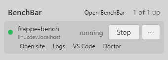
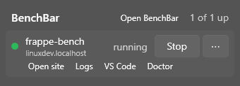

On Windows, benches run inside WSL 2, never on Windows itself. Two small
programs bring them to the Windows side:

- `benchbar.exe`, the shim: every command forwards to `benchbar` inside
  the distro, so `benchbar.exe status`, `up`, `down` and `doctor` work
  from PowerShell.
- BenchBar Tray, a notification area app: the runner shows the state of
  your benches, and a click opens them.

Windows support is a preview. Both programs are unsigned until the
signing application is approved, so Smart App Control in enforce mode
blocks them and SmartScreen warns on first start (see
[Code signing policy](#code-signing-policy)).

## What you need

- Windows 11 (or Windows 10 22H2) with WSL 2 and a distro that runs
  systemd. Ubuntu 24.04 is the tested one.
- `benchbar` installed inside the distro, with a bench: see
  [Install](install.md#linux).
- `benchbar.exe` on your PATH (`benchbar.exe path install`) and the
  distro recorded with `benchbar.exe adopt-distro`.
- The keepalive task, so benches come back after a reboot without a
  terminal: `benchbar.exe keepalive install`. The tray never keeps the
  distro running on its own.
- For the tray: the .NET 10 Desktop Runtime
  (`winget install Microsoft.DotNet.DesktopRuntime.10`).

## Install

In PowerShell, as yourself (no administrator rights):

```powershell
irm https://raw.githubusercontent.com/askysh/benchbar/main/install.ps1 | iex
```

The installer picks the zip for your CPU (x64 or Arm64) from the latest
GitHub release, checks it against the release's
`benchbar-windows-<version>-SHA256SUMS.txt`, and installs it to
`%LOCALAPPDATA%\Programs\BenchBar`. Then it puts that folder on your user
PATH (`benchbar.exe path install`), checks the .NET 10 Desktop Runtime and
prints the `winget` line when it is missing, offers to open the tray at
logon, and ends with `benchbar.exe doctor`. Running it again updates in
place. It writes nothing inside a WSL distro; the final doctor starts the distro if it is stopped.

Run as a file it takes `-Version X.Y.Z` (a given release), `-NoTray`
(only `benchbar.exe`) and `-Yes` (no questions). Piped into `iex`, set
`BENCHBAR_VERSION`, `BENCHBAR_NO_TRAY=1` or `BENCHBAR_YES=1` first.

To run it as a file, download `install.ps1` and run `Unblock-File .\install.ps1`
first (a downloaded script is blocked by the default execution policy), or
start it with `powershell -ExecutionPolicy Bypass -File .\install.ps1 ...`.

Without the script: download `benchbar-windows-<version>-amd64.zip` (or
`-arm64.zip`) from the [releases](https://github.com/askysh/benchbar/releases),
check it with `Get-FileHash`, unpack it into a folder of your choice and
run `benchbar.exe path install` from there.

### A test build you were sent

Every zip carries `install.ps1`, so a build that is not on a release
installs the same way, from its own folder:

1. Unpack the whole zip (right click, Extract All) into a new folder, for
   example in Downloads. `benchbar-windows-<version>-amd64.zip` is for
   Intel and AMD PCs, `-arm64.zip` for Arm PCs.
2. Open PowerShell in that folder and run:

   ```powershell
   powershell -ExecutionPolicy Bypass -File .\install.ps1
   ```

It checks every file against the `SHA256SUMS` in the zip, installs to
`%LOCALAPPDATA%\Programs\BenchBar` as above, and ends with
`benchbar.exe doctor`. To keep the zip unpacked, pass it instead:
`.\install.ps1 -Zip .\benchbar-windows-<version>-amd64.zip`. A checksums
file next to the zip is checked too when there is one.

Every program in the zip is unsigned until the signing application is
approved: SmartScreen shows "Windows protected your PC" on first start
(More info, Run anyway), and Smart App Control in enforce mode blocks
it. The `README.txt` in the zip says which programs are signed.

## Code signing policy

Pending: this section takes effect when the SignPath Foundation
application is approved. Until then the Windows binaries are unsigned.

- Free code signing for the project's own binaries (`benchbar.exe`, `BenchBarTray.exe`, `BenchBarTray.dll`, `BenchBar.Tray.Core.dll`) is provided
  by [SignPath.io](https://about.signpath.io), with a certificate by
  [SignPath Foundation](https://signpath.org). The signature names
  SignPath Foundation as the publisher.
- Only binaries built by the `release-windows.yml` workflow of
  [askysh/benchbar](https://github.com/askysh/benchbar) from a release
  tag are signed. Nothing built on a developer machine is.
- Committers and reviewers: the members of the
  [askysh/benchbar](https://github.com/askysh/benchbar) repository.
  Approver: Akash Mishra ([@askysh](https://github.com/askysh)), who
  approves each signing request.
- Check a signature in PowerShell:
  `Get-AuthenticodeSignature "$env:LOCALAPPDATA\Programs\BenchBar\benchbar.exe"`
  shows `Valid` and the publisher.
- Privacy: neither program sends data anywhere. The tray reads GitHub's
  release list only when you click Check for Updates.

## The tray



The runner in the notification area sleeps when the benches are stopped,
runs while one is up, stumbles when a bench crashes and holds a paused
pose when the crash guard paused it or its ports are taken. With
Windows animation effects off it shows still poses. It is tinted for a
light or a dark taskbar.

Left click opens the flyout, one row per bench:

- the state, the name and the default site, with **Start** or **Stop**,
  and **Restart** in the ⋯ menu;
- **Open site** in your default browser (`*.localhost` answers on
  Windows, because WSL forwards localhost);
- **Logs**: the last lines of the bench log in a read only window, with
  Copy and Open in Notepad;
- **Open in VS Code**: the bench folder through the WSL extension
  (`code --remote wsl+DISTRO PATH`). Without `code` on PATH the row says
  how to get it;
- **Doctor**: the checks of `benchbar doctor` with their fix lines and a
  Copy button. It changes nothing.

Esc closes the flyout, Enter on a row opens the site.



Right click opens the menu: Open BenchBar at logon (a shortcut in your
Startup folder, no admin needed), Appearance (System, Light or Dark),
Runner (the built in Bench and Coffee cup, and your own), Check for
Updates, Help, Report a Bug and Quit.

When a bench crashes, is paused by the crash guard or meets a port
conflict, the tray shows one Windows notification with the bench and
the command that fixes it. It does not repeat it until the state
changes again.

### When the distro is stopped

The tray asks WSL which distros run (`wsl.exe --list --running`), which
does not start one, and asks `benchbar.exe status` only while the distro
runs. A stopped distro shows the sleeping runner and a **Start** button
in the flyout, which starts `benchbar.exe keepalive run`. This keeps the
tray from waking a distro that WSL shut down after its idle time.

### Settings

The tray keeps its settings under a `tray` key in
`%LOCALAPPDATA%\BenchBar\config.json`, the file `benchbar.exe` uses for
the distro. Custom runners go in `%LOCALAPPDATA%\BenchBar\runners\<id>\`,
in the format of [Custom runners](runners.md); the frames are scaled to
the notification area's square slot.

### What it costs

At rest the tray polls `benchbar.exe status` every 30 seconds while a
bench runs and backs off to every 5 minutes when nothing is up. It
starts nothing at all while the computer sleeps or is locked.

Measured on a Ryzen 7 6800H laptop: about 17 MB of private memory and
under 0.1 percent of one core at rest, 0.6 percent while the runner
runs. Once the flyout has been open, WPF keeps its graphics stack
loaded and the tray stays at about 43 MB.

## What the tray does not do

- It does not create benches, sites or profiles, and has no BenchBar
  window: use the CLI inside the distro.
- It does not install or repair anything. Doctor shows the fix lines;
  you run them.
- It does not update itself. Check for Updates opens the release page.
- It never reads files inside the distro: every fact comes from
  `benchbar.exe`.
